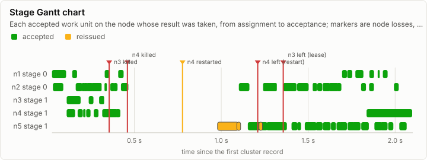
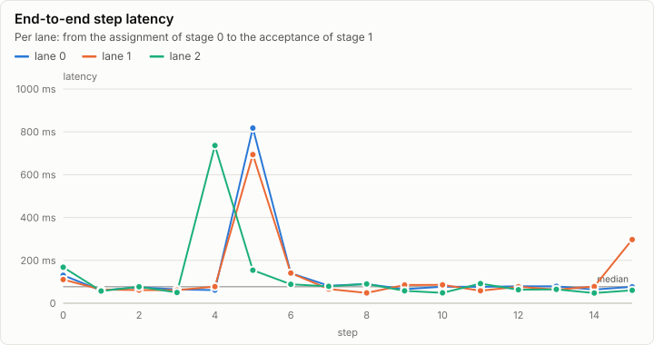
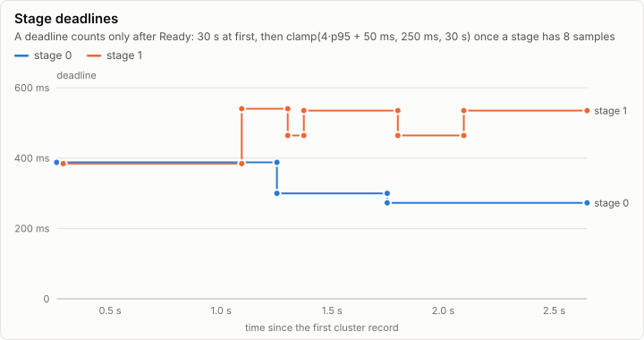
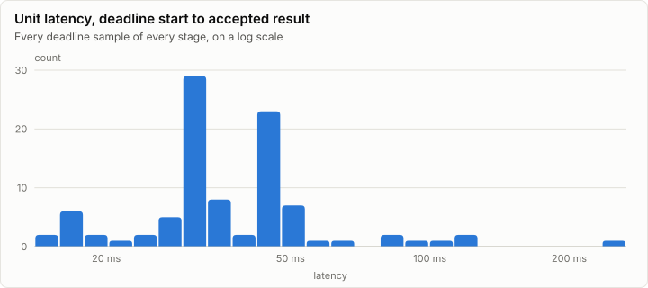
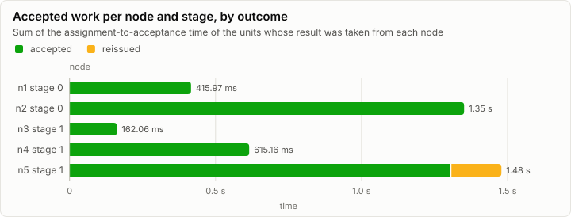

# Cluster: Tiny model on five node processes: both stage-1 replicas killed, the spare n5 takes over, n4 restarted (C2a)

**PASS.** 96 work units, every one cross-checked by a second replica; 3 units reissued, 2 node losses, no divergence.

| Outcome | Work units | Cross-checked | Reissued | Nodes lost | Divergences | Epoch |
| --- | ---: | ---: | ---: | ---: | ---: | ---: |
| completed | 96 | 95 of 96 | 3 | 2 | 0 | 7 |

Run digest: `e3ce317691dc2c47be6ac505535aae009c3b87064dd54e26f2d5b2112e672844`

## Pipeline

Each bar is a work unit the coordinator accepted, drawn on the node whose result it took, from the assignment to the acceptance. Green units were accepted from their first assignment; amber ones were reissued to another node after the first missed its deadline. Markers are node losses, kills, restarts and demotions.

## Nodes

| Node | Stage | Backend | Assigned | Accepted | Reissued to it | Duplicates | Deadline misses | Accepted time |
| --- | ---: | --- | ---: | ---: | ---: | ---: | ---: | ---: |
| n1 | 0 | cpu-f32 | 52 | 12 | 0 | 28 | 0 | 415.97 ms |
| n2 | 0 | cpu-f32 | 52 | 36 | 0 | 13 | 0 | 1.35 s |
| n3 | 1 | cpu-f32 | 30 | 4 | 0 | 6 | 3 | 162.06 ms |
| n4 | 1 | cpu-f32 | 52 | 11 | 0 | 32 | 3 | 615.16 ms |
| n5 | 1 | cpu-f32 | 39 | 33 | 3 | 1 | 0 | 1.48 s |

### Counters

| Counter | Split | Total |
| --- | --- | ---: |
| cluster.assign | retransmit=false | 198 |
| cluster.assign | retransmit=true | 27 |
| cluster.reissue |  | 3 |
| cluster.duplicate |  | 80 |
| cluster.deadline.miss |  | 6 |
| cluster.replay.served |  | 61 |
| cluster.replay.units |  | 45 |
| cluster.frame.rejected | reason=stale_epoch | 7 |
| cluster.chaos | fault=drop | 19 |
| cluster.chaos | fault=duplicate | 5 |
| cluster.chaos | fault=kill | 2 |
| cluster.chaos | fault=restart | 1 |

### Cluster events

| Time | Node | Event | Detail |
| ---: | --- | --- | --- |
| 0 ns | coord | cluster.member.join | node=n4 incarnation=4 reason=join |
| 7.15 ms | coord | cluster.member.join | node=n3 incarnation=3 reason=join |
| 7.46 ms | coord | cluster.member.join | node=n1 incarnation=1 reason=join |
| 7.70 ms | coord | cluster.member.join | node=n2 incarnation=2 reason=join |
| 355.38 ms | coord | cluster.chaos | fault=kill node=n3 |
| 429.39 ms | coord | cluster.member.join | node=n5 incarnation=5 reason=join |
| 460.20 ms | coord | cluster.chaos | fault=kill node=n4 |
| 777.12 ms | coord | cluster.chaos | fault=restart node=n4 |
| 1.21 s | coord | cluster.member.leave | node=n4 reason=restart |
| 1.21 s | coord | cluster.member.join | node=n4 incarnation=1004 reason=restart |
| 1.36 s | coord | cluster.member.leave | node=n3 reason=lease |
| 2.65 s | coord | cluster.run | node=coord status=completed units=96 epoch=7 reissues=3 duplicates=80 divergences=0 replays=16 cross_checked=95 unconfirmed=0 end_ns=3104930800 |

## Metering

| Node | Component | Stage | Wall (self) | GPU | FLOPs | Bytes moved | Tokens | Records |
| --- | --- | --- | ---: | ---: | ---: | ---: | ---: | ---: |
| coord | cluster.coordinator |  | 0 ns | 0 ns | 0 | 237.22 KiB | 0 | 378 |
| n1 | forward | 0 | 77.44 ms | 0 ns | 15.22M | 7.04 MiB | 0 | 2,688 |
| n2 | forward | 0 | 69.39 ms | 0 ns | 15.22M | 7.04 MiB | 0 | 2,688 |
| n3 | forward | 1 | 39.50 ms | 0 ns | 10.26M | 1.85 MiB | 86 | 330 |
| n4 | forward | 1 | 44.14 ms | 0 ns | 11.12M | 2.74 MiB | 92 | 663 |
| n4-r1 | forward | 1 | 140.57 ms | 0 ns | 25.93M | 10.40 MiB | 203 | 3,180 |
| n5 | forward | 1 | 106.61 ms | 0 ns | 16.83M | 8.61 MiB | 129 | 2,880 |

## Run

| Field | Value |
| --- | --- |
| Run | `20261018-154120-1dd7d965` |
| Title | Tiny model on five node processes: both stage-1 replicas killed, the spare n5 takes over, n4 restarted (C2a) |
| Kind | cluster |
| Status | ok |
| Started | 2026-10-18T15:41:20.595Z |
| Ended | 2026-10-18T15:41:23.792Z |
| Execution class | cpu-f32 cpu, .NET 10.0.13, win-x64+avx2+fma |
| Class id | `7cc3fe8cde13` |
| Driver | .NET 10.0.13 |
| Commit | `39a5f1bdf7a78497af1acb842b7c95c22da27e46` |
| Nodes | 7 |
| Records | 13,481 |
| Synthetic | no |

| Parameter | Value |
| --- | --- |
| backend | cpu-f32 |
| job | da6f4c6d6e6f4e0907cb835885b1c2b56f37d5cedd0e7dbf55f4c9fd318139eb |
| kills | n3 after 20 units; n4 after 30 units, restarted after 300 ms |
| lanes | 3 |
| min_nodes | 4 |
| model | goldens/tiny/g1/model |
| model_id | ae4c888d8089683fbd1eaebdc8e394aece8494d94f069ac8da34ae9dbe8ab797 |
| nodes | n1:0-0 n2:0-0 n3:1-1 n4:1-1 n5:all |
| processes | nodes proxy |
| prompt_tokens | 13,1,70 |
| proxy_faults | partition n1 1200-1700 ms |
| replicas | 2 |
| scenario | bothlost5-seed-103 |
| seed | 103 |
| source | Lrm.Serving harness |
| split | 1 |
| steps | 16 |
| stop_at_eos | false |
| topology | bothlost5 |

### Nodes

| Node | Role | Execution class | Records | Finished | Dropped |
| --- | --- | --- | ---: | --- | ---: |
| coord | creator | cpu-f32 cpu, .NET 10.0.13, win-x64+avx2+fma | 1,039 | ok | 0 |
| n1 | joined | cpu-f32 cpu, .NET 10.0.13, win-x64+avx2+fma | 2,692 | ok | 0 |
| n2 | joined | cpu-f32 cpu, .NET 10.0.13, win-x64+avx2+fma | 2,688 | ok | 0 |
| n3 | joined | cpu-f32 cpu, .NET 10.0.13, win-x64+avx2+fma | 330 | no | 0 |
| n4 | joined | cpu-f32 cpu, .NET 10.0.13, win-x64+avx2+fma | 663 | no | 0 |
| n4-r1 | joined | cpu-f32 cpu, .NET 10.0.13, win-x64+avx2+fma | 3,186 | ok | 0 |
| n5 | joined | cpu-f32 cpu, .NET 10.0.13, win-x64+avx2+fma | 2,883 | ok | 0 |

### Log problems

- n3: line 332: the last line is cut off (no final LF)
- n3: no run.end trailer (the node is still running, or it stopped without finishing)
- n4: line 665: the last line is cut off (no final LF)
- n4: no run.end trailer (the node is still running, or it stopped without finishing)
