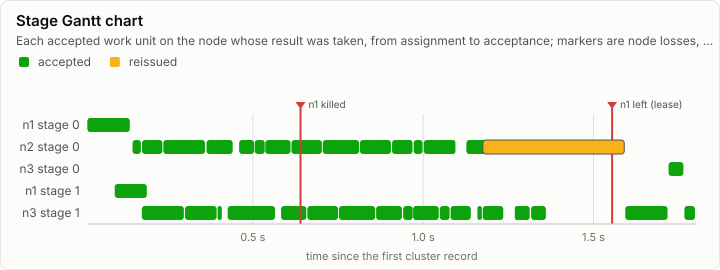
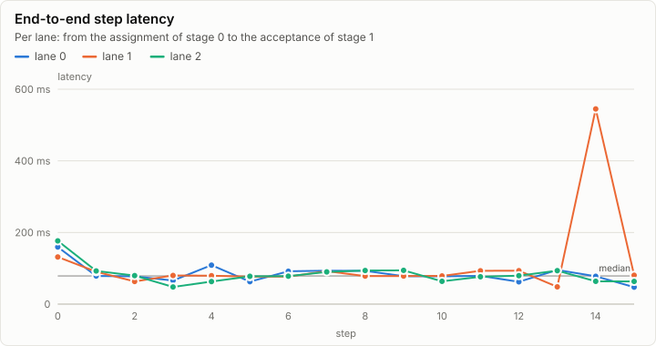
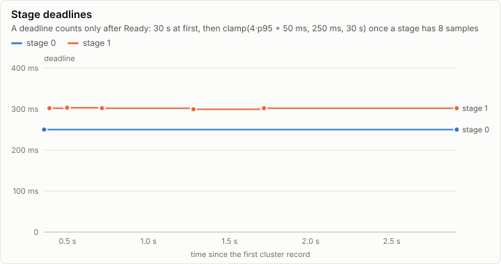
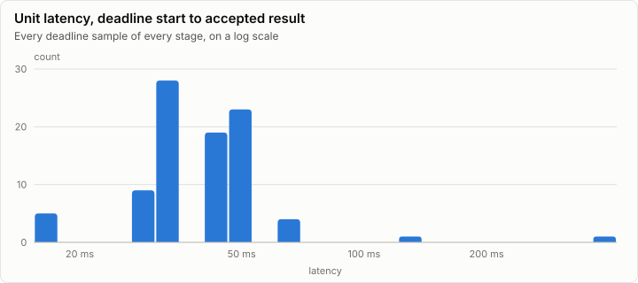
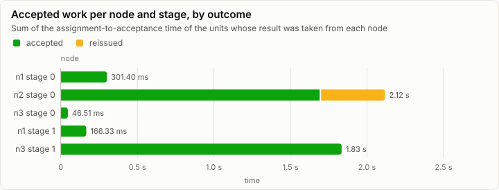

# Cluster: Tiny model on three node processes, two replicas per stage: n1 killed after 40 units, failover (C2a)

**PASS.** 96 work units, every one cross-checked by a second replica; 1 unit reissued, 1 node loss, no divergence.

| Outcome | Work units | Cross-checked | Reissued | Nodes lost | Divergences | Epoch |
| --- | ---: | ---: | ---: | ---: | ---: | ---: |
| completed | 96 | 96 of 96 | 1 | 1 | 0 | 4 |

Run digest: `e3ce317691dc2c47be6ac505535aae009c3b87064dd54e26f2d5b2112e672844`

## Pipeline

Each bar is a work unit the coordinator accepted, drawn on the node whose result it took, from the assignment to the acceptance. Green units were accepted from their first assignment; amber ones were reissued to another node after the first missed its deadline. Markers are node losses, kills, restarts and demotions.

## Nodes

| Node | Stage | Backend | Assigned | Accepted | Reissued to it | Duplicates | Deadline misses | Accepted time |
| --- | ---: | --- | ---: | ---: | ---: | ---: | ---: | ---: |
| n1 | 0 | cpu-f32 | 48 | 3 | 0 | 14 | 1 | 301.40 ms |
| n2 | 0 | cpu-f32 | 50 | 44 | 1 | 4 | 1 | 2.12 s |
| n3 | 0 | cpu-f32 | 7 | 1 | 0 | 3 | 0 | 46.51 ms |
| n1 | 1 | cpu-f32 | 46 | 3 | 0 | 12 | 0 | 166.33 ms |
| n2 | 1 | cpu-f32 | 6 | 0 | 0 | 4 | 0 | 0 ns |
| n3 | 1 | cpu-f32 | 48 | 45 | 0 | 3 | 0 | 1.83 s |

### Counters

| Counter | Split | Total |
| --- | --- | ---: |
| cluster.assign | retransmit=false | 193 |
| cluster.assign | retransmit=true | 12 |
| cluster.reissue |  | 1 |
| cluster.duplicate |  | 40 |
| cluster.deadline.miss |  | 2 |
| cluster.replay.served |  | 102 |
| cluster.replay.units |  | 88 |
| cluster.frame.rejected | reason=stale_epoch | 2 |
| cluster.chaos | fault=drop | 4 |
| cluster.chaos | fault=duplicate | 3 |
| cluster.chaos | fault=kill | 1 |

### Cluster events

| Time | Node | Event | Detail |
| ---: | --- | --- | --- |
| 0 ns | coord | cluster.member.join | node=n1 incarnation=1 reason=join |
| 7.15 ms | coord | cluster.member.join | node=n3 incarnation=3 reason=join |
| 7.41 ms | coord | cluster.member.join | node=n2 incarnation=2 reason=join |
| 639.98 ms | coord | cluster.chaos | fault=kill node=n1 |
| 1.55 s | coord | cluster.member.leave | node=n1 reason=lease |
| 2.90 s | coord | cluster.run | node=coord status=completed units=96 epoch=4 reissues=1 duplicates=40 divergences=0 replays=7 cross_checked=96 unconfirmed=0 end_ns=3341562000 |

## Metering

| Node | Component | Stage | Wall (self) | GPU | FLOPs | Bytes moved | Tokens | Records |
| --- | --- | --- | ---: | ---: | ---: | ---: | ---: | ---: |
| coord | cluster.coordinator |  | 0 ns | 0 ns | 0 | 172.57 KiB | 0 | 288 |
| n1 | forward | 0 | 51.60 ms | 0 ns | 11.23M | 2.89 MiB | 0 | 840 |
| n1 | forward | 1 | 29.41 ms | 0 ns | 11.47M | 3.10 MiB | 94 | 811 |
| n2 | forward | 0 | 65.07 ms | 0 ns | 15.22M | 7.04 MiB | 0 | 2,688 |
| n2 | forward | 1 | 15.62 ms | 0 ns | 16.83M | 8.61 MiB | 129 | 2,880 |
| n3 | forward | 0 | 14.78 ms | 0 ns | 15.22M | 7.04 MiB | 0 | 2,688 |
| n3 | forward | 1 | 62.92 ms | 0 ns | 16.83M | 8.61 MiB | 129 | 2,880 |

## Run

| Field | Value |
| --- | --- |
| Run | `20261018-154116-32c002b6` |
| Title | Tiny model on three node processes, two replicas per stage: n1 killed after 40 units, failover (C2a) |
| Kind | cluster |
| Status | ok |
| Started | 2026-10-18T15:41:16.673Z |
| Ended | 2026-10-18T15:41:20.115Z |
| Execution class | cpu-f32 cpu, .NET 10.0.13, win-x64+avx2+fma |
| Class id | `7cc3fe8cde13` |
| Driver | .NET 10.0.13 |
| Commit | `39a5f1bdf7a78497af1acb842b7c95c22da27e46` |
| Nodes | 4 |
| Records | 13,595 |
| Synthetic | no |

| Parameter | Value |
| --- | --- |
| backend | cpu-f32 |
| job | da6f4c6d6e6f4e0907cb835885b1c2b56f37d5cedd0e7dbf55f4c9fd318139eb |
| kills | n1 after 40 units |
| lanes | 3 |
| min_nodes | 3 |
| model | goldens/tiny/g1/model |
| model_id | ae4c888d8089683fbd1eaebdc8e394aece8494d94f069ac8da34ae9dbe8ab797 |
| nodes | n1:all n2:all n3:all |
| processes | nodes proxy |
| prompt_tokens | 13,1,70 |
| proxy_faults | sever n3 at 2182 ms |
| replicas | 2 |
| scenario | replicated3-seed-102 |
| seed | 102 |
| source | Lrm.Serving harness |
| split | 1 |
| steps | 16 |
| stop_at_eos | false |
| topology | replicated3 |

### Nodes

| Node | Role | Execution class | Records | Finished | Dropped |
| --- | --- | --- | ---: | --- | ---: |
| coord | creator | cpu-f32 cpu, .NET 10.0.13, win-x64+avx2+fma | 802 | ok | 0 |
| n1 | joined | cpu-f32 cpu, .NET 10.0.13, win-x64+avx2+fma | 1,651 | no | 0 |
| n2 | joined | cpu-f32 cpu, .NET 10.0.13, win-x64+avx2+fma | 5,571 | ok | 0 |
| n3 | joined | cpu-f32 cpu, .NET 10.0.13, win-x64+avx2+fma | 5,571 | ok | 0 |

### Log problems

- n1: line 1653: the last line is cut off (no final LF)
- n1: no run.end trailer (the node is still running, or it stopped without finishing)
