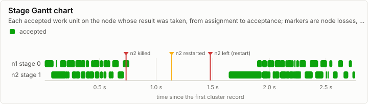
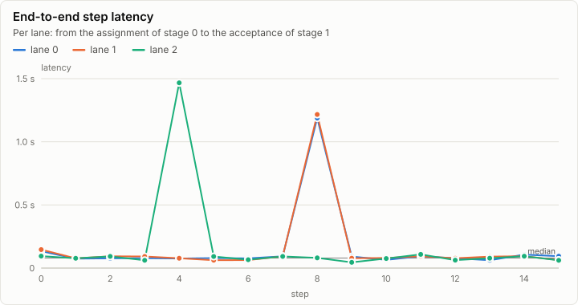
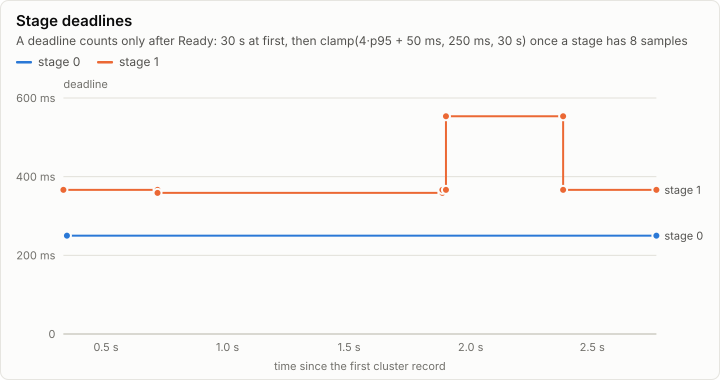
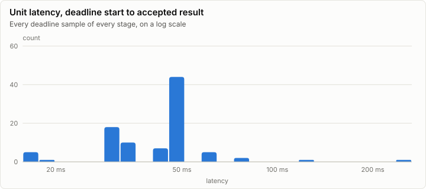
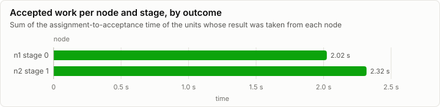

# Cluster: Tiny model on two node processes behind lrm chaos-proxy: n2 (stage 1) killed after 40 units and restarted (C2a)

**PASS.** 96 work units, every one cross-checked by a second replica; 0 units reissued, 1 node loss, no divergence.

| Outcome | Work units | Cross-checked | Reissued | Nodes lost | Divergences | Epoch |
| --- | ---: | ---: | ---: | ---: | ---: | ---: |
| completed | 96 | 0 of 96 | 0 | 1 | 0 | 3 |

Run digest: `e3ce317691dc2c47be6ac505535aae009c3b87064dd54e26f2d5b2112e672844`

## Pipeline

Each bar is a work unit the coordinator accepted, drawn on the node whose result it took, from the assignment to the acceptance. Green units were accepted from their first assignment; amber ones were reissued to another node after the first missed its deadline. Markers are node losses, kills, restarts and demotions.

## Nodes

| Node | Stage | Backend | Assigned | Accepted | Reissued to it | Duplicates | Deadline misses | Accepted time |
| --- | ---: | --- | ---: | ---: | ---: | ---: | ---: | ---: |
| n1 | 0 | cpu-f32 | 48 | 48 | 0 | 0 | 0 | 2.02 s |
| n2 | 1 | cpu-f32 | 55 | 48 | 0 | 0 | 4 | 2.32 s |

### Counters

| Counter | Split | Total |
| --- | --- | ---: |
| cluster.assign | retransmit=false | 96 |
| cluster.assign | retransmit=true | 7 |
| cluster.deadline.miss |  | 4 |
| cluster.replay.served |  | 20 |
| cluster.replay.units |  | 20 |
| cluster.frame.rejected | reason=stale_epoch | 1 |
| cluster.chaos | fault=drop | 2 |
| cluster.chaos | fault=duplicate | 4 |
| cluster.chaos | fault=kill | 1 |
| cluster.chaos | fault=restart | 1 |

### Cluster events

| Time | Node | Event | Detail |
| ---: | --- | --- | --- |
| 0 ns | coord | cluster.member.join | node=n1 incarnation=1 reason=join |
| 6.84 ms | coord | cluster.member.join | node=n2 incarnation=2 reason=join |
| 733.31 ms | coord | cluster.chaos | fault=kill node=n2 |
| 881.41 ms | coord | cluster.reissue.unavailable | node=coord lane=2 stage=1 step=4 |
| 1.13 s | coord | cluster.reissue.unavailable | node=coord lane=0 stage=1 step=8 |
| 1.13 s | coord | cluster.reissue.unavailable | node=coord lane=1 stage=1 step=8 |
| 1.14 s | coord | cluster.chaos | fault=restart node=n2 |
| 1.48 s | coord | cluster.member.leave | node=n2 reason=restart |
| 1.48 s | coord | cluster.member.join | node=n2 incarnation=1002 reason=restart |
| 2.76 s | coord | cluster.run | node=coord status=completed units=96 epoch=3 reissues=0 duplicates=0 divergences=0 replays=3 cross_checked=0 unconfirmed=0 end_ns=3234092800 |

## Metering

| Node | Component | Stage | Wall (self) | GPU | FLOPs | Bytes moved | Tokens | Records |
| --- | --- | --- | ---: | ---: | ---: | ---: | ---: | ---: |
| coord | cluster.coordinator |  | 0 ns | 0 ns | 0 | 88.63 KiB | 0 | 163 |
| n1 | forward | 0 | 69.81 ms | 0 ns | 15.22M | 7.04 MiB | 0 | 2,688 |
| n2 | forward | 1 | 49.44 ms | 0 ns | 11.90M | 3.55 MiB | 97 | 995 |
| n2-r1 | forward | 1 | 68.90 ms | 0 ns | 16.83M | 8.61 MiB | 129 | 2,880 |

## Run

| Field | Value |
| --- | --- |
| Run | `20261018-154112-e8cca8ca` |
| Title | Tiny model on two node processes behind lrm chaos-proxy: n2 (stage 1) killed after 40 units and restarted (C2a) |
| Kind | cluster |
| Status | ok |
| Started | 2026-10-18T15:41:12.887Z |
| Ended | 2026-10-18T15:41:16.208Z |
| Execution class | cpu-f32 cpu, .NET 10.0.13, win-x64+avx2+fma |
| Class id | `7cc3fe8cde13` |
| Driver | .NET 10.0.13 |
| Commit | `39a5f1bdf7a78497af1acb842b7c95c22da27e46` |
| Nodes | 4 |
| Records | 7,061 |
| Synthetic | no |

| Parameter | Value |
| --- | --- |
| backend | cpu-f32 |
| job | da6f4c6d6e6f4e0907cb835885b1c2b56f37d5cedd0e7dbf55f4c9fd318139eb |
| kills | n2 after 40 units, restarted after 400 ms |
| lanes | 3 |
| min_nodes | 2 |
| model | goldens/tiny/g1/model |
| model_id | ae4c888d8089683fbd1eaebdc8e394aece8494d94f069ac8da34ae9dbe8ab797 |
| nodes | n1:0-0 n2:1-1 |
| processes | nodes proxy |
| prompt_tokens | 13,1,70 |
| proxy_faults | sever n1 at 1500 ms |
| replicas | 1 |
| scenario | split2-seed-101 |
| seed | 101 |
| source | Lrm.Serving harness |
| split | 1 |
| steps | 16 |
| stop_at_eos | false |
| topology | split2 |

### Nodes

| Node | Role | Execution class | Records | Finished | Dropped |
| --- | --- | --- | ---: | --- | ---: |
| coord | creator | cpu-f32 cpu, .NET 10.0.13, win-x64+avx2+fma | 495 | ok | 0 |
| n1 | joined | cpu-f32 cpu, .NET 10.0.13, win-x64+avx2+fma | 2,688 | ok | 0 |
| n2 | joined | cpu-f32 cpu, .NET 10.0.13, win-x64+avx2+fma | 995 | no | 0 |
| n2-r1 | joined | cpu-f32 cpu, .NET 10.0.13, win-x64+avx2+fma | 2,883 | ok | 0 |

### Log problems

- n2: line 997: the last line is cut off (no final LF)
- n2: no run.end trailer (the node is still running, or it stopped without finishing)
