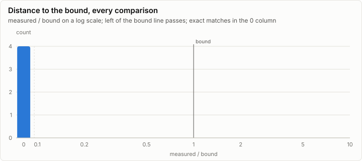

# Parity: Tiny model on two node processes behind lrm chaos-proxy: n2 (stage 1) killed after 40 units and restarted (C2a)

**PASS.** All 4 oracle self-tests pass.

- Comparisons: 0, failed: 0
- Pairs: none; cases: 0
- Closest to its bound: (no pair) (self-test) cluster_greedy_ids_vs_single_process exact: 0.000 of the bound

## Error by layer

Every per-layer tap's rel_l2 against the golden, summarized per layer over all cases and taps. A pair passes when every dot and whisker stays under its bound line.

## Per pair

## Per case

_No rows._

## Oracle self-tests

4 of 4 pass.

| Self-test | Metric | Measured | Bound | Ratio | Result |
| --- | --- | ---: | ---: | ---: | --- |
| cluster_run_digest_vs_plan_order | exact | 0 | 0 | 0.000 | ✓ pass |
| cluster_replica_digest_vs_plan_order | exact | 0 | 0 | 0.000 | ✓ pass |
| cluster_logits_vs_single_process | exact | 0 | 0 | 0.000 | ✓ pass |
| cluster_greedy_ids_vs_single_process | exact | 0 | 0 | 0.000 | ✓ pass |

## Closest to the bound

| Pair | Case | Tap | Metric | Measured | Bound | Ratio | Result |
| --- | --- | --- | --- | ---: | ---: | ---: | --- |
| (no pair) | (self-test) | cluster_greedy_ids_vs_single_process | exact | 0 | 0 | 0.000 | ✓ pass |
| (no pair) | (self-test) | cluster_logits_vs_single_process | exact | 0 | 0 | 0.000 | ✓ pass |
| (no pair) | (self-test) | cluster_replica_digest_vs_plan_order | exact | 0 | 0 | 0.000 | ✓ pass |
| (no pair) | (self-test) | cluster_run_digest_vs_plan_order | exact | 0 | 0 | 0.000 | ✓ pass |

## Run

| Field | Value |
| --- | --- |
| Run | `20261018-154112-e8cca8ca` |
| Title | Tiny model on two node processes behind lrm chaos-proxy: n2 (stage 1) killed after 40 units and restarted (C2a) |
| Kind | cluster |
| Status | ok |
| Started | 2026-10-18T15:41:12.887Z |
| Ended | 2026-10-18T15:41:16.208Z |
| Execution class | cpu-f32 cpu, .NET 10.0.13, win-x64+avx2+fma |
| Class id | `7cc3fe8cde13` |
| Driver | .NET 10.0.13 |
| Commit | `39a5f1bdf7a78497af1acb842b7c95c22da27e46` |
| Nodes | 4 |
| Records | 7,061 |
| Synthetic | no |

| Parameter | Value |
| --- | --- |
| backend | cpu-f32 |
| job | da6f4c6d6e6f4e0907cb835885b1c2b56f37d5cedd0e7dbf55f4c9fd318139eb |
| kills | n2 after 40 units, restarted after 400 ms |
| lanes | 3 |
| min_nodes | 2 |
| model | goldens/tiny/g1/model |
| model_id | ae4c888d8089683fbd1eaebdc8e394aece8494d94f069ac8da34ae9dbe8ab797 |
| nodes | n1:0-0 n2:1-1 |
| processes | nodes proxy |
| prompt_tokens | 13,1,70 |
| proxy_faults | sever n1 at 1500 ms |
| replicas | 1 |
| scenario | split2-seed-101 |
| seed | 101 |
| source | Lrm.Serving harness |
| split | 1 |
| steps | 16 |
| stop_at_eos | false |
| topology | split2 |

### Nodes

| Node | Role | Execution class | Records | Finished | Dropped |
| --- | --- | --- | ---: | --- | ---: |
| coord | creator | cpu-f32 cpu, .NET 10.0.13, win-x64+avx2+fma | 495 | ok | 0 |
| n1 | joined | cpu-f32 cpu, .NET 10.0.13, win-x64+avx2+fma | 2,688 | ok | 0 |
| n2 | joined | cpu-f32 cpu, .NET 10.0.13, win-x64+avx2+fma | 995 | no | 0 |
| n2-r1 | joined | cpu-f32 cpu, .NET 10.0.13, win-x64+avx2+fma | 2,883 | ok | 0 |

### Log problems

- n2: line 997: the last line is cut off (no final LF)
- n2: no run.end trailer (the node is still running, or it stopped without finishing)
