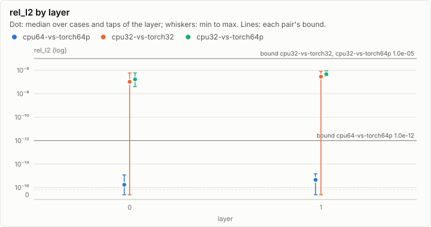
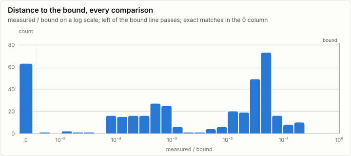
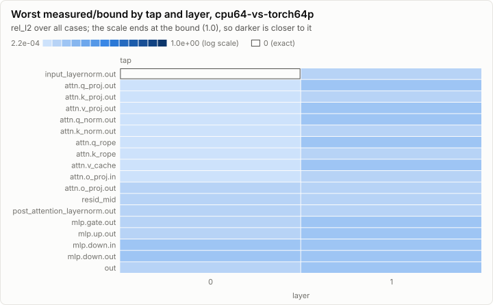
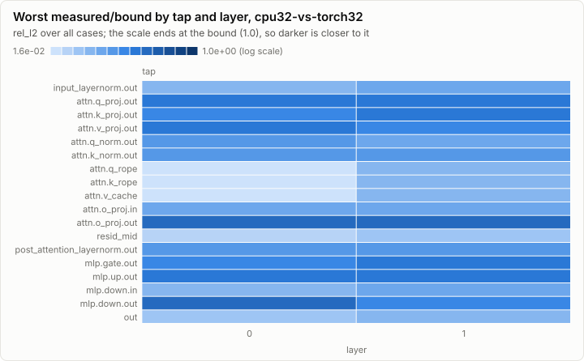
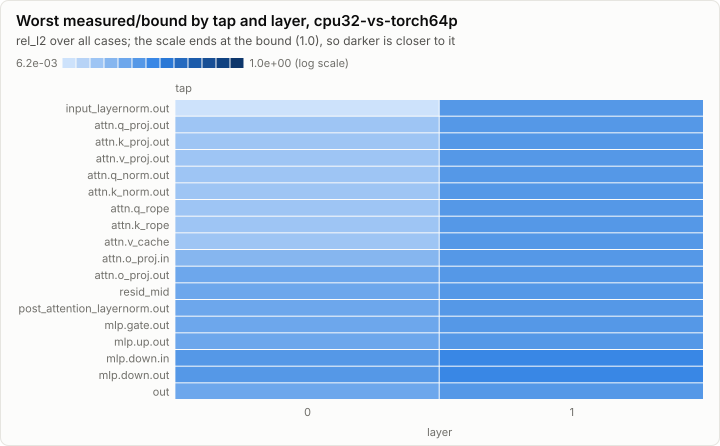

# Parity: Tiny model: CpuRef F64 and F32 against torch64p and torch32

**PASS.** All 400 comparisons are within their bounds.

- Comparisons: 400, failed: 0
- Pairs: cpu64-vs-torch64p, cpu32-vs-torch32, cpu32-vs-torch64p; cases: 3
- Closest to its bound: cpu32-vs-torch32 p1 L0.mlp.down.out rel_l2: 0.242 of the bound

## Error by layer

Every per-layer tap's rel_l2 against the golden, summarized per layer over all cases and taps. A pair passes when every dot and whisker stays under its bound line.

## Per pair

### cpu64-vs-torch64p: PASS

159 comparisons, 0 failed, worst ratio 0.001 of the bound.

### cpu32-vs-torch32: PASS

163 comparisons, 0 failed, worst ratio 0.242 of the bound.

### cpu32-vs-torch64p: PASS

78 comparisons, 0 failed, worst ratio 0.088 of the bound.

## Per case

| Case | Checks | Failed | Worst comparison | Worst ratio | Logits rel_l2 | Greedy match |
| --- | ---: | ---: | --- | ---: | --- | --- |
| p0 | 199 | 0 | cpu32-vs-torch32 L0.post_attention_layernorm.out rel_l2 | 0.104 | cpu64-vs-torch64p 9.73e-16, cpu64-vs-torch64p 7.85e-17, cpu32-vs-torch32 5.57e-07, cpu32-vs-torch64p 5.98e-07, cpu32-vs-torch32 4.56e-08 | 64/64, 64/64 |
| p1 | 199 | 0 | cpu32-vs-torch32 L0.mlp.down.out rel_l2 | 0.242 | cpu64-vs-torch64p 6.31e-16, cpu64-vs-torch64p 2.91e-16, cpu32-vs-torch32 3.90e-07, cpu32-vs-torch32 1.57e-07, cpu32-vs-torch64p 3.93e-07 | 64/64, 64/64 |
| p2 | 2 | 0 | cpu32-vs-torch32 logits rel_l2 | 0.072 | cpu64-vs-torch64p 1.19e-15, cpu32-vs-torch32 7.17e-07 | n/a |

## Closest to the bound

| Pair | Case | Tap | Metric | Measured | Bound | Ratio | Result |
| --- | --- | --- | --- | ---: | ---: | ---: | --- |
| cpu32-vs-torch32 | p1 | L0.mlp.down.out | rel_l2 | 2.42e-07 | 1.00e-06 | 0.242 | ✓ pass |
| cpu32-vs-torch32 | p1 | L1.attn.o_proj.out | rel_l2 | 2.25e-07 | 1.00e-06 | 0.225 | ✓ pass |
| cpu32-vs-torch32 | p1 | L0.attn.o_proj.out | rel_l2 | 2.22e-07 | 1.00e-06 | 0.222 | ✓ pass |
| cpu32-vs-torch32 | p1 | L1.mlp.up.out | rel_l2 | 1.81e-07 | 1.00e-06 | 0.181 | ✓ pass |
| cpu32-vs-torch32 | p1 | L0.attn.q_proj.out | rel_l2 | 1.78e-07 | 1.00e-06 | 0.178 | ✓ pass |
| cpu32-vs-torch32 | p1 | L1.attn.q_proj.out | rel_l2 | 1.70e-07 | 1.00e-06 | 0.170 | ✓ pass |
| cpu32-vs-torch32 | p1 | L0.attn.v_proj.out | rel_l2 | 1.64e-07 | 1.00e-06 | 0.164 | ✓ pass |
| cpu32-vs-torch32 | p1 | L0.mlp.up.out | rel_l2 | 1.64e-07 | 1.00e-06 | 0.164 | ✓ pass |
| cpu32-vs-torch32 | p1 | L1.mlp.gate.out | rel_l2 | 1.57e-07 | 1.00e-06 | 0.157 | ✓ pass |
| cpu32-vs-torch32 | p1 | logits | rel_l2 | 1.57e-07 | 1.00e-06 | 0.157 | ✓ pass |
| cpu32-vs-torch32 | p1 | L1.attn.k_proj.out | rel_l2 | 1.52e-07 | 1.00e-06 | 0.152 | ✓ pass |
| cpu32-vs-torch32 | p1 | L1.attn.v_proj.out | rel_l2 | 1.49e-07 | 1.00e-06 | 0.149 | ✓ pass |
| cpu32-vs-torch32 | p1 | L1.mlp.down.out | rel_l2 | 1.48e-07 | 1.00e-06 | 0.148 | ✓ pass |
| cpu32-vs-torch32 | p1 | L0.attn.k_proj.out | rel_l2 | 1.40e-07 | 1.00e-06 | 0.140 | ✓ pass |
| cpu32-vs-torch32 | p1 | L0.mlp.gate.out | rel_l2 | 1.37e-07 | 1.00e-06 | 0.137 | ✓ pass |

## Run

| Field | Value |
| --- | --- |
| Run | `20261018-031842-301406ba` |
| Title | Tiny model: CpuRef F64 and F32 against torch64p and torch32 |
| Kind | parity |
| Status | ok |
| Started | 2026-10-18T03:18:42.817Z |
| Ended | 2026-10-18T03:18:43.820Z |
| Execution class | cpu-f64 cpu, .NET 10.0.13, win-x64+avx2+fma |
| Class id | `f705487c3bfc` |
| Driver | .NET 10.0.13 |
| Commit | `ad5d24292344ad2c1bf262fa0f2f3a5c2781bef0` |
| Nodes | 2 |
| Records | 10,260 |
| Synthetic | no |

| Parameter | Value |
| --- | --- |
| golden | goldens/tiny/g1 |
| nodes | n0 cpu-f64, n1 cpu-f32 |
| source | tests/Lrm.Tensor.Tests (O2 tiny-model acceptance) |

### Nodes

| Node | Role | Execution class | Records | Finished | Dropped |
| --- | --- | --- | ---: | --- | ---: |
| n0 | creator | cpu-f64 cpu, .NET 10.0.13, win-x64+avx2+fma | 5,087 | ok | 0 |
| n1 | joined | cpu-f32 cpu, .NET 10.0.13, win-x64+avx2+fma | 5,173 | ok | 0 |

### Log problems

None.
