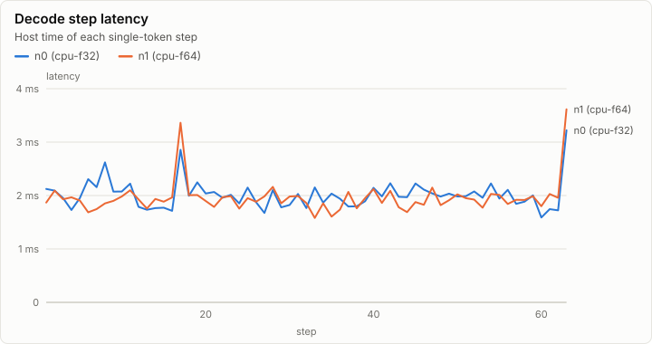
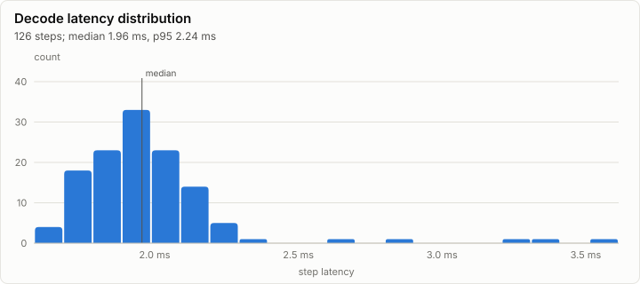
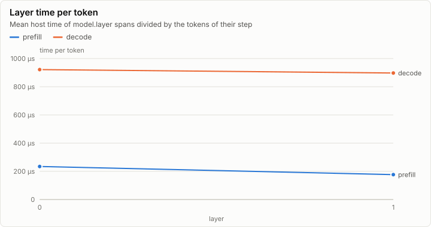

# Inference: Tiny model: greedy decoding of p0, 64 steps, on cpu-f32 and cpu-f64 (M2a)

| Prefill | Decode | First token | FLOPs per token | Achieved |
| ---: | ---: | ---: | ---: | ---: |
| 1,544 tok/s | 503.6 tok/s | 11.61 ms | 270.30 KFLOP | 153.86 MFLOP/s |

## Speed

| Phase | Steps | Tokens | Time | Rate | Median step |
| --- | ---: | ---: | ---: | ---: | ---: |
| prefill | 2 | 26 | 16.84 ms | 1,544 tok/s | 8.42 ms |
| decode | 126 | 126 | 250.18 ms | 503.6 tok/s | 1.96 ms |

## Layers

## Memory

_No rows._

## Metering

Resource use attributed to node, component and stage (layers summed). Wall time is span self time, so nested spans are not counted twice.

| Node | Component | Stage | Wall (self) | GPU | FLOPs | Bytes moved | Tokens | Records |
| --- | --- | --- | ---: | ---: | ---: | ---: | ---: | ---: |
| n0 | forward | 0 | 138.38 ms | 0 ns | 20.54M | 18.97 MiB | 76 | 7,488 |
| n0 | generate |  | 2.40 ms | 0 ns | 0 | 0 B | 0 | 1 |
| n1 | forward | 0 | 128.65 ms | 0 ns | 20.54M | 18.97 MiB | 76 | 7,488 |
| n1 | generate |  | 1.82 ms | 0 ns | 0 | 0 B | 0 | 1 |

## Run

| Field | Value |
| --- | --- |
| Run | `20261018-051353-a6ef3348` |
| Title | Tiny model: greedy decoding of p0, 64 steps, on cpu-f32 and cpu-f64 (M2a) |
| Kind | inference |
| Status | ok |
| Started | 2026-10-18T05:13:53.171Z |
| Ended | 2026-10-18T05:13:53.518Z |
| Execution class | cpu-f32 cpu, .NET 10.0.13, win-x64+avx2+fma |
| Class id | `7cc3fe8cde13` |
| Driver | .NET 10.0.13 |
| Commit | `27d074bf7e3f5d932506def124accaa4111d7d61` |
| Nodes | 2 |
| Records | 14,980 |
| Synthetic | no |

| Parameter | Value |
| --- | --- |
| backends | cpu-f32,cpu-f64 |
| command | lrm generate |
| model | goldens/tiny/g1/model |
| model_sha256 | 7ade5616bee29bf1008e4a2902cd7aa6b334e3571aa978356d7adfe08e058b2e |
| prompt | goldens/tiny/g1/fwd_f32.p0.safetensors |
| prompt_tokens | 13 |
| revision | local:tiny-g1 |
| steps | 64 |
| stop_at_eos | false |
| threads | 8 |
| warmup_steps | 2 |

### Nodes

| Node | Role | Execution class | Records | Finished | Dropped |
| --- | --- | --- | ---: | --- | ---: |
| n0 | creator | cpu-f32 cpu, .NET 10.0.13, win-x64+avx2+fma | 7,490 | ok | 0 |
| n1 | joined | cpu-f64 cpu, .NET 10.0.13, win-x64+avx2+fma | 7,490 | ok | 0 |

### Log problems

None.
