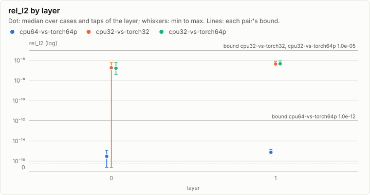
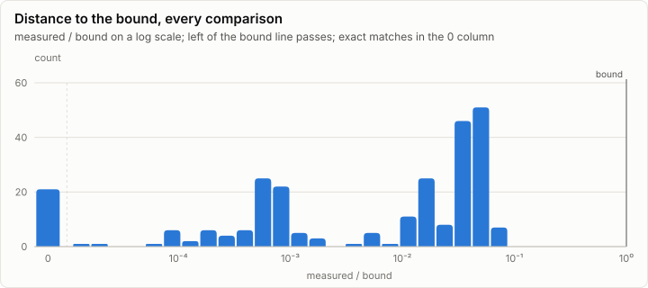
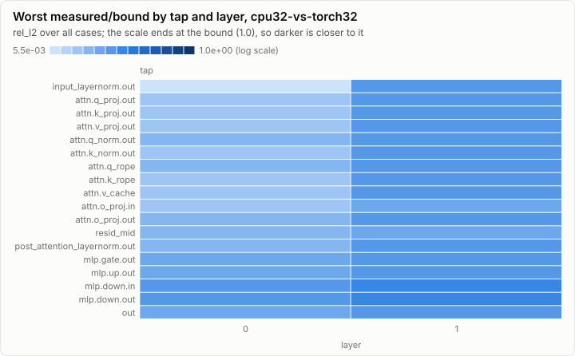
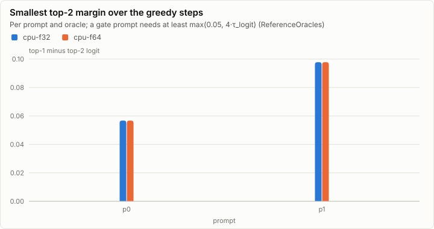

# Parity: Tiny model: the Qwen forward (M2a) on cpu-f64 and cpu-f32

**PASS.** All 250 comparisons are within their bounds. All 12 oracle self-tests pass.

- Comparisons: 250, failed: 0
- Pairs: cpu64-vs-torch64p, cpu32-vs-torch32, cpu32-vs-torch64p; cases: 3
- Closest to its bound: cpu32-vs-torch64p p0 L1.mlp.down.out rel_l2: 0.088 of the bound

## Error by layer

Every per-layer tap's rel_l2 against the golden, summarized per layer over all cases and taps. A pair passes when every dot and whisker stays under its bound line.

## Per pair

### cpu64-vs-torch64p: PASS

81 comparisons, 0 failed, worst ratio 0.001 of the bound.

### cpu32-vs-torch32: PASS

87 comparisons, 0 failed, worst ratio 0.081 of the bound.

### cpu32-vs-torch64p: PASS

82 comparisons, 0 failed, worst ratio 0.088 of the bound.

## Per case

| Case | Checks | Failed | Worst comparison | Worst ratio | Logits rel_l2 | Greedy match |
| --- | ---: | ---: | --- | ---: | --- | --- |
| p0 | 123 | 0 | cpu32-vs-torch64p L1.mlp.down.out rel_l2 | 0.088 | cpu64-vs-torch64p 9.73e-16, cpu32-vs-torch32 5.57e-07, cpu32-vs-torch64p 5.98e-07 | 64/64, 64/64 |
| p1 | 123 | 0 | cpu32-vs-torch32 L1.mlp.down.in rel_l2 | 0.073 | cpu64-vs-torch64p 6.31e-16, cpu32-vs-torch32 3.90e-07, cpu32-vs-torch64p 3.93e-07 | 64/64, 64/64 |
| p2 | 4 | 0 | cpu32-vs-torch32 logits rel_l2 | 0.072 | cpu64-vs-torch64p 1.19e-15, cpu32-vs-torch32 7.17e-07 | n/a |

## Oracle self-tests

12 of 12 pass.

| Self-test | Metric | Measured | Bound | Ratio | Result |
| --- | --- | ---: | ---: | ---: | --- |
| cpu-f64 two stages (embed + L0 \| L1 + head, residual through the host) = one stage (p0: prefill + 16 decode steps, logits and caches) | exact | 0 | 0 | 0.000 | ✓ pass |
| cpu-f64 prefill = chunks 64 + 6 (p2, 70 tokens: logits, caches, 39 taps) | exact | 0 | 0 | 0.000 | ✓ pass |
| cpu-f64 prefill = decode (p2, 70 tokens: logits, caches, 39 taps) | exact | 0 | 0 | 0.000 | ✓ pass |
| cpu-f64 prefill = chunks 10 + 31 + 1 + 28 (p2, 70 tokens: logits, caches, 39 taps) | exact | 0 | 0 | 0.000 | ✓ pass |
| cpu-f64 1 thread = 7 threads (p2: logits, 39 taps) | exact | 0 | 0 | 0.000 | ✓ pass |
| cpu-f64 1 thread = 32 threads (p2: logits, 39 taps) | exact | 0 | 0 | 0.000 | ✓ pass |
| cpu-f32 1 thread = 7 threads (p2: logits, 39 taps) | exact | 0 | 0 | 0.000 | ✓ pass |
| cpu-f32 1 thread = 32 threads (p2: logits, 39 taps) | exact | 0 | 0 | 0.000 | ✓ pass |
| cpu-f32 two stages (embed + L0 \| L1 + head, residual through the host) = one stage (p0: prefill + 16 decode steps, logits and caches) | exact | 0 | 0 | 0.000 | ✓ pass |
| cpu-f32 prefill = chunks 64 + 6 (p2, 70 tokens: logits, caches, 39 taps) | exact | 0 | 0 | 0.000 | ✓ pass |
| cpu-f32 prefill = decode (p2, 70 tokens: logits, caches, 39 taps) | exact | 0 | 0 | 0.000 | ✓ pass |
| cpu-f32 prefill = chunks 10 + 31 + 1 + 28 (p2, 70 tokens: logits, caches, 39 taps) | exact | 0 | 0 | 0.000 | ✓ pass |

## Greedy margins

The smallest margin is 0.0567 (p0, cpu-f64). No float32 argmax agreement was recorded.

| Prompt | Oracle | Smallest margin | In float32 ulps | float32 argmax agrees |
| --- | --- | ---: | ---: | --- |
| p0 | cpu-f32 | 0.0567 | n/a | n/a |
| p0 | cpu-f64 | 0.0567 | n/a | n/a |
| p1 | cpu-f32 | 0.0978 | n/a | n/a |
| p1 | cpu-f64 | 0.0978 | n/a | n/a |

## Closest to the bound

| Pair | Case | Tap | Metric | Measured | Bound | Ratio | Result |
| --- | --- | --- | --- | ---: | ---: | ---: | --- |
| cpu32-vs-torch64p | p0 | L1.mlp.down.out | rel_l2 | 8.81e-07 | 1.00e-05 | 0.088 | ✓ pass |
| cpu32-vs-torch64p | p0 | L1.mlp.down.in | rel_l2 | 8.39e-07 | 1.00e-05 | 0.084 | ✓ pass |
| cpu32-vs-torch32 | p0 | L1.mlp.down.out | rel_l2 | 8.13e-07 | 1.00e-05 | 0.081 | ✓ pass |
| cpu32-vs-torch32 | p0 | L1.mlp.down.in | rel_l2 | 7.58e-07 | 1.00e-05 | 0.076 | ✓ pass |
| cpu32-vs-torch32 | p1 | L1.mlp.down.in | rel_l2 | 7.33e-07 | 1.00e-05 | 0.073 | ✓ pass |
| cpu32-vs-torch32 | p2 | logits | rel_l2 | 7.17e-07 | 1.00e-05 | 0.072 | ✓ pass |
| cpu32-vs-torch32 | p1 | L1.mlp.down.out | rel_l2 | 6.77e-07 | 1.00e-05 | 0.068 | ✓ pass |
| cpu32-vs-torch64p | p0 | logits | rel_l2 | 5.98e-07 | 1.00e-05 | 0.060 | ✓ pass |
| cpu32-vs-torch64p | p0 | L0.mlp.down.out | rel_l2 | 5.92e-07 | 1.00e-05 | 0.059 | ✓ pass |
| cpu32-vs-torch32 | p0 | L0.mlp.down.out | rel_l2 | 5.83e-07 | 1.00e-05 | 0.058 | ✓ pass |
| cpu32-vs-torch64p | p0 | final_norm.out | rel_l2 | 5.82e-07 | 1.00e-05 | 0.058 | ✓ pass |
| cpu32-vs-torch64p | p1 | L1.mlp.down.in | rel_l2 | 5.74e-07 | 1.00e-05 | 0.057 | ✓ pass |
| cpu32-vs-torch64p | p0 | L0.mlp.down.in | rel_l2 | 5.73e-07 | 1.00e-05 | 0.057 | ✓ pass |
| cpu32-vs-torch64p | p0 | L1.out | rel_l2 | 5.61e-07 | 1.00e-05 | 0.056 | ✓ pass |
| cpu32-vs-torch64p | p1 | L1.mlp.down.out | rel_l2 | 5.58e-07 | 1.00e-05 | 0.056 | ✓ pass |

## Run

| Field | Value |
| --- | --- |
| Run | `20261018-051350-1c9f3dd8` |
| Title | Tiny model: the Qwen forward (M2a) on cpu-f64 and cpu-f32 |
| Kind | parity |
| Status | ok |
| Started | 2026-10-18T05:13:50.322Z |
| Ended | 2026-10-18T05:13:52.360Z |
| Execution class | cpu-f64 cpu, .NET 10.0.13, win-x64+avx2+fma |
| Class id | `f705487c3bfc` |
| Driver | .NET 10.0.13 |
| Commit | `27d074bf7e3f5d932506def124accaa4111d7d61` |
| Nodes | 2 |
| Records | 66,796 |
| Synthetic | no |

| Parameter | Value |
| --- | --- |
| golden | goldens/tiny/g1 |
| model | goldens/tiny/g1/model (local:tiny-g1) |
| nodes | n0 cpu-f64, n1 cpu-f32 |
| source | tests/Lrm.Models.Qwen.Tests (M2a tiny-model acceptance) |
| threads | 8 |

### Nodes

| Node | Role | Execution class | Records | Finished | Dropped |
| --- | --- | --- | ---: | --- | ---: |
| n0 | creator | cpu-f64 cpu, .NET 10.0.13, win-x64+avx2+fma | 32,414 | ok | 0 |
| n1 | joined | cpu-f32 cpu, .NET 10.0.13, win-x64+avx2+fma | 34,382 | ok | 0 |

### Log problems

None.
