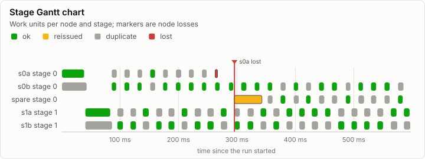
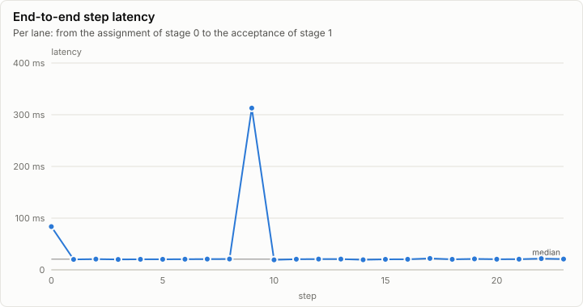
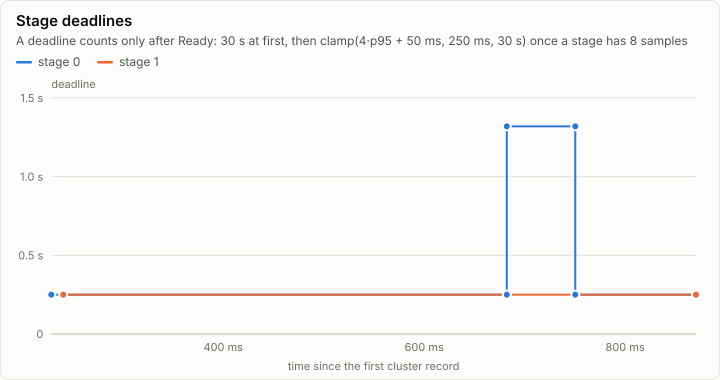
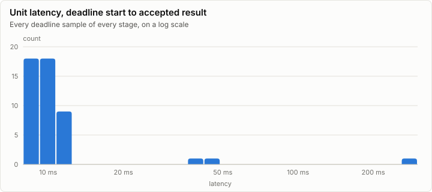
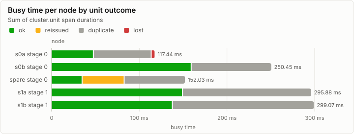

# Cluster: Two-stage pipeline, 2 replicas per stage and a spare, one node killed (synthetic)

> **Synthetic data.** This report was rendered from a run log made by a synthetic generator (`lrm report --synthetic`), so the visuals can be reviewed before the real runs exist. None of its numbers are measurements.

**PASS.** 48 work units, every one cross-checked by a second replica; 1 unit reissued, 1 node loss, no divergence.

| Outcome | Work units | Cross-checked | Reissued | Nodes lost | Divergences | Epoch |
| --- | ---: | ---: | ---: | ---: | ---: | ---: |
| completed | 48 | 48 of 48 | 1 | 1 | 0 | 6 |

Run digest: `9563af1d0c1580c8aba6fb4750d67978181bb2d9f15b222adb6628b6169246dc`

## Pipeline

Each bar is a work unit the coordinator accepted, drawn on the node whose result it took, from the assignment to the acceptance. Green units were accepted from their first assignment; amber ones were reissued to another node after the first missed its deadline. Markers are node losses, kills, restarts and demotions.

## Nodes

| Node | Stage | Backend | Assigned | Accepted | Reissued to it | Duplicates | Deadline misses | Accepted time |
| --- | ---: | --- | ---: | ---: | ---: | ---: | ---: | ---: |
| s0a | 0 | vulkan | 10 | 2 | 0 | 7 | 1 | 48.14 ms |
| s0b | 0 | vulkan | 24 | 14 | 0 | 10 | 1 | 122.66 ms |
| spare | 0 | vulkan | 15 | 8 | 1 | 7 | 0 | 362.32 ms |
| s1a | 1 | d3d12 | 24 | 8 | 0 | 16 | 0 | 118.02 ms |
| s1b | 1 | d3d12 | 24 | 16 | 0 | 8 | 0 | 172.03 ms |

### Counters

| Counter | Split | Total |
| --- | --- | ---: |
| cluster.assign | retransmit=false | 97 |
| cluster.reissue |  | 1 |
| cluster.duplicate |  | 48 |
| cluster.deadline.miss |  | 2 |
| cluster.replay.served |  | 9 |
| cluster.replay.units |  | 9 |
| cluster.chaos | fault=kill | 1 |

### Cluster events

| Time | Node | Event | Detail |
| ---: | --- | --- | --- |
| 0 ns | coord | cluster.member.join | node=s0a incarnation=1 reason=join |
| 150.00 µs | coord | cluster.member.join | node=s0b incarnation=1 reason=join |
| 300.00 µs | coord | cluster.member.join | node=s1a incarnation=1 reason=join |
| 450.00 µs | coord | cluster.member.join | node=s1b incarnation=1 reason=join |
| 600.00 µs | coord | cluster.member.join | node=spare incarnation=1 reason=join |
| 265.25 ms | coord | cluster.chaos | node=s0a fault=kill |
| 512.25 ms | coord | cluster.demote | node=s0a stage=0 |
| 762.25 ms | coord | cluster.member.leave | node=s0a reason=lease |
| 870.57 ms | coord | cluster.run | node=coord status=completed units=48 epoch=6 reissues=1 duplicates=48 divergences=0 replays=1 cross_checked=48 unconfirmed=0 end_ns=1792314000870773720 |

## Metering

| Node | Component | Stage | Wall (self) | GPU | FLOPs | Bytes moved | Tokens | Records |
| --- | --- | --- | ---: | ---: | ---: | ---: | ---: | ---: |
| coord | cluster.coordinator |  | 0 ns | 0 ns | 0 | 4.22 MiB | 0 | 103 |

## Run

| Field | Value |
| --- | --- |
| Run | `synthetic-cluster` |
| Title | Two-stage pipeline, 2 replicas per stage and a spare, one node killed (synthetic) |
| Kind | cluster |
| Status | ok |
| Started | 2026-10-18T09:00:00.000Z |
| Ended | 2026-10-18T09:00:00.870Z |
| Execution class | not recorded |
| Class id | n/a |
| Driver | n/a |
| Commit | not recorded |
| Nodes | 6 |
| Records | 421 |
| Synthetic | yes |

| Parameter | Value |
| --- | --- |
| generator | lrm report --synthetic cluster |
| model | Qwen3-0.6B |
| replicas | 2 |
| revision | c1899de289a04d12100db370d81485cdf75e47ca |
| seed | 7 |
| spares | 1 |
| split | 14 |
| steps | 24 |

### Nodes

| Node | Role | Execution class | Records | Finished | Dropped |
| --- | --- | --- | ---: | --- | ---: |
| coord | creator | not recorded | 420 | ok | 0 |
| s0a | joined | vulkan pci:10de:2704, 616.92, win-x64 shaders 87f057325043 | 0 | no | 0 |
| s0b | joined | vulkan pci:10de:2704, 616.92, win-x64 shaders 87f057325043 | 0 | ok | 0 |
| s1a | joined | d3d12 pci:10de:2704, 616.92, win-x64 shaders 87f057325043 | 0 | ok | 0 |
| s1b | joined | d3d12 pci:10de:2704, 616.92, win-x64 shaders 87f057325043 | 0 | ok | 0 |
| spare | joined | vulkan pci:10de:2704, 616.92, win-x64 shaders 87f057325043 | 1 | ok | 0 |

### Log problems

- s0a: no run.end trailer (the node is still running, or it stopped without finishing)
