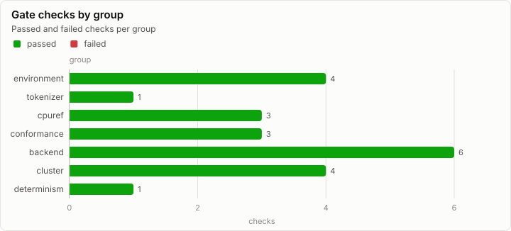
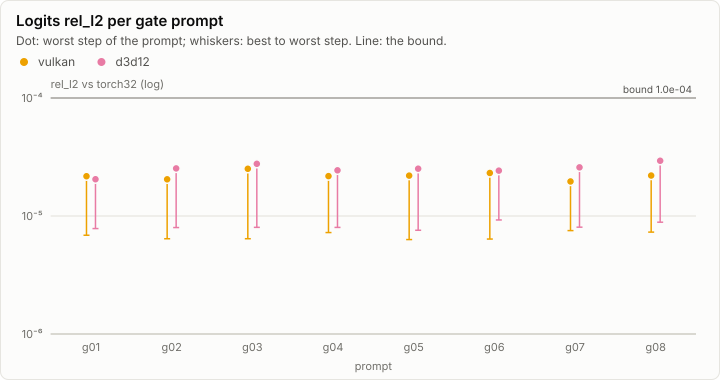

# Gate 1: Gate 1 on a fresh clone (synthetic)

> **Synthetic data.** This report was rendered from a run log made by a synthetic generator (`lrm report --synthetic`), so the visuals can be reviewed before the real runs exist. None of its numbers are measurements.

**Gate 1: PASS.** 22 of 22 checks pass.

## Matrix

| Group | All | cpu-device | vulkan | d3d12 |
| --- | --- | --- | --- | --- |
| environment | ✓ 4/4 | – | – | – |
| tokenizer | ✓ 1/1 | – | – | – |
| cpuref | ✓ 3/3 | – | – | – |
| conformance | – | ✓ 1/1 | ✓ 1/1 | ✓ 1/1 |
| backend | – | – | ✓ 3/3 | ✓ 3/3 |
| cluster | ✓ 2/2 | – | ✓ 1/1 | ✓ 1/1 |
| determinism | ✓ 1/1 | – | – | – |

## Logits per gate prompt

## Every check

| Group | Check | Backend | Result | Detail |
| --- | --- | --- | --- | --- |
| environment | SDK 10.0.402 pinned | all | ✓ pass | global.json |
| environment | driver matches the manifest | all | ✓ pass | 616.92 |
| environment | DXC 1.9.2609.5 | all | ✓ pass | --version verified |
| environment | weights SHA256SUMS | all | ✓ pass | model.safetensors, tokenizer.json |
| tokenizer | corpus exact | all | ✓ pass | 2,048 / 2,048 cases |
| cpuref | cpu64 vs torch64p | all | ✓ pass | max rel_l2 3.1e-12 <= 1e-10 |
| cpuref | cpu32 vs torch32 | all | ✓ pass | max rel_l2 6.2e-06 <= 2e-05 |
| cpuref | greedy ids | all | ✓ pass | 8 prompts x 64 steps identical |
| conformance | conformance matrix | cpu-device | ✓ pass | every catalog kernel within KernelBounds |
| conformance | conformance matrix | vulkan | ✓ pass | every catalog kernel within KernelBounds |
| conformance | conformance matrix | d3d12 | ✓ pass | every catalog kernel within KernelBounds |
| backend | logits within tolerance | vulkan | ✓ pass | 8 prompts |
| backend | greedy ids identical | vulkan | ✓ pass | 8 prompts x 64 steps |
| backend | teacher-forced agreement | vulkan | ✓ pass | where margin >= 2 tau |
| backend | logits within tolerance | d3d12 | ✓ pass | 8 prompts |
| backend | greedy ids identical | d3d12 | ✓ pass | 8 prompts x 64 steps |
| backend | teacher-forced agreement | d3d12 | ✓ pass | where margin >= 2 tau |
| cluster | vulkan\|vulkan split bit-identical | vulkan | ✓ pass | digest equal |
| cluster | d3d12\|d3d12 split bit-identical | d3d12 | ✓ pass | digest equal |
| cluster | vulkan\|d3d12 split within tolerance | all | ✓ pass | rel_l2 4.1e-05 <= 1e-04 |
| cluster | GPU chaos 25 seeds bit-identical | all | ✓ pass | 25 / 25 |
| determinism | second run identical | all | ✓ pass | every digest equal |

## Run

| Field | Value |
| --- | --- |
| Run | `synthetic-gate1` |
| Title | Gate 1 on a fresh clone (synthetic) |
| Kind | gate1 |
| Status | ok |
| Started | 2026-10-18T09:00:00.000Z |
| Ended | 2026-10-18T09:02:06.648Z |
| Execution class | cpu-f32 cpu, .NET 10.0.13, win-x64+avx2+fma |
| Class id | `7cc3fe8cde13` |
| Driver | .NET 10.0.13 |
| Commit | not recorded |
| Nodes | 1 |
| Records | 1,046 |
| Synthetic | yes |

| Parameter | Value |
| --- | --- |
| generator | lrm report --synthetic gate1 |
| goldens | qwen3-0.6b/g1 |
| model | Qwen3-0.6B |
| revision | c1899de289a04d12100db370d81485cdf75e47ca |
| tolerances | v1 |

### Nodes

| Node | Role | Execution class | Records | Finished | Dropped |
| --- | --- | --- | ---: | --- | ---: |
| n0 | creator | cpu-f32 cpu, .NET 10.0.13, win-x64+avx2+fma | 1,046 | ok | 0 |

### Log problems

None.
