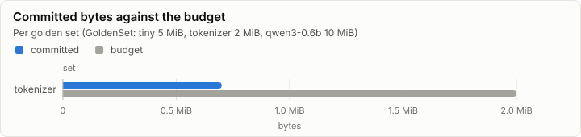
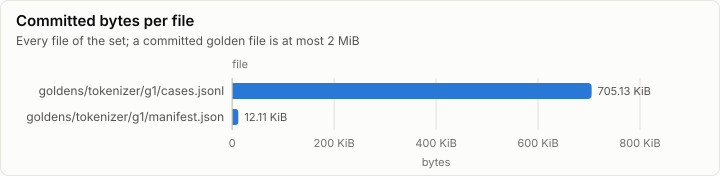
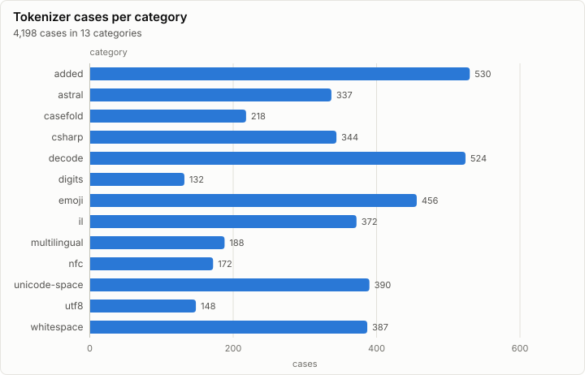

# Golden set: make_tokenizer --check (synthetic)

> **Synthetic data.** This report was rendered from a run log made by a synthetic generator (`lrm report --synthetic`), so the visuals can be reviewed before the real runs exist. None of its numbers are measurements.

**PASS.** 3 checks pass, and every set is within its budget.

- Sets: tokenizer 717.24 KiB of 2.00 MiB
- Regeneration: byte-identical to the committed files
- Double run: identical at 8 threads
- Checks: 3 of 3 pass

## Size

| Set | Committed | Budget | Share | Within budget |
| --- | ---: | ---: | ---: | --- |
| tokenizer | 717.24 KiB | 2.00 MiB | 35.0% | ✓ pass |

| File | Size | Bytes |
| --- | ---: | ---: |
| goldens/tokenizer/g1/cases.jsonl | 705.13 KiB | 722,056 |
| goldens/tokenizer/g1/manifest.json | 12.11 KiB | 12,400 |

## Checks

Every `goldens.*` check of the run, and the oracle self-tests that carry a measured value.

| Check | Detail | Measured | Result |
| --- | --- | ---: | --- |
| goldens.double_run_identical | set=tokenizer threads=8 |  | ✓ pass |
| goldens.tokenizer.transformers | agree=3678 differ=0 tokenizer_class=Qwen2Tokenizer |  | ✓ pass |
| goldens.regen_identical | set=tokenizer |  | ✓ pass |

## Tokenizer corpus

4,198 cases in 13 categories. transformers' Qwen2Tokenizer agrees with tokenizers on all 3,678 encode cases it was given.

| Kind | Cases |
| --- | ---: |
| decode | 520 |
| encode | 3,528 |
| encode_bytes | 142 |
| encode_reject | 8 |

## Phases

| Phase | Set | Duration |
| --- | --- | ---: |
| goldens.tokenizer.build | tokenizer | 4.66 s |
| goldens.tokenizer.crosscheck | tokenizer | 583.75 ms |

## Run

| Field | Value |
| --- | --- |
| Run | `synthetic-goldens` |
| Title | make_tokenizer --check (synthetic) |
| Kind | goldens |
| Status | ok |
| Started | 2026-10-18T09:00:00.000Z |
| Ended | 2026-10-18T09:00:05.243Z |
| Execution class | not recorded |
| Class id | n/a |
| Driver | n/a |
| Commit | not recorded |
| Nodes | 1 |
| Records | 25 |
| Synthetic | yes |

| Parameter | Value |
| --- | --- |
| generator | lrm report --synthetic goldens |
| set | goldens/tokenizer/g1 |
| tool | make_tokenizer |

### Nodes

| Node | Role | Execution class | Records | Finished | Dropped |
| --- | --- | --- | ---: | --- | ---: |
| n0 | creator | not recorded | 25 | ok | 0 |

### Log problems

None.
