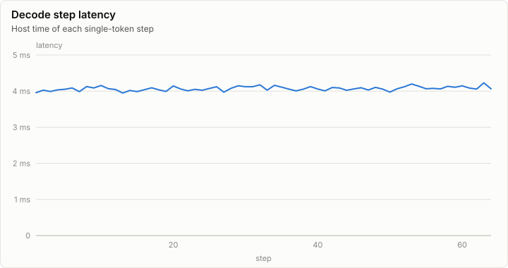
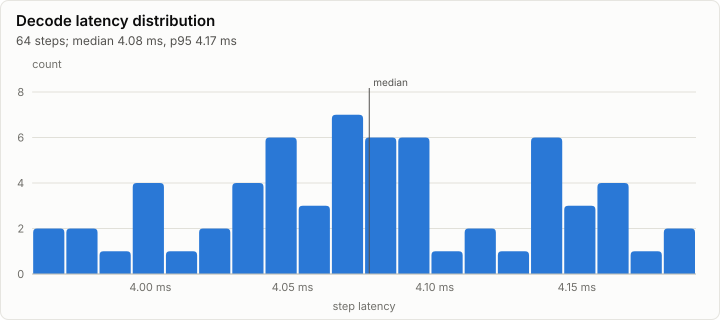
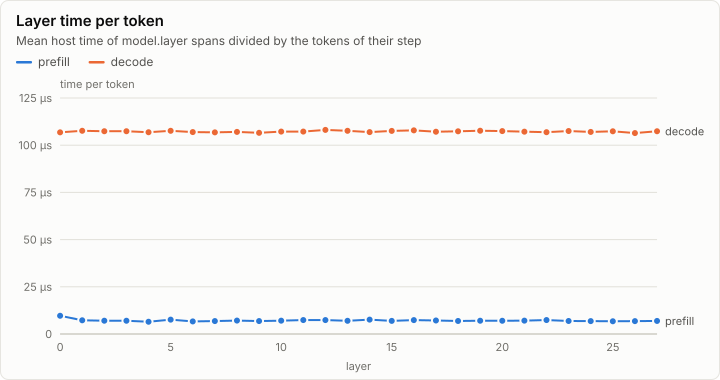
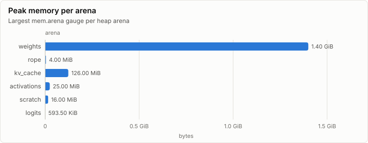

# Inference: Prefill 512 tokens, then 64 greedy steps on Vulkan (synthetic)

> **Synthetic data.** This report was rendered from a run log made by a synthetic generator (`lrm report --synthetic`), so the visuals can be reviewed before the real runs exist. None of its numbers are measurements.

| Prefill | Decode | First token | FLOPs per token | Achieved |
| ---: | ---: | ---: | ---: | ---: |
| 4,950 tok/s | 245.2 tok/s | 103.43 ms | 983.82 MFLOP | 1.55 TFLOP/s |

## Speed

| Phase | Steps | Tokens | Time | Rate | Median step |
| --- | ---: | ---: | ---: | ---: | ---: |
| prefill | 1 | 512 | 103.43 ms | 4,950 tok/s | 103.43 ms |
| decode | 64 | 64 | 261.00 ms | 245.2 tok/s | 4.08 ms |

## Layers

## Memory

| Node | Arena | Peak | Last | Samples |
| --- | --- | ---: | ---: | ---: |
| n0 | weights | 1.40 GiB | 1.40 GiB | 1 |
| n0 | rope | 4.00 MiB | 4.00 MiB | 1 |
| n0 | kv_cache | 126.00 MiB | 126.00 MiB | 65 |
| n0 | activations | 25.00 MiB | 1.05 MiB | 65 |
| n0 | scratch | 16.00 MiB | 16.00 MiB | 1 |
| n0 | logits | 593.50 KiB | 593.50 KiB | 1 |

## Metering

Resource use attributed to node, component and stage (layers summed). Wall time is span self time, so nested spans are not counted twice.

| Node | Component | Stage | Wall (self) | GPU | FLOPs | Bytes moved | Tokens | Records |
| --- | --- | --- | ---: | ---: | ---: | ---: | ---: | ---: |
| n0 | forward | 0 | 364.43 ms | 250.01 ms | 566.68G | 83.32 GiB | 576 | 7,605 |

## Run

| Field | Value |
| --- | --- |
| Run | `synthetic-inference` |
| Title | Prefill 512 tokens, then 64 greedy steps on Vulkan (synthetic) |
| Kind | inference |
| Status | ok |
| Started | 2026-10-18T09:00:00.000Z |
| Ended | 2026-10-18T09:00:00.369Z |
| Execution class | vulkan pci:10de:2704, 616.92, win-x64 shaders 87f057325043 |
| Class id | `529aef195246` |
| Driver | 616.92 |
| Commit | not recorded |
| Nodes | 1 |
| Records | 7,739 |
| Synthetic | yes |

| Parameter | Value |
| --- | --- |
| decode_steps | 64 |
| generator | lrm report --synthetic inference |
| model | Qwen3-0.6B |
| prompt_tokens | 512 |
| revision | c1899de289a04d12100db370d81485cdf75e47ca |

### Nodes

| Node | Role | Execution class | Records | Finished | Dropped |
| --- | --- | --- | ---: | --- | ---: |
| n0 | creator | vulkan pci:10de:2704, 616.92, win-x64 shaders 87f057325043 | 7,739 | ok | 0 |

### Log problems

None.
