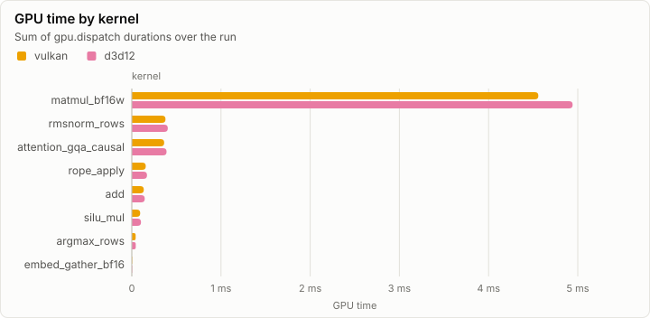
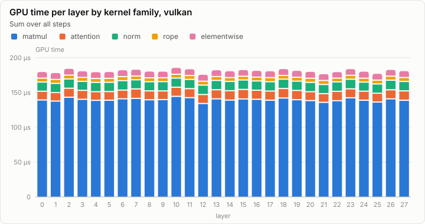
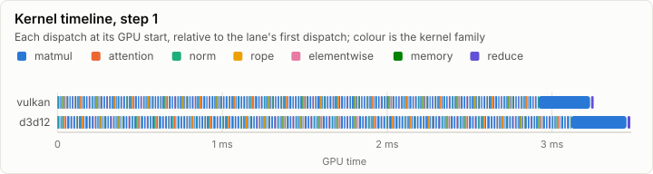
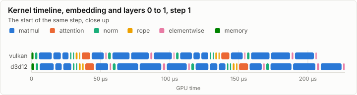
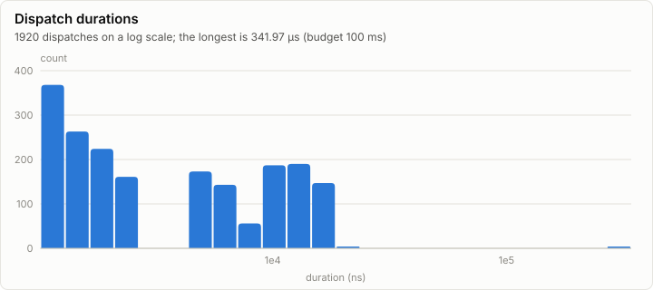

# Kernels: Kernel conformance and decode dispatch timing (synthetic)

> **Synthetic data.** This report was rendered from a run log made by a synthetic generator (`lrm report --synthetic`), so the visuals can be reviewed before the real runs exist. None of its numbers are measurements.

**FAIL.** 1 of 52 conformance cases fail. Every dispatch is under the 100 ms budget.

- Conformance cases: 52, failed: 1
- GPU dispatches: 1,920, total GPU time 11.94 ms

## Conformance matrix

Passing cases out of all cases, per kernel and backend.

| Kernel | Family | vulkan | d3d12 |
| --- | --- | --- | --- |
| matmul_bf16w | matmul | ✓ 4/4 | ✓ 4/4 |
| attention_gqa_causal | attention | ✓ 4/4 | ✗ 3/4 |
| rmsnorm_rows | norm | ✓ 4/4 | ✓ 4/4 |
| rope_apply | rope | ✓ 3/3 | ✓ 3/3 |
| add | elementwise | ✓ 2/2 | ✓ 2/2 |
| silu_mul | elementwise | ✓ 2/2 | ✓ 2/2 |
| copy_rows | memory | ✓ 2/2 | ✓ 2/2 |
| embed_gather_bf16 | memory | ✓ 3/3 | ✓ 3/3 |
| argmax_rows | reduce | ✓ 2/2 | ✓ 2/2 |

### Failing cases

| Kernel | Case | Backend | Measured | Bound | Detail |
| --- | --- | --- | ---: | ---: | --- |
| attention_gqa_causal | T=1024 past=3072 | d3d12 | 3.10e-06 | 2.40e-06 |  |

## fp32 denormals

The mode each shader backend measured with the `scale_f32` denormal probe right after loading its kernels (GpuBackendInterface). It is fixed within an execution class, and it decides what bit-exact means for a kernel that does fp32 arithmetic (KernelAbiAndCatalog, kernel rules).

| Backend | Node | fp32 denormals | Bit-exact fp32 arithmetic means |
| --- | --- | --- | --- |
| vulkan | n0 | flush | equal to CpuRef with every fp32 denormal input and result set to zero of the same sign |
| d3d12 | n1 | preserve | equal to CpuRef as it is |

## GPU time

## Timeline

### Slowest dispatches

| Kernel | Backend | Layer | Step | Duration | Of budget |
| --- | --- | ---: | ---: | ---: | ---: |
| matmul_bf16w | d3d12 |  | 1 | 341.97 µs | 0.3% |
| matmul_bf16w | d3d12 |  | 0 | 334.03 µs | 0.3% |
| matmul_bf16w | vulkan |  | 1 | 319.12 µs | 0.3% |
| matmul_bf16w | vulkan |  | 0 | 300.68 µs | 0.3% |
| argmax_rows | d3d12 |  | 1 | 22.48 µs | 0.0% |
| argmax_rows | vulkan |  | 0 | 22.11 µs | 0.0% |
| argmax_rows | d3d12 |  | 0 | 21.77 µs | 0.0% |
| argmax_rows | vulkan |  | 1 | 20.92 µs | 0.0% |
| matmul_bf16w | d3d12 | 20 | 1 | 17.34 µs | 0.0% |
| matmul_bf16w | d3d12 | 27 | 1 | 17.04 µs | 0.0% |

## Run

| Field | Value |
| --- | --- |
| Run | `synthetic-kernels` |
| Title | Kernel conformance and decode dispatch timing (synthetic) |
| Kind | kernels |
| Status | failed |
| Started | 2026-10-18T09:00:00.000Z |
| Ended | 2026-10-18T09:00:00.169Z |
| Execution class | vulkan pci:10de:2704, 616.92, win-x64 shaders 87f057325043 |
| Class id | `529aef195246` |
| Driver | 616.92 |
| Commit | not recorded |
| Nodes | 2 |
| Records | 1,974 |
| Synthetic | yes |

| Parameter | Value |
| --- | --- |
| catalog | contracts-v1 |
| generator | lrm report --synthetic kernels |
| steps | 2 |

### Nodes

| Node | Role | Execution class | Records | Finished | Dropped |
| --- | --- | --- | ---: | --- | ---: |
| n0 | creator | vulkan pci:10de:2704, 616.92, win-x64 shaders 87f057325043 | 987 | failed | 0 |
| n1 | joined | d3d12 pci:10de:2704, 616.92, win-x64 shaders 87f057325043 | 987 | failed | 0 |

### Log problems

None.
