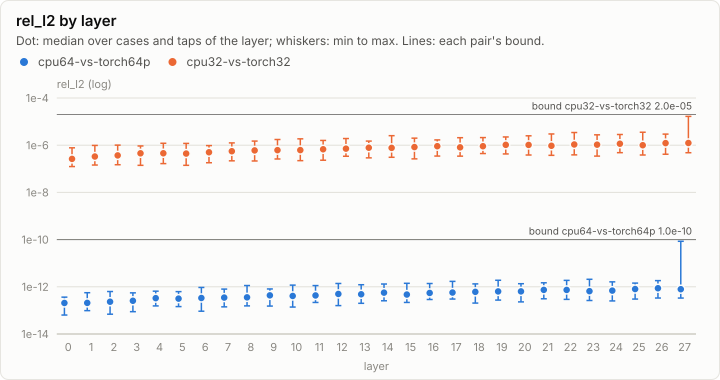
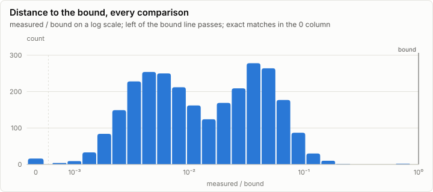
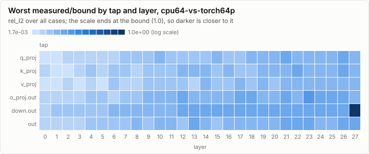
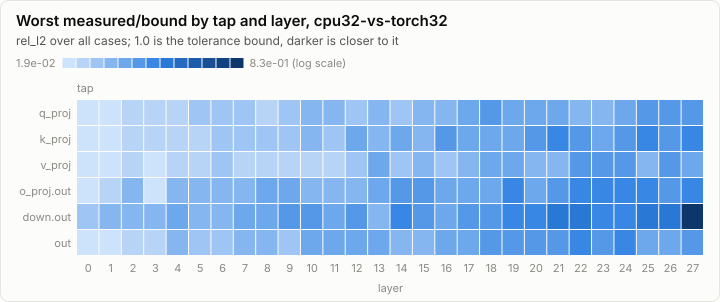

# Parity: CPU reference vs the goldens (synthetic)

> **Synthetic data.** This report was rendered from a run log made by a synthetic generator (`lrm report --synthetic`), so the visuals can be reviewed before the real runs exist. None of its numbers are measurements.

**PASS.** All 2,768 comparisons are within their bounds.

- Comparisons: 2,768, failed: 0
- Pairs: cpu64-vs-torch64p, cpu32-vs-torch32; cases: 8
- Closest to its bound: cpu64-vs-torch64p g05 L27.down.out rel_l2: 0.848 of the bound

## Error by layer

Every per-layer tap's rel_l2 against the golden, summarized per layer over all cases and taps. A pair passes when every dot and whisker stays under its bound line.

## Per pair

### cpu64-vs-torch64p: PASS

1,384 comparisons, 0 failed, worst ratio 0.848 of the bound.

### cpu32-vs-torch32: PASS

1,384 comparisons, 0 failed, worst ratio 0.832 of the bound.

## Per case

| Case | Checks | Failed | Worst comparison | Worst ratio | Logits rel_l2 | Greedy match |
| --- | ---: | ---: | --- | ---: | --- | --- |
| g01 | 346 | 0 | cpu32-vs-torch32 logits max_abs | 0.147 | cpu64-vs-torch64p 1.15e-12, cpu32-vs-torch32 1.20e-06 | 64/64, 64/64 |
| g02 | 346 | 0 | cpu32-vs-torch32 L25.down.out rel_l2 | 0.177 | cpu64-vs-torch64p 1.74e-12, cpu32-vs-torch32 1.15e-06 | 64/64, 64/64 |
| g03 | 346 | 0 | cpu32-vs-torch32 L22.down.out rel_l2 | 0.172 | cpu64-vs-torch64p 6.29e-13, cpu32-vs-torch32 1.08e-06 | 64/64, 64/64 |
| g04 | 346 | 0 | cpu32-vs-torch32 L21.down.out rel_l2 | 0.150 | cpu64-vs-torch64p 8.22e-13, cpu32-vs-torch32 1.28e-06 | 64/64, 64/64 |
| g05 | 346 | 0 | cpu64-vs-torch64p L27.down.out rel_l2 | 0.848 | cpu64-vs-torch64p 1.55e-12, cpu32-vs-torch32 1.43e-06 | 64/64, 64/64 |
| g06 | 346 | 0 | cpu32-vs-torch32 L25.o_proj.out rel_l2 | 0.143 | cpu64-vs-torch64p 1.35e-12, cpu32-vs-torch32 1.30e-06 | 64/64, 64/64 |
| g07 | 346 | 0 | cpu32-vs-torch32 logits max_abs | 0.220 | cpu64-vs-torch64p 9.79e-13, cpu32-vs-torch32 3.04e-06 | 64/64, 64/64 |
| g08 | 346 | 0 | cpu32-vs-torch32 L22.out rel_l2 | 0.138 | cpu64-vs-torch64p 1.27e-12, cpu32-vs-torch32 1.54e-06 | 64/64, 64/64 |

## Closest to the bound

| Pair | Case | Tap | Metric | Measured | Bound | Ratio | Result |
| --- | --- | --- | --- | ---: | ---: | ---: | --- |
| cpu64-vs-torch64p | g05 | L27.down.out | rel_l2 | 8.48e-11 | 1.00e-10 | 0.848 | ✓ pass |
| cpu32-vs-torch32 | g05 | L27.down.out | rel_l2 | 1.66e-05 | 2.00e-05 | 0.832 | ✓ pass |
| cpu32-vs-torch32 | g07 | logits | max_abs | 4.40e-04 | 2.00e-03 | 0.220 | ✓ pass |
| cpu32-vs-torch32 | g02 | L25.down.out | rel_l2 | 3.54e-06 | 2.00e-05 | 0.177 | ✓ pass |
| cpu32-vs-torch32 | g02 | L27.down.out | rel_l2 | 3.46e-06 | 2.00e-05 | 0.173 | ✓ pass |
| cpu32-vs-torch32 | g03 | L22.down.out | rel_l2 | 3.44e-06 | 2.00e-05 | 0.172 | ✓ pass |
| cpu32-vs-torch32 | g07 | logits | rel_l2 | 3.04e-06 | 2.00e-05 | 0.152 | ✓ pass |
| cpu32-vs-torch32 | g04 | L21.down.out | rel_l2 | 2.99e-06 | 2.00e-05 | 0.150 | ✓ pass |
| cpu32-vs-torch32 | g03 | L26.down.out | rel_l2 | 2.95e-06 | 2.00e-05 | 0.148 | ✓ pass |
| cpu32-vs-torch32 | g01 | logits | max_abs | 2.94e-04 | 2.00e-03 | 0.147 | ✓ pass |
| cpu32-vs-torch32 | g02 | L26.down.out | rel_l2 | 2.87e-06 | 2.00e-05 | 0.143 | ✓ pass |
| cpu32-vs-torch32 | g06 | L25.o_proj.out | rel_l2 | 2.86e-06 | 2.00e-05 | 0.143 | ✓ pass |
| cpu32-vs-torch32 | g07 | L24.down.out | rel_l2 | 2.84e-06 | 2.00e-05 | 0.142 | ✓ pass |
| cpu32-vs-torch32 | g04 | logits | max_abs | 2.80e-04 | 2.00e-03 | 0.140 | ✓ pass |
| cpu32-vs-torch32 | g07 | L25.down.out | rel_l2 | 2.80e-06 | 2.00e-05 | 0.140 | ✓ pass |

## Run

| Field | Value |
| --- | --- |
| Run | `synthetic-parity` |
| Title | CPU reference vs the goldens (synthetic) |
| Kind | parity |
| Status | ok |
| Started | 2026-10-18T09:00:00.000Z |
| Ended | 2026-10-18T09:00:00.126Z |
| Execution class | cpu-f32 cpu, .NET 10.0.13, win-x64+avx2+fma |
| Class id | `7cc3fe8cde13` |
| Driver | .NET 10.0.13 |
| Commit | not recorded |
| Nodes | 1 |
| Records | 2,776 |
| Synthetic | yes |

| Parameter | Value |
| --- | --- |
| generator | lrm report --synthetic parity |
| goldens | qwen3-0.6b/g1 |
| model | Qwen3-0.6B |
| prompts | 8 |
| revision | c1899de289a04d12100db370d81485cdf75e47ca |
| tolerances | v1 |

### Nodes

| Node | Role | Execution class | Records | Finished | Dropped |
| --- | --- | --- | ---: | --- | ---: |
| n0 | creator | cpu-f32 cpu, .NET 10.0.13, win-x64+avx2+fma | 2,776 | ok | 0 |

### Log problems

None.
