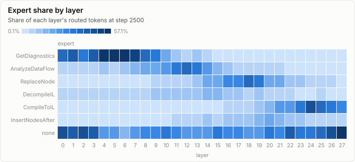
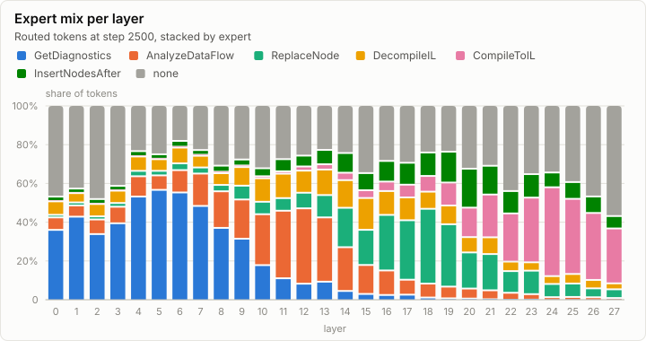
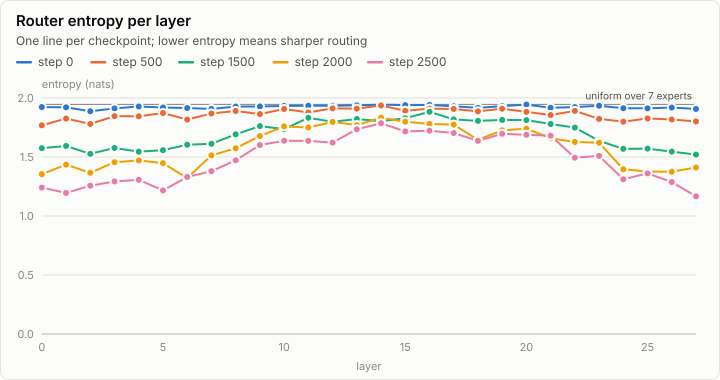
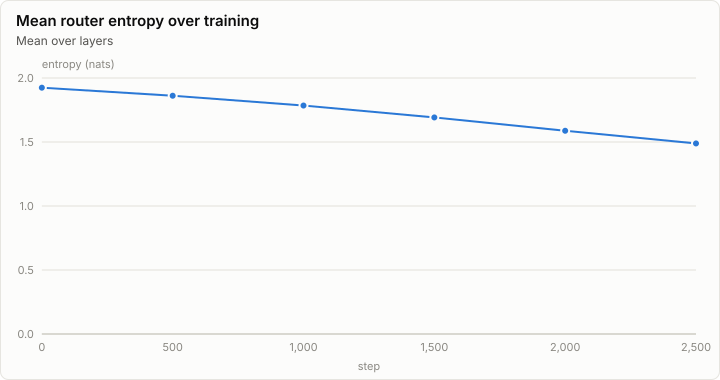

# Routing: Roslyn expert routing through training (synthetic, Phase 3 preview)

> **Synthetic data.** This report was rendered from a run log made by a synthetic generator (`lrm report --synthetic`), so the visuals can be reviewed before the real runs exist. None of its numbers are measurements.

7 experts over 28 layers; the charts show step 2500 unless they say otherwise.

## Expert usage

## Router entropy

## Top expert per layer

| Layer | Top expert | Share | Entropy (nats) |
| ---: | --- | ---: | ---: |
| 0 | none | 46.3% | 1.241 |
| 1 | GetDiagnostics | 43.3% | 1.196 |
| 2 | none | 47.6% | 1.257 |
| 3 | none | 40.8% | 1.293 |
| 4 | GetDiagnostics | 53.7% | 1.307 |
| 5 | GetDiagnostics | 57.1% | 1.217 |
| 6 | GetDiagnostics | 55.8% | 1.331 |
| 7 | GetDiagnostics | 48.9% | 1.380 |
| 8 | GetDiagnostics | 37.5% | 1.472 |
| 9 | GetDiagnostics | 31.9% | 1.602 |
| 10 | none | 31.7% | 1.637 |
| 11 | AnalyzeDataFlow | 34.9% | 1.636 |
| 12 | AnalyzeDataFlow | 38.9% | 1.622 |
| 13 | AnalyzeDataFlow | 33.2% | 1.735 |
| 14 | none | 23.9% | 1.786 |
| 15 | none | 34.2% | 1.717 |
| 16 | ReplaceNode | 28.7% | 1.723 |
| 17 | ReplaceNode | 30.7% | 1.703 |
| 18 | ReplaceNode | 38.6% | 1.637 |
| 19 | ReplaceNode | 32.2% | 1.697 |
| 20 | none | 31.9% | 1.688 |
| 21 | none | 30.4% | 1.681 |
| 22 | none | 43.5% | 1.494 |
| 23 | none | 34.7% | 1.509 |
| 24 | CompileToIL | 45.8% | 1.311 |
| 25 | none | 38.8% | 1.362 |
| 26 | none | 46.3% | 1.288 |
| 27 | none | 56.4% | 1.167 |

## Run

| Field | Value |
| --- | --- |
| Run | `synthetic-routing` |
| Title | Roslyn expert routing through training (synthetic, Phase 3 preview) |
| Kind | routing |
| Status | ok |
| Started | 2026-10-18T09:00:00.000Z |
| Ended | 2026-10-18T09:06:00.000Z |
| Execution class | vulkan pci:10de:2704, 616.92, win-x64 shaders 87f057325043 |
| Class id | `529aef195246` |
| Driver | 616.92 |
| Commit | not recorded |
| Nodes | 1 |
| Records | 1,344 |
| Synthetic | yes |

| Parameter | Value |
| --- | --- |
| experts | 6 routed + none |
| generator | lrm report --synthetic routing |
| tokens_per_checkpoint | 4096 |

### Nodes

| Node | Role | Execution class | Records | Finished | Dropped |
| --- | --- | --- | ---: | --- | ---: |
| n0 | creator | vulkan pci:10de:2704, 616.92, win-x64 shaders 87f057325043 | 1,344 | ok | 0 |

### Log problems

None.
