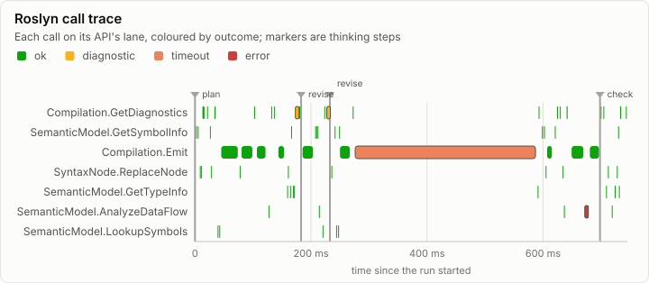
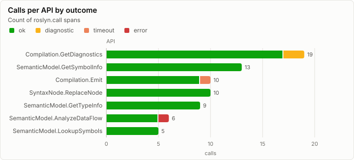
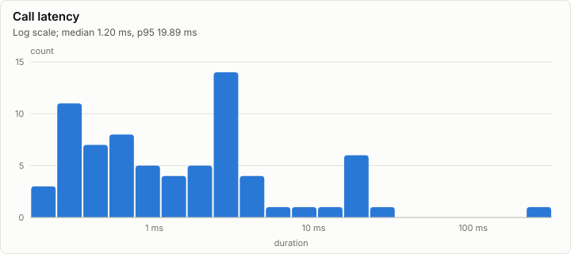

# Thinking: Roslyn calls while writing one method (synthetic, Phase 3 preview)

> **Synthetic data.** This report was rendered from a run log made by a synthetic generator (`lrm report --synthetic`), so the visuals can be reviewed before the real runs exist. None of its numbers are measurements.

72 Roslyn calls from 4 layers, 94.4% of them ok; 4 thinking steps.

## Trace

## By API

| API | Calls | ok | diagnostic | timeout | error | Median | Max |
| --- | ---: | ---: | ---: | ---: | ---: | ---: | ---: |
| `Compilation.GetDiagnostics` | 19 | 17 | 2 | 0 | 0 | 2.91 ms | 5.04 ms |
| `SemanticModel.GetSymbolInfo` | 13 | 13 | 0 | 0 | 0 | 274.01 µs | 526.83 µs |
| `Compilation.Emit` | 10 | 9 | 0 | 1 | 0 | 19.09 ms | 312.36 ms |
| `SyntaxNode.ReplaceNode` | 10 | 10 | 0 | 0 | 0 | 882.68 µs | 1.41 ms |
| `SemanticModel.GetTypeInfo` | 9 | 9 | 0 | 0 | 0 | 403.21 µs | 686.72 µs |
| `SemanticModel.AnalyzeDataFlow` | 6 | 5 | 0 | 0 | 1 | 1.91 ms | 2.22 ms |
| `SemanticModel.LookupSymbols` | 5 | 5 | 0 | 0 | 0 | 653.94 µs | 991.39 µs |

## First calls

| # | Time | Layer | Token | API | Outcome | Duration | Detail |
| ---: | ---: | ---: | ---: | --- | --- | ---: | --- |
| 1 | 1.55 ms | 20 | 4 | `SemanticModel.GetSymbolInfo` | ok | 526.83 µs |  |
| 2 | 4.69 ms | 8 | 9 | `SemanticModel.GetSymbolInfo` | ok | 279.16 µs |  |
| 3 | 8.33 ms | 16 | 14 | `SyntaxNode.ReplaceNode` | ok | 913.20 µs |  |
| 4 | 10.55 ms | 20 | 16 | `SyntaxNode.ReplaceNode` | ok | 1.41 ms |  |
| 5 | 12.88 ms | 8 | 18 | `Compilation.GetDiagnostics` | ok | 5.04 ms |  |
| 6 | 20.83 ms | 20 | 23 | `Compilation.GetDiagnostics` | ok | 2.86 ms |  |
| 7 | 25.75 ms | 12 | 28 | `SemanticModel.GetSymbolInfo` | ok | 274.01 µs |  |
| 8 | 27.73 ms | 20 | 32 | `SyntaxNode.ReplaceNode` | ok | 1.17 ms |  |
| 9 | 33.60 ms | 16 | 34 | `Compilation.GetDiagnostics` | ok | 3.56 ms |  |
| 10 | 38.89 ms | 8 | 38 | `SemanticModel.LookupSymbols` | ok | 653.94 µs |  |
| 11 | 41.88 ms | 8 | 43 | `SemanticModel.LookupSymbols` | ok | 991.39 µs |  |
| 12 | 45.24 ms | 12 | 45 | `Compilation.Emit` | ok | 30.08 ms |  |
| 13 | 77.05 ms | 8 | 47 | `SyntaxNode.ReplaceNode` | ok | 713.08 µs |  |
| 14 | 80.14 ms | 12 | 50 | `Compilation.Emit` | ok | 20.28 ms |  |
| 15 | 101.98 ms | 20 | 55 | `Compilation.GetDiagnostics` | ok | 2.41 ms |  |
| 16 | 106.72 ms | 16 | 60 | `Compilation.Emit` | ok | 16.38 ms |  |
| 17 | 126.73 ms | 8 | 64 | `SemanticModel.AnalyzeDataFlow` | ok | 1.65 ms |  |
| 18 | 131.46 ms | 8 | 67 | `Compilation.GetDiagnostics` | ok | 2.63 ms |  |
| 19 | 136.07 ms | 12 | 71 | `Compilation.GetDiagnostics` | ok | 2.66 ms |  |
| 20 | 143.77 ms | 12 | 76 | `Compilation.Emit` | ok | 11.34 ms |  |
| 21 | 158.93 ms | 8 | 81 | `SemanticModel.GetTypeInfo` | ok | 418.85 µs |  |
| 22 | 160.16 ms | 16 | 84 | `SyntaxNode.ReplaceNode` | ok | 452.86 µs |  |
| 23 | 163.95 ms | 8 | 86 | `SemanticModel.GetTypeInfo` | ok | 686.72 µs |  |
| 24 | 165.71 ms | 20 | 89 | `SemanticModel.GetSymbolInfo` | ok | 424.74 µs |  |
| 25 | 168.76 ms | 12 | 94 | `SemanticModel.GetTypeInfo` | ok | 477.34 µs |  |
| 26 | 170.71 ms | 16 | 99 | `SemanticModel.GetTypeInfo` | ok | 518.58 µs |  |
| 27 | 173.03 ms | 8 | 101 | `Compilation.GetDiagnostics` | diagnostic | 2.90 ms | CS0103: The name 'fields' does not exist |
| 28 | 179.44 ms | 16 | 106 | `Compilation.GetDiagnostics` | ok | 3.44 ms |  |
| 29 | 185.41 ms | 20 | 109 | `Compilation.Emit` | ok | 19.57 ms |  |
| 30 | 207.28 ms | 20 | 111 | `SemanticModel.GetSymbolInfo` | ok | 487.80 µs |  |
| 31 | 208.91 ms | 16 | 115 | `SemanticModel.GetSymbolInfo` | ok | 246.98 µs |  |
| 32 | 211.22 ms | 12 | 120 | `SemanticModel.GetSymbolInfo` | ok | 337.54 µs |  |
| 33 | 213.62 ms | 20 | 125 | `SemanticModel.AnalyzeDataFlow` | ok | 1.93 ms |  |
| 34 | 219.89 ms | 8 | 128 | `SemanticModel.LookupSymbols` | ok | 800.32 µs |  |
| 35 | 222.95 ms | 16 | 130 | `Compilation.GetDiagnostics` | ok | 2.44 ms |  |
| 36 | 227.20 ms | 8 | 135 | `Compilation.GetDiagnostics` | diagnostic | 4.28 ms | CS1503: cannot convert from 'string' to 'int' |
| 37 | 232.35 ms | 20 | 137 | `SemanticModel.GetTypeInfo` | ok | 245.21 µs |  |
| 38 | 235.09 ms | 16 | 142 | `SyntaxNode.ReplaceNode` | ok | 1.22 ms |  |
| 39 | 240.69 ms | 20 | 145 | `SemanticModel.GetSymbolInfo` | ok | 338.68 µs |  |
| 40 | 243.33 ms | 12 | 148 | `SemanticModel.LookupSymbols` | ok | 612.16 µs |  |

## Run

| Field | Value |
| --- | --- |
| Run | `synthetic-thinking` |
| Title | Roslyn calls while writing one method (synthetic, Phase 3 preview) |
| Kind | thinking |
| Status | ok |
| Started | 2026-10-18T09:00:00.000Z |
| Ended | 2026-10-18T09:00:00.745Z |
| Execution class | vulkan pci:10de:2704, 616.92, win-x64 shaders 87f057325043 |
| Class id | `529aef195246` |
| Driver | 616.92 |
| Commit | not recorded |
| Nodes | 1 |
| Records | 76 |
| Synthetic | yes |

| Parameter | Value |
| --- | --- |
| generator | lrm report --synthetic thinking |
| task | level 3: parse a CSV line into a record |
| tokens | 220 |

### Nodes

| Node | Role | Execution class | Records | Finished | Dropped |
| --- | --- | --- | ---: | --- | ---: |
| n0 | creator | vulkan pci:10de:2704, 616.92, win-x64 shaders 87f057325043 | 76 | ok | 0 |

### Log problems

None.
