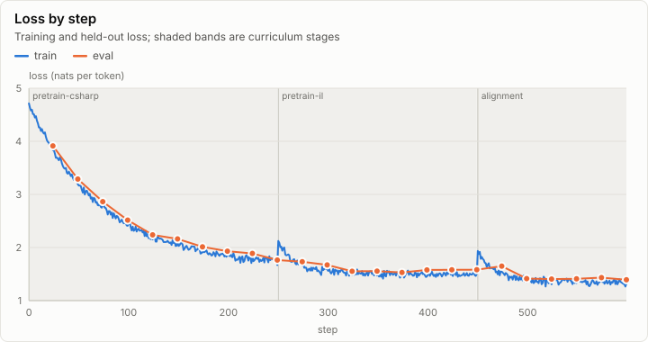
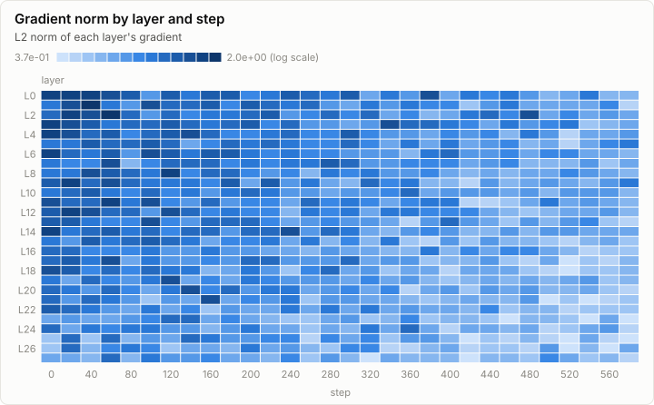
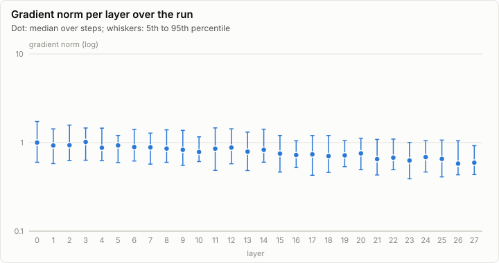
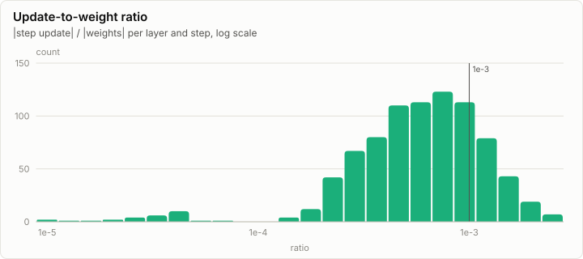
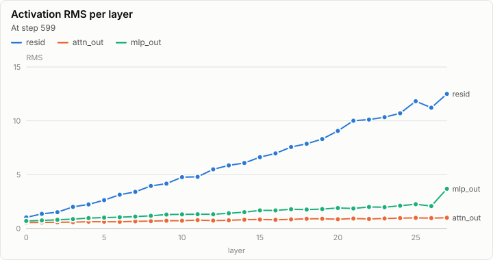

# Training: Pretraining curriculum, 600 steps (synthetic, Phase 2 preview)

> **Synthetic data.** This report was rendered from a run log made by a synthetic generator (`lrm report --synthetic`), so the visuals can be reviewed before the real runs exist. None of its numbers are measurements.

Final training loss 1.321 after 599 steps.

## Loss

| Stage | First step | Last step | Loss at start | Loss at end | Held-out at end |
| --- | ---: | ---: | ---: | ---: | ---: |
| pretrain-csharp | 0 | 249 | 4.713 | 1.669 | 1.763 |
| pretrain-il | 250 | 449 | 2.123 | 1.504 | 1.582 |
| alignment | 450 | 599 | 1.935 | 1.321 | 1.392 |

## Gradients

## Activations

## Run

| Field | Value |
| --- | --- |
| Run | `synthetic-training` |
| Title | Pretraining curriculum, 600 steps (synthetic, Phase 2 preview) |
| Kind | training |
| Status | ok |
| Started | 2026-10-18T09:00:00.000Z |
| Ended | 2026-10-18T09:04:06.407Z |
| Execution class | vulkan pci:10de:2704, 616.92, win-x64 shaders 87f057325043 |
| Class id | `529aef195246` |
| Driver | 616.92 |
| Commit | not recorded |
| Nodes | 1 |
| Records | 3,408 |
| Synthetic | yes |

| Parameter | Value |
| --- | --- |
| batch_tokens | 65536 |
| generator | lrm report --synthetic training |
| lr | 3e-4 |
| model | Qwen3-0.6B |
| optimizer | AdamW |
| revision | c1899de289a04d12100db370d81485cdf75e47ca |

### Nodes

| Node | Role | Execution class | Records | Finished | Dropped |
| --- | --- | --- | ---: | --- | ---: |
| n0 | creator | vulkan pci:10de:2704, 616.92, win-x64 shaders 87f057325043 | 3,408 | ok | 0 |

### Log problems

None.
