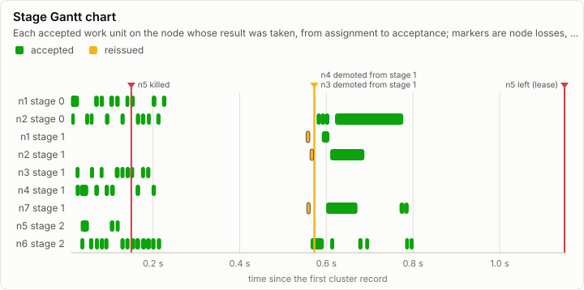
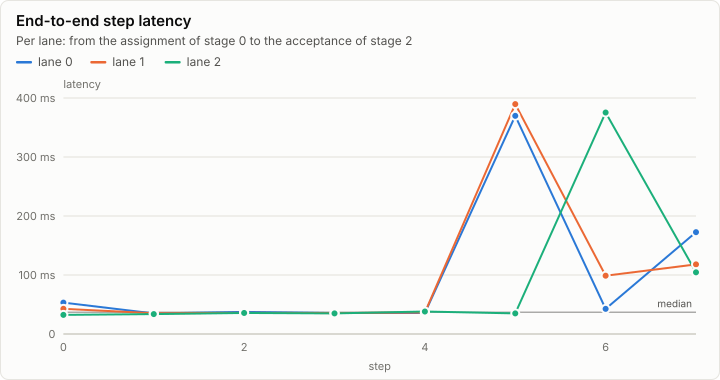
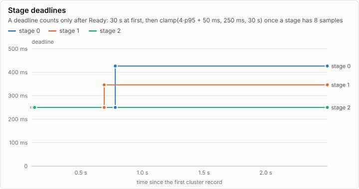
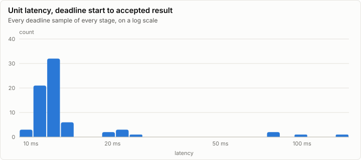
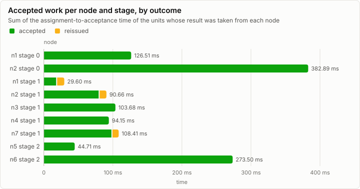

# Cluster: Simulated chaos run: n5 killed, stage 1 lagging (C1 simulator)

**PASS.** 72 work units, every one cross-checked by a second replica; 3 units reissued, 1 node loss, no divergence.

| Outcome | Work units | Cross-checked | Reissued | Nodes lost | Divergences | Epoch |
| --- | ---: | ---: | ---: | ---: | ---: | ---: |
| completed | 72 | 72 of 72 | 3 | 1 | 0 | 8 |

Run digest: `507fb323a4f9e5efda3e7a0ce78bd9ff1c1ed07d6a95b8520850357bf90eec16`

## Pipeline

Each bar is a work unit the coordinator accepted, drawn on the node whose result it took, from the assignment to the acceptance. Green units were accepted from their first assignment; amber ones were reissued to another node after the first missed its deadline. Markers are node losses, kills, restarts and demotions.

## Nodes

| Node | Stage | Backend | Assigned | Accepted | Reissued to it | Duplicates | Deadline misses | Accepted time |
| --- | ---: | --- | ---: | ---: | ---: | ---: | ---: | ---: |
| n1 | 0 | n/a | 24 | 10 | 0 | 14 | 0 | 126.51 ms |
| n2 | 0 | n/a | 24 | 14 | 0 | 10 | 0 | 382.89 ms |
| n1 | 1 | n/a | 6 | 2 | 1 | 4 | 0 | 29.60 ms |
| n2 | 1 | n/a | 6 | 2 | 1 | 4 | 0 | 90.66 ms |
| n3 | 1 | n/a | 22 | 9 | 0 | 8 | 3 | 103.68 ms |
| n4 | 1 | n/a | 22 | 7 | 0 | 10 | 3 | 94.15 ms |
| n7 | 1 | n/a | 6 | 4 | 1 | 2 | 0 | 108.41 ms |
| n3 | 2 | n/a | 6 | 0 | 0 | 0 | 0 | 0 ns |
| n4 | 2 | n/a | 9 | 0 | 0 | 0 | 0 | 0 ns |
| n5 | 2 | n/a | 24 | 3 | 0 | 7 | 0 | 44.71 ms |
| n6 | 2 | n/a | 24 | 21 | 0 | 3 | 0 | 273.50 ms |
| n7 | 2 | n/a | 3 | 0 | 0 | 3 | 0 | 0 ns |

### Counters

| Counter | Split | Total |
| --- | --- | ---: |
| cluster.assign | retransmit=false | 152 |
| cluster.assign | retransmit=true | 24 |
| cluster.reissue |  | 3 |
| cluster.duplicate |  | 65 |
| cluster.deadline.miss |  | 6 |
| cluster.replay.served |  | 75 |
| cluster.replay.units |  | 75 |
| cluster.chaos | fault=kill | 1 |

### Cluster events

| Time | Node | Event | Detail |
| ---: | --- | --- | --- |
| 0 ns | n0 | cluster.member.join | node=n5 incarnation=1 reason=join |
| 195.43 µs | n0 | cluster.member.join | node=n1 incarnation=1 reason=join |
| 198.09 µs | n0 | cluster.member.join | node=n3 incarnation=1 reason=join |
| 351.66 µs | n0 | cluster.member.join | node=n2 incarnation=1 reason=join |
| 423.35 µs | n0 | cluster.member.join | node=n6 incarnation=1 reason=join |
| 708.90 µs | n0 | cluster.member.join | node=n7 incarnation=1 reason=join |
| 1.66 ms | n0 | cluster.member.join | node=n4 incarnation=1 reason=join |
| 149.76 ms | n0 | cluster.chaos | fault=kill node=n5 |
| 572.27 ms | n0 | cluster.demote | node=n3 stage=1 |
| 572.27 ms | n0 | cluster.demote | node=n4 stage=1 |
| 1.15 s | n0 | cluster.member.leave | node=n5 reason=lease |
| 2.50 s | n0 | cluster.run | node=coord status=completed units=72 epoch=8 reissues=3 duplicates=65 divergences=0 replays=12 cross_checked=72 unconfirmed=0 end_ns=2499027632 |

## Metering

| Node | Component | Stage | Wall (self) | GPU | FLOPs | Bytes moved | Tokens | Records |
| --- | --- | --- | ---: | ---: | ---: | ---: | ---: | ---: |
| n0 | cluster.coordinator |  | 0 ns | 0 ns | 0 | 110.41 KiB | 0 | 387 |

## Run

| Field | Value |
| --- | --- |
| Run | `20261018-041935-d69324b0` |
| Title | Simulated chaos run: n5 killed, stage 1 lagging (C1 simulator) |
| Kind | cluster |
| Status | ok |
| Started | 2026-10-18T04:19:35.924Z |
| Ended | 2026-10-18T04:19:36.094Z |
| Execution class | cpu-f32 fake, lrm.fake/1, any |
| Class id | `86d7e37b8867` |
| Driver | lrm.fake/1 |
| Commit | `80c38c1db1c5d5d411bf33866f55d7597f9e4ce9` |
| Nodes | 1 |
| Records | 914 |
| Synthetic | no |

| Parameter | Value |
| --- | --- |
| faults | kill n5 at 150 ms; n3 and n4 lag 200x from 200 ms |
| job | FakeJob.standard: 4 lanes, 3 stages, 6 steps, 2 replicas per stage |
| nodes | 7 (n1 to n6 and the spare n7), ready at 10 ms, clean LAN |
| seed | 12 |
| source | tests/Lrm.Cluster.Tests (C1 deterministic simulator) |
| time | virtual ns |

### Nodes

| Node | Role | Execution class | Records | Finished | Dropped |
| --- | --- | --- | ---: | --- | ---: |
| n0 | creator | cpu-f32 fake, lrm.fake/1, any | 914 | ok | 0 |

### Log problems

None.
