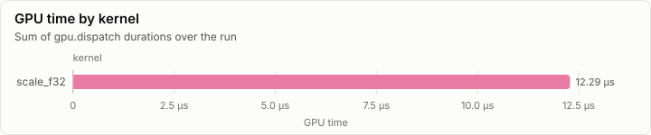
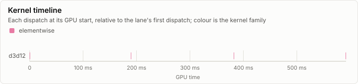
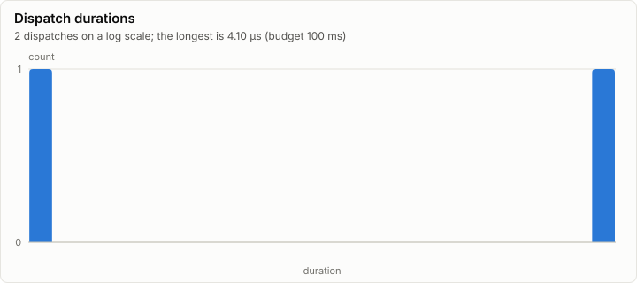

# Kernels: D3D12 fp32 denormal probe on scale_f32 (int-0001)

No conformance cases were recorded. Every dispatch is under the 100 ms budget.

- Conformance cases: 0, failed: 0
- GPU dispatches: 2, total GPU time 6.14 µs

## Conformance matrix

Passing cases out of all cases, per kernel and backend.

_No rows._

### Failing cases

_No rows._

## fp32 denormals

The mode each shader backend measured with the `scale_f32` denormal probe right after loading its kernels (GpuBackendInterface). It is fixed within an execution class, and it decides what bit-exact means for a kernel that does fp32 arithmetic (KernelAbiAndCatalog, kernel rules).

| Backend | Node | fp32 denormals | Bit-exact fp32 arithmetic means |
| --- | --- | --- | --- |
| d3d12 | n0 | preserve | equal to CpuRef as it is |

## GPU time

## Timeline

### Slowest dispatches

| Kernel | Backend | Layer | Step | Duration | Of budget |
| --- | --- | ---: | ---: | ---: | ---: |
| scale_f32 | d3d12 |  |  | 4.10 µs | 0.0% |
| scale_f32 | d3d12 |  |  | 2.05 µs | 0.0% |

## Run

| Field | Value |
| --- | --- |
| Run | `20261018-031937-1f674011` |
| Title | D3D12 fp32 denormal probe on scale_f32 (int-0001) |
| Kind | kernels |
| Status | ok |
| Started | 2026-10-18T03:19:37.109Z |
| Ended | 2026-10-18T03:19:37.528Z |
| Execution class | d3d12 pci:10de:2704, 32.0.16.1692, win-x64 shaders b12cabbf300b |
| Class id | `9469669b5935` |
| Driver | 32.0.16.1692 |
| Commit | `ad5d24292344ad2c1bf262fa0f2f3a5c2781bef0` |
| Nodes | 1 |
| Records | 4 |
| Synthetic | no |

| Parameter | Value |
| --- | --- |
| driver | 616.92 |
| dxil_flags | -T cs_6_6 -E main -HV 2021 -O3 -WX -denorm preserve |
| probe | scale_f32, a = 0.5, Fp32Denormals.probeInputs (GpuBackendInterface) |
| source | tests/Lrm.Gpu.D3D12.Interop.Tests (gpu tier) |

### Nodes

| Node | Role | Execution class | Records | Finished | Dropped |
| --- | --- | --- | ---: | --- | ---: |
| n0 | creator | d3d12 pci:10de:2704, 32.0.16.1692, win-x64 shaders b12cabbf300b | 4 | ok | 0 |

### Log problems

None.
