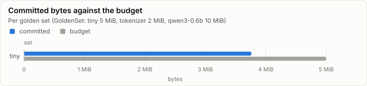
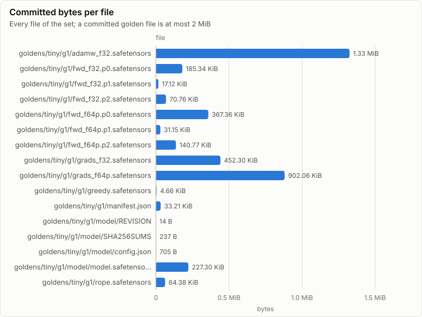

# Golden set: make_tiny (tools/goldens)

**PASS.** 13 checks pass, and every set is within its budget.

- Sets: tiny 3.76 MiB of 5.00 MiB
- Regeneration: byte-identical to the committed files
- Double run: identical at 8 threads
- Checks: 13 of 13 pass

## Size

| Set | Committed | Budget | Share | Within budget |
| --- | ---: | ---: | ---: | --- |
| tiny | 3.76 MiB | 5.00 MiB | 75.3% | ✓ pass |

| File | Size | Bytes |
| --- | ---: | ---: |
| goldens/tiny/g1/adamw_f32.safetensors | 1.33 MiB | 1,389,704 |
| goldens/tiny/g1/fwd_f32.p0.safetensors | 185.34 KiB | 189,784 |
| goldens/tiny/g1/fwd_f32.p1.safetensors | 17.12 KiB | 17,528 |
| goldens/tiny/g1/fwd_f32.p2.safetensors | 70.76 KiB | 72,456 |
| goldens/tiny/g1/fwd_f64p.p0.safetensors | 367.36 KiB | 376,176 |
| goldens/tiny/g1/fwd_f64p.p1.safetensors | 31.15 KiB | 31,896 |
| goldens/tiny/g1/fwd_f64p.p2.safetensors | 140.77 KiB | 144,144 |
| goldens/tiny/g1/grads_f32.safetensors | 452.30 KiB | 463,156 |
| goldens/tiny/g1/grads_f64p.safetensors | 902.06 KiB | 923,712 |
| goldens/tiny/g1/greedy.safetensors | 4.66 KiB | 4,776 |
| goldens/tiny/g1/manifest.json | 33.21 KiB | 34,004 |
| goldens/tiny/g1/model/REVISION | 14 B | 14 |
| goldens/tiny/g1/model/SHA256SUMS | 237 B | 237 |
| goldens/tiny/g1/model/config.json | 705 B | 705 |
| goldens/tiny/g1/model/model.safetensors | 227.30 KiB | 232,760 |
| goldens/tiny/g1/rope.safetensors | 64.38 KiB | 65,920 |

## Checks

Every `goldens.*` check of the run, and the oracle self-tests that carry a measured value.

| Check | Detail | Measured | Result |
| --- | --- | ---: | --- |
| golden.compare | metric=relL2 measured=4.544056313978002E-16 bound=1E-13 check=attention_fp64 pair=oracle-selftest | 4.54e-16 ≤ 1.00e-13 | ✓ pass |
| goldens.selftest | check=bf16_rne |  | ✓ pass |
| golden.compare | metric=relL2 measured=1.1821761876464124E-16 bound=1E-15 check=rmsnorm_fp64 pair=oracle-selftest | 1.18e-16 ≤ 1.00e-15 | ✓ pass |
| goldens.selftest | check=rng_kats |  | ✓ pass |
| goldens.selftest | check=rope_t_spec |  | ✓ pass |
| goldens.selftest | check=safetensors |  | ✓ pass |
| golden.compare | metric=relL2 measured=1.5881643758411594E-15 bound=1E-13 check=tiny_fp64_forward pair=oracle-selftest | 1.59e-15 ≤ 1.00e-13 | ✓ pass |
| goldens.greedy.f32_argmax_agrees | prompt=p0 oracle=torch32 |  | ✓ pass |
| goldens.greedy.f32_argmax_agrees | prompt=p0 oracle=torch64p |  | ✓ pass |
| goldens.greedy.f32_argmax_agrees | prompt=p1 oracle=torch32 |  | ✓ pass |
| goldens.greedy.f32_argmax_agrees | prompt=p1 oracle=torch64p |  | ✓ pass |
| goldens.double_run_identical | set=tiny threads=8 |  | ✓ pass |
| goldens.regen_identical | set=tiny |  | ✓ pass |

## Phases

| Phase | Set | Duration |
| --- | --- | ---: |
| goldens.select_prompts | tiny | 747.45 ms |
| goldens.selftests | tiny | 453.09 ms |
| goldens.double_run | tiny | 3.70 s |

## Run

| Field | Value |
| --- | --- |
| Run | `20261018-041847-38fbb81f` |
| Title | make_tiny (tools/goldens) |
| Kind | parity |
| Status | ok |
| Started | 2026-10-18T04:18:47.552Z |
| Ended | 2026-10-18T04:18:53.797Z |
| Execution class | not recorded |
| Class id | n/a |
| Driver | n/a |
| Commit | `80c38c1db1c5d5d411bf33866f55d7597f9e4ce9` |
| Nodes | 1 |
| Records | 144 |
| Synthetic | no |

| Parameter | Value |
| --- | --- |
| tool | make_tiny |

### Nodes

| Node | Role | Execution class | Records | Finished | Dropped |
| --- | --- | --- | ---: | --- | ---: |
| n0 | creator | not recorded | 144 | ok | 0 |

### Log problems

None.
