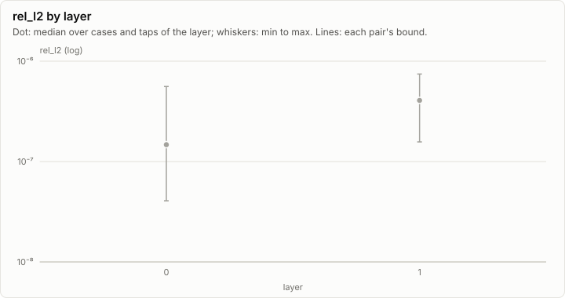
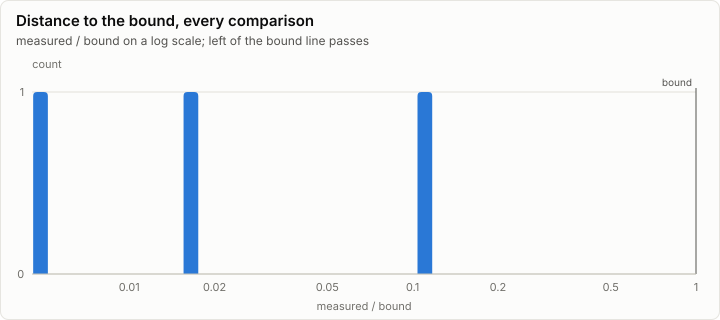
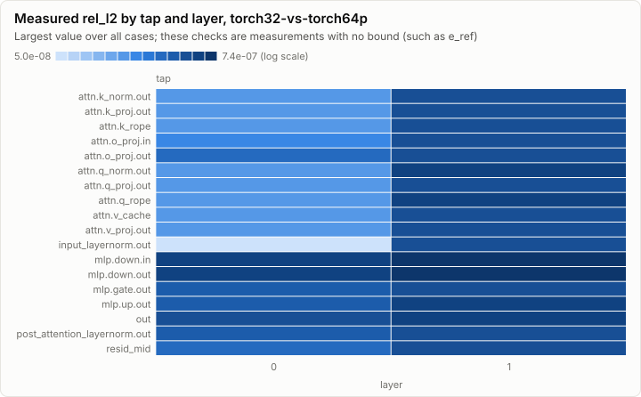
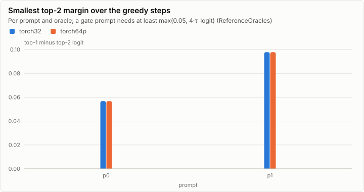

# Parity: make_tiny (tools/goldens)

**PASS.** All 103 comparisons are within their bounds. All 7 oracle self-tests pass.

- Comparisons: 103, failed: 0
- Pairs: torch32-vs-torch64p; cases: 4
- Closest to its bound: oracle-selftest (self-test) rmsnorm_fp64 rel_l2: 0.118 of the bound

## Error by layer

Every per-layer tap's rel_l2 against the golden, summarized per layer over all cases and taps. A pair passes when every dot and whisker stays under its bound line.

## Per pair

### torch32-vs-torch64p: PASS

103 comparisons, 0 failed, worst ratio n/a of the bound.

## Per case

| Case | Checks | Failed | Worst comparison | Worst ratio | Logits rel_l2 | Greedy match |
| --- | ---: | ---: | --- | ---: | --- | --- |
| (gradient) | 24 | 0 |  |  | n/a | n/a |
| p0 | 39 | 0 |  |  | torch32-vs-torch64p 5.44e-07 | n/a |
| p1 | 39 | 0 |  |  | torch32-vs-torch64p 1.92e-07 | n/a |
| p2 | 1 | 0 |  |  | torch32-vs-torch64p 6.69e-07 | n/a |

## Oracle self-tests

7 of 7 pass.

| Self-test | Metric | Measured | Bound | Ratio | Result |
| --- | --- | ---: | ---: | ---: | --- |
| attention_fp64 | rel_l2 | 4.54e-16 | 1.00e-13 | 0.005 | ✓ pass |
| rmsnorm_fp64 | rel_l2 | 1.18e-16 | 1.00e-15 | 0.118 | ✓ pass |
| tiny_fp64_forward | rel_l2 | 1.59e-15 | 1.00e-13 | 0.016 | ✓ pass |
| bf16_rne | exact |  |  |  | ✓ pass |
| rng_kats | exact |  |  |  | ✓ pass |
| rope_t_spec | exact |  |  |  | ✓ pass |
| safetensors | exact |  |  |  | ✓ pass |

## Greedy margins

The smallest margin is 0.0567 (p0, torch64p). The float32 argmax agrees with the oracle at every step of every prompt.

| Prompt | Oracle | Smallest margin | In float32 ulps | float32 argmax agrees |
| --- | --- | ---: | ---: | --- |
| p0 | torch32 | 0.0567 | 59,494 | ✓ pass |
| p0 | torch64p | 0.0567 | 59,493 | ✓ pass |
| p1 | torch32 | 0.0978 | 205,089 | ✓ pass |
| p1 | torch64p | 0.0978 | 205,090 | ✓ pass |

## Closest to the bound

| Pair | Case | Tap | Metric | Measured | Bound | Ratio | Result |
| --- | --- | --- | --- | ---: | ---: | ---: | --- |
| oracle-selftest | (self-test) | rmsnorm_fp64 | rel_l2 | 1.18e-16 | 1.00e-15 | 0.118 | ✓ pass |
| oracle-selftest | (self-test) | tiny_fp64_forward | rel_l2 | 1.59e-15 | 1.00e-13 | 0.016 | ✓ pass |
| oracle-selftest | (self-test) | attention_fp64 | rel_l2 | 4.54e-16 | 1.00e-13 | 0.005 | ✓ pass |

## Run

| Field | Value |
| --- | --- |
| Run | `20261018-041847-38fbb81f` |
| Title | make_tiny (tools/goldens) |
| Kind | parity |
| Status | ok |
| Started | 2026-10-18T04:18:47.552Z |
| Ended | 2026-10-18T04:18:53.797Z |
| Execution class | not recorded |
| Class id | n/a |
| Driver | n/a |
| Commit | `80c38c1db1c5d5d411bf33866f55d7597f9e4ce9` |
| Nodes | 1 |
| Records | 144 |
| Synthetic | no |

| Parameter | Value |
| --- | --- |
| tool | make_tiny |

### Nodes

| Node | Role | Execution class | Records | Finished | Dropped |
| --- | --- | --- | ---: | --- | ---: |
| n0 | creator | not recorded | 144 | ok | 0 |

### Log problems

None.
