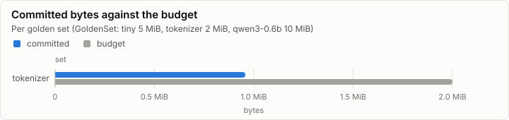
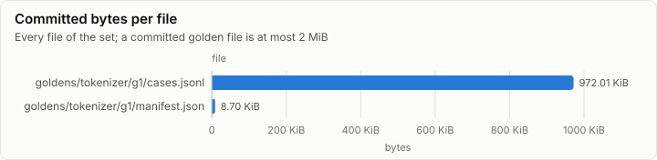
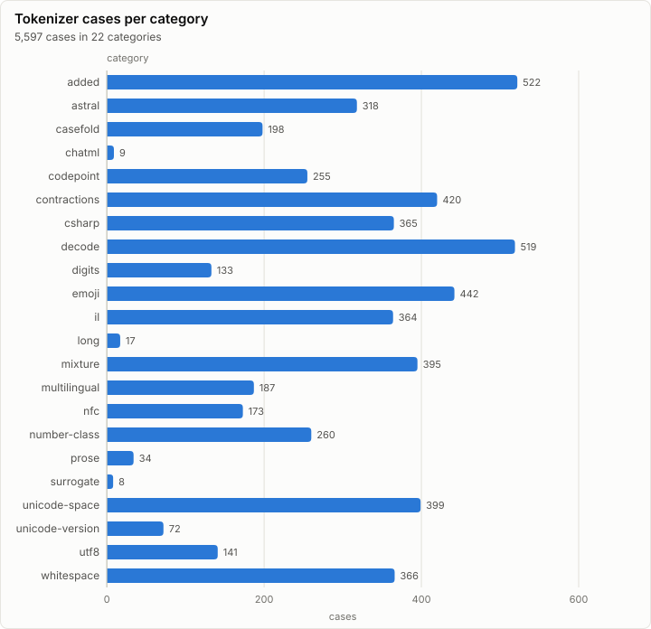

# Golden set: make_tokenizer (tools/goldens)

**PASS.** 3 checks pass, and every set is within its budget.

- Sets: tokenizer 980.71 KiB of 2.00 MiB
- Regeneration: byte-identical to the committed files
- Double run: identical at 8 threads
- Checks: 3 of 3 pass

## Size

| Set | Committed | Budget | Share | Within budget |
| --- | ---: | ---: | ---: | --- |
| tokenizer | 980.71 KiB | 2.00 MiB | 47.9% | ✓ pass |

| File | Size | Bytes |
| --- | ---: | ---: |
| goldens/tokenizer/g1/cases.jsonl | 972.01 KiB | 995,340 |
| goldens/tokenizer/g1/manifest.json | 8.70 KiB | 8,908 |

## Checks

Every `goldens.*` check of the run, and the oracle self-tests that carry a measured value.

| Check | Detail | Measured | Result |
| --- | --- | ---: | --- |
| goldens.tokenizer.transformers | agree=5070 differ=0 tokenizer_class=Qwen2Tokenizer |  | ✓ pass |
| goldens.double_run_identical | set=tokenizer threads=8 |  | ✓ pass |
| goldens.regen_identical | set=tokenizer |  | ✓ pass |

## Tokenizer corpus

5,597 cases in 22 categories. transformers' Qwen2Tokenizer agrees with tokenizers on all 5,070 encode cases it was given.

| Kind | Cases |
| --- | ---: |
| decode | 519 |
| encode | 4,929 |
| encode_bytes | 141 |
| encode_reject | 8 |

## Phases

| Phase | Set | Duration |
| --- | --- | ---: |
| goldens.tokenizer.build | tokenizer | 4.22 s |
| goldens.tokenizer.crosscheck | tokenizer | 635.09 ms |

## Run

| Field | Value |
| --- | --- |
| Run | `20261018-041859-53093d21` |
| Title | make_tokenizer (tools/goldens) |
| Kind | goldens |
| Status | ok |
| Started | 2026-10-18T04:18:59.266Z |
| Ended | 2026-10-18T04:19:04.799Z |
| Execution class | not recorded |
| Class id | n/a |
| Driver | n/a |
| Commit | `80c38c1db1c5d5d411bf33866f55d7597f9e4ce9` |
| Nodes | 1 |
| Records | 34 |
| Synthetic | no |

| Parameter | Value |
| --- | --- |
| tool | make_tokenizer |

### Nodes

| Node | Role | Execution class | Records | Finished | Dropped |
| --- | --- | --- | ---: | --- | ---: |
| n0 | creator | not recorded | 34 | ok | 0 |

### Log problems

None.
