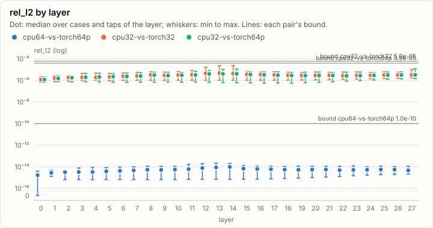
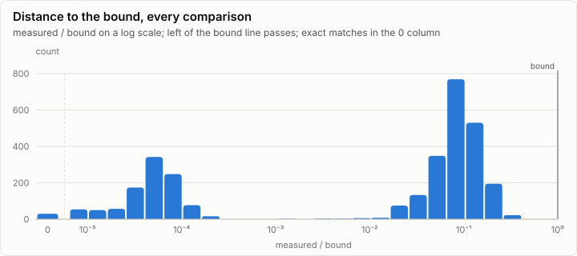
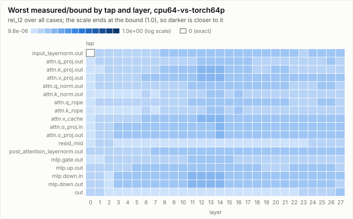
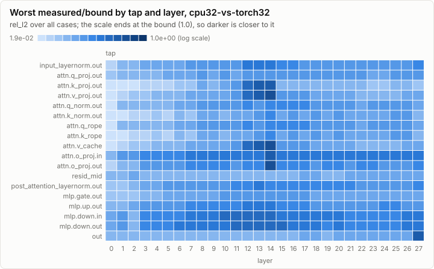
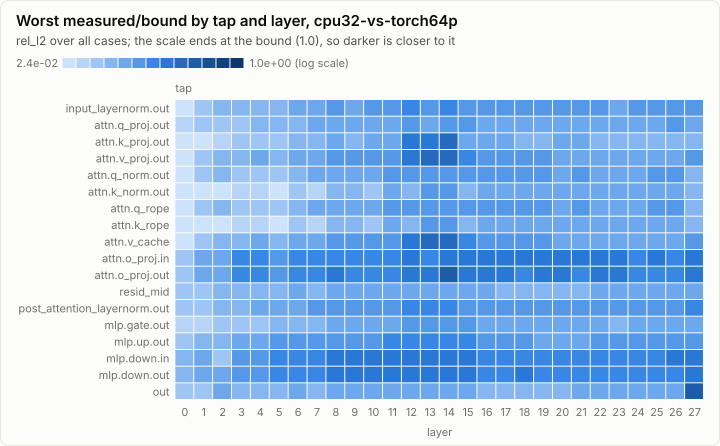

# Parity: CpuRef calibration probe (G2): CpuRef F32 and F64 on the Qwen3-0.6B gate prompts

**PASS.** All 3,162 comparisons are within their bounds.

- Comparisons: 3,162, failed: 0
- Pairs: cpu64-vs-torch64p, cpu32-vs-torch32, cpu32-vs-torch64p; cases: 12
- Closest to its bound: cpu32-vs-torch32 csharp-002 L14.attn.o_proj.out rel_l2: 0.416 of the bound

## Error by layer

Every per-layer tap's rel_l2 against the golden, summarized per layer over all cases and taps. A pair passes when every dot and whisker stays under its bound line.

## Per pair

### cpu64-vs-torch64p: PASS

1,042 comparisons, 0 failed, worst ratio 0.000 of the bound.

### cpu32-vs-torch32: PASS

1,072 comparisons, 0 failed, worst ratio 0.416 of the bound.

### cpu32-vs-torch64p: PASS

1,048 comparisons, 0 failed, worst ratio 0.404 of the bound.

## Per case

| Case | Checks | Failed | Worst comparison | Worst ratio | Logits rel_l2 | Greedy match |
| --- | ---: | ---: | --- | ---: | --- | --- |
| chatml-000 | 11 | 0 | cpu32-vs-torch32 logits rel_l2 | 0.145 | cpu64-vs-torch64p 8.11e-15, cpu32-vs-torch32 4.36e-06, cpu32-vs-torch64p 4.27e-06 | 64/64, 64/64 |
| chatml-027 | 11 | 0 | cpu32-vs-torch32 logits rel_l2 | 0.115 | cpu64-vs-torch64p 6.16e-15, cpu32-vs-torch32 3.44e-06, cpu32-vs-torch64p 3.42e-06 | 64/64, 64/64 |
| csharp-002 | 1,529 | 0 | cpu32-vs-torch32 L14.attn.o_proj.out rel_l2 | 0.416 | cpu64-vs-torch64p 6.39e-15, cpu32-vs-torch32 4.21e-06, cpu32-vs-torch64p 4.21e-06 | 64/64, 64/64 |
| csharp-044 | 11 | 0 | cpu32-vs-torch32 logits max_abs | 0.155 | cpu64-vs-torch64p 5.38e-15, cpu32-vs-torch32 3.15e-06, cpu32-vs-torch64p 3.00e-06 | 64/64, 64/64 |
| design-001 | 11 | 0 | cpu32-vs-torch32 logits rel_l2 | 0.117 | cpu64-vs-torch64p 6.16e-15, cpu32-vs-torch32 3.50e-06, cpu32-vs-torch64p 3.40e-06 | 64/64, 64/64 |
| design-009 | 11 | 0 | cpu32-vs-torch32 logits rel_l2 | 0.132 | cpu64-vs-torch64p 7.02e-15, cpu32-vs-torch32 3.96e-06, cpu32-vs-torch64p 3.89e-06 | 64/64, 64/64 |
| license-001 | 11 | 0 | cpu32-vs-torch32 logits rel_l2 | 0.116 | cpu64-vs-torch64p 6.18e-15, cpu32-vs-torch32 3.47e-06, cpu32-vs-torch64p 3.33e-06 | 64/64, 64/64 |
| license-008 | 11 | 0 | cpu32-vs-torch64p logits rel_l2 | 0.164 | cpu64-vs-torch64p 9.80e-15, cpu32-vs-torch32 4.80e-06, cpu32-vs-torch64p 4.93e-06 | 64/64, 64/64 |
| long-csharp | 8 | 0 | cpu32-vs-torch64p logits rel_l2 | 0.170 | cpu32-vs-torch32 4.84e-06, cpu32-vs-torch64p 5.10e-06 | n/a |
| long-design | 8 | 0 | cpu32-vs-torch32 logits rel_l2 | 0.104 | cpu32-vs-torch32 3.12e-06, cpu32-vs-torch64p 3.06e-06 | n/a |
| multilingual-002 | 1,529 | 0 | cpu32-vs-torch64p L27.out rel_l2 | 0.404 | cpu64-vs-torch64p 7.86e-15, cpu32-vs-torch32 4.25e-06, cpu32-vs-torch64p 4.54e-06 | 64/64, 64/64 |
| multilingual-023 | 11 | 0 | cpu32-vs-torch32 logits rel_l2 | 0.119 | cpu64-vs-torch64p 5.94e-15, cpu32-vs-torch32 3.58e-06, cpu32-vs-torch64p 3.40e-06 | 64/64, 64/64 |

## Closest to the bound

| Pair | Case | Tap | Metric | Measured | Bound | Ratio | Result |
| --- | --- | --- | --- | ---: | ---: | ---: | --- |
| cpu32-vs-torch32 | csharp-002 | L14.attn.o_proj.out | rel_l2 | 1.85e-05 | 4.45e-05 | 0.416 | ✓ pass |
| cpu32-vs-torch64p | multilingual-002 | L27.out | rel_l2 | 1.21e-05 | 3.00e-05 | 0.404 | ✓ pass |
| cpu32-vs-torch32 | csharp-002 | L14.attn.v_cache | rel_l2 | 2.38e-05 | 5.91e-05 | 0.403 | ✓ pass |
| cpu32-vs-torch32 | csharp-002 | L14.attn.v_proj.out | rel_l2 | 2.38e-05 | 5.91e-05 | 0.403 | ✓ pass |
| cpu32-vs-torch32 | csharp-002 | L14.attn.o_proj.in | rel_l2 | 1.15e-05 | 3.00e-05 | 0.382 | ✓ pass |
| cpu32-vs-torch32 | csharp-002 | L13.attn.v_cache | rel_l2 | 2.24e-05 | 5.91e-05 | 0.378 | ✓ pass |
| cpu32-vs-torch32 | csharp-002 | L13.attn.v_proj.out | rel_l2 | 2.24e-05 | 5.91e-05 | 0.378 | ✓ pass |
| cpu32-vs-torch32 | csharp-002 | L14.attn.k_proj.out | rel_l2 | 2.21e-05 | 5.89e-05 | 0.374 | ✓ pass |
| cpu32-vs-torch32 | multilingual-002 | L27.out | rel_l2 | 1.02e-05 | 3.00e-05 | 0.340 | ✓ pass |
| cpu32-vs-torch32 | csharp-002 | L13.attn.k_proj.out | rel_l2 | 1.91e-05 | 5.89e-05 | 0.324 | ✓ pass |
| cpu32-vs-torch64p | csharp-002 | L14.attn.o_proj.out | rel_l2 | 9.69e-06 | 3.00e-05 | 0.323 | ✓ pass |
| cpu32-vs-torch64p | csharp-002 | L14.attn.v_cache | rel_l2 | 1.15e-05 | 3.94e-05 | 0.291 | ✓ pass |
| cpu32-vs-torch64p | csharp-002 | L14.attn.v_proj.out | rel_l2 | 1.15e-05 | 3.94e-05 | 0.291 | ✓ pass |
| cpu32-vs-torch32 | csharp-002 | L12.attn.v_cache | rel_l2 | 1.68e-05 | 5.91e-05 | 0.285 | ✓ pass |
| cpu32-vs-torch32 | csharp-002 | L12.attn.v_proj.out | rel_l2 | 1.68e-05 | 5.91e-05 | 0.285 | ✓ pass |

## Run

| Field | Value |
| --- | --- |
| Run | `20261018-091611-7cb55719` |
| Title | CpuRef calibration probe (G2): CpuRef F32 and F64 on the Qwen3-0.6B gate prompts |
| Kind | parity |
| Status | ok |
| Started | 2026-10-18T09:16:11.293Z |
| Ended | 2026-10-18T09:54:01.979Z |
| Execution class | cpu-f64 cpu, .NET 10.0.13, win-x64+avx2+fma |
| Class id | `f705487c3bfc` |
| Driver | .NET 10.0.13 |
| Commit | not recorded |
| Nodes | 2 |
| Records | 3,162 |
| Synthetic | no |

| Parameter | Value |
| --- | --- |
| golden | goldens/qwen3-0.6b/g1 |
| nodes | n0 cpu-f64, n1 cpu-f32 |
| source | tools/goldens/qwen/cpuref_probe.fsx (G2 calibration evidence, not gate1-cpu) |
| threads | 8 |

### Nodes

| Node | Role | Execution class | Records | Finished | Dropped |
| --- | --- | --- | ---: | --- | ---: |
| n0 | creator | cpu-f64 cpu, .NET 10.0.13, win-x64+avx2+fma | 1,042 | ok | 0 |
| n1 | joined | cpu-f32 cpu, .NET 10.0.13, win-x64+avx2+fma | 2,120 | ok | 0 |

### Log problems

None.
