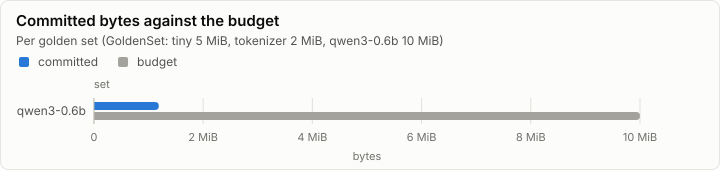
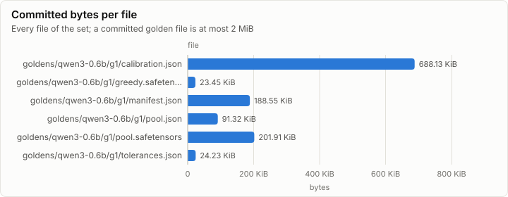

# Golden set: make_qwen (tools/goldens/qwen): Qwen3-0.6B goldens and tolerances

**PASS.** 93 checks pass, and every set is within its budget.

- Sets: qwen3-0.6b 1.19 MiB of 10.00 MiB
- Regeneration: not checked (the tool wrote the set; `--check` compares a regeneration with the committed bytes)
- Double run: identical at 8 threads, identical at 8 threads, identical at 8 threads, identical at 8 threads
- Checks: 93 of 93 pass

## Size

| Set | Committed | Budget | Share | Within budget |
| --- | ---: | ---: | ---: | --- |
| qwen3-0.6b | 1.19 MiB | 10.00 MiB | 11.9% | ✓ pass |

| File | Size | Bytes |
| --- | ---: | ---: |
| goldens/qwen3-0.6b/g1/calibration.json | 688.13 KiB | 704,643 |
| goldens/qwen3-0.6b/g1/greedy.safetensors | 23.45 KiB | 24,008 |
| goldens/qwen3-0.6b/g1/manifest.json | 188.55 KiB | 193,077 |
| goldens/qwen3-0.6b/g1/pool.json | 91.32 KiB | 93,514 |
| goldens/qwen3-0.6b/g1/pool.safetensors | 201.91 KiB | 206,752 |
| goldens/qwen3-0.6b/g1/tolerances.json | 24.23 KiB | 24,807 |

## Checks

Every `goldens.*` check of the run, and the oracle self-tests that carry a measured value.

| Check | Detail | Measured | Result |
| --- | --- | ---: | --- |
| golden.compare | metric=relL2 measured=4.544056313978002E-16 bound=1E-13 check=attention_fp64 pair=oracle-selftest | 4.54e-16 ≤ 1.00e-13 | ✓ pass |
| goldens.selftest | check=bf16_rne |  | ✓ pass |
| golden.compare | metric=relL2 measured=5.205250179253776E-15 bound=1E-13 check=qwen_fp64_forward pair=oracle-selftest | 5.21e-15 ≤ 1.00e-13 | ✓ pass |
| golden.compare | metric=relL2 measured=1.1821761876464124E-16 bound=1E-15 check=rmsnorm_fp64 pair=oracle-selftest | 1.18e-16 ≤ 1.00e-15 | ✓ pass |
| goldens.selftest | check=rng_kats |  | ✓ pass |
| goldens.selftest | check=rope_t_spec |  | ✓ pass |
| goldens.selftest | check=safetensors |  | ✓ pass |
| goldens.tie_probe | set=qwen3-0.6b cases=40 |  | ✓ pass |
| goldens.greedy.f32_argmax_agrees | prompt=chatml-000 oracle=torch32 |  | ✓ pass |
| goldens.greedy.manual_equals_no_cache | prompt=chatml-000 oracle=torch32 |  | ✓ pass |
| goldens.greedy.manual_equals_generate | prompt=chatml-000 oracle=torch32 steps=64 |  | ✓ pass |
| goldens.greedy.f32_argmax_agrees | prompt=chatml-000 oracle=torch64p |  | ✓ pass |
| goldens.greedy.manual_equals_no_cache | prompt=chatml-000 oracle=torch64p |  | ✓ pass |
| goldens.greedy.manual_equals_generate | prompt=chatml-000 oracle=torch64p steps=64 |  | ✓ pass |
| goldens.greedy.torch64p_equals_torch32 | prompt=chatml-000 steps=64 |  | ✓ pass |
| goldens.teacher_forced.oracles_agree | prompt=chatml-000 |  | ✓ pass |
| goldens.greedy.f32_argmax_agrees | prompt=chatml-027 oracle=torch32 |  | ✓ pass |
| goldens.greedy.manual_equals_no_cache | prompt=chatml-027 oracle=torch32 |  | ✓ pass |
| goldens.greedy.manual_equals_generate | prompt=chatml-027 oracle=torch32 steps=64 |  | ✓ pass |
| goldens.greedy.f32_argmax_agrees | prompt=chatml-027 oracle=torch64p |  | ✓ pass |
| goldens.greedy.manual_equals_no_cache | prompt=chatml-027 oracle=torch64p |  | ✓ pass |
| goldens.greedy.manual_equals_generate | prompt=chatml-027 oracle=torch64p steps=64 |  | ✓ pass |
| goldens.greedy.torch64p_equals_torch32 | prompt=chatml-027 steps=64 |  | ✓ pass |
| goldens.teacher_forced.oracles_agree | prompt=chatml-027 |  | ✓ pass |
| goldens.greedy.f32_argmax_agrees | prompt=csharp-002 oracle=torch32 |  | ✓ pass |
| goldens.greedy.manual_equals_no_cache | prompt=csharp-002 oracle=torch32 |  | ✓ pass |
| goldens.greedy.manual_equals_generate | prompt=csharp-002 oracle=torch32 steps=64 |  | ✓ pass |
| goldens.greedy.f32_argmax_agrees | prompt=csharp-002 oracle=torch64p |  | ✓ pass |
| goldens.greedy.manual_equals_no_cache | prompt=csharp-002 oracle=torch64p |  | ✓ pass |
| goldens.greedy.manual_equals_generate | prompt=csharp-002 oracle=torch64p steps=64 |  | ✓ pass |
| goldens.greedy.torch64p_equals_torch32 | prompt=csharp-002 steps=64 |  | ✓ pass |
| goldens.teacher_forced.oracles_agree | prompt=csharp-002 |  | ✓ pass |
| goldens.greedy.f32_argmax_agrees | prompt=csharp-044 oracle=torch32 |  | ✓ pass |
| goldens.greedy.manual_equals_no_cache | prompt=csharp-044 oracle=torch32 |  | ✓ pass |
| goldens.greedy.manual_equals_generate | prompt=csharp-044 oracle=torch32 steps=64 |  | ✓ pass |
| goldens.greedy.f32_argmax_agrees | prompt=csharp-044 oracle=torch64p |  | ✓ pass |
| goldens.greedy.manual_equals_no_cache | prompt=csharp-044 oracle=torch64p |  | ✓ pass |
| goldens.greedy.manual_equals_generate | prompt=csharp-044 oracle=torch64p steps=64 |  | ✓ pass |
| goldens.greedy.torch64p_equals_torch32 | prompt=csharp-044 steps=64 |  | ✓ pass |
| goldens.teacher_forced.oracles_agree | prompt=csharp-044 |  | ✓ pass |
| goldens.greedy.f32_argmax_agrees | prompt=design-001 oracle=torch32 |  | ✓ pass |
| goldens.greedy.manual_equals_no_cache | prompt=design-001 oracle=torch32 |  | ✓ pass |
| goldens.greedy.manual_equals_generate | prompt=design-001 oracle=torch32 steps=64 |  | ✓ pass |
| goldens.greedy.f32_argmax_agrees | prompt=design-001 oracle=torch64p |  | ✓ pass |
| goldens.greedy.manual_equals_no_cache | prompt=design-001 oracle=torch64p |  | ✓ pass |
| goldens.greedy.manual_equals_generate | prompt=design-001 oracle=torch64p steps=64 |  | ✓ pass |
| goldens.greedy.torch64p_equals_torch32 | prompt=design-001 steps=64 |  | ✓ pass |
| goldens.teacher_forced.oracles_agree | prompt=design-001 |  | ✓ pass |
| goldens.greedy.f32_argmax_agrees | prompt=design-009 oracle=torch32 |  | ✓ pass |
| goldens.greedy.manual_equals_no_cache | prompt=design-009 oracle=torch32 |  | ✓ pass |
| goldens.greedy.manual_equals_generate | prompt=design-009 oracle=torch32 steps=64 |  | ✓ pass |
| goldens.greedy.f32_argmax_agrees | prompt=design-009 oracle=torch64p |  | ✓ pass |
| goldens.greedy.manual_equals_no_cache | prompt=design-009 oracle=torch64p |  | ✓ pass |
| goldens.greedy.manual_equals_generate | prompt=design-009 oracle=torch64p steps=64 |  | ✓ pass |
| goldens.greedy.torch64p_equals_torch32 | prompt=design-009 steps=64 |  | ✓ pass |
| goldens.teacher_forced.oracles_agree | prompt=design-009 |  | ✓ pass |
| goldens.greedy.f32_argmax_agrees | prompt=license-001 oracle=torch32 |  | ✓ pass |
| goldens.greedy.manual_equals_no_cache | prompt=license-001 oracle=torch32 |  | ✓ pass |
| goldens.greedy.manual_equals_generate | prompt=license-001 oracle=torch32 steps=64 |  | ✓ pass |
| goldens.greedy.f32_argmax_agrees | prompt=license-001 oracle=torch64p |  | ✓ pass |
| goldens.greedy.manual_equals_no_cache | prompt=license-001 oracle=torch64p |  | ✓ pass |
| goldens.greedy.manual_equals_generate | prompt=license-001 oracle=torch64p steps=64 |  | ✓ pass |
| goldens.greedy.torch64p_equals_torch32 | prompt=license-001 steps=64 |  | ✓ pass |
| goldens.teacher_forced.oracles_agree | prompt=license-001 |  | ✓ pass |
| goldens.greedy.f32_argmax_agrees | prompt=license-008 oracle=torch32 |  | ✓ pass |
| goldens.greedy.manual_equals_no_cache | prompt=license-008 oracle=torch32 |  | ✓ pass |
| goldens.greedy.manual_equals_generate | prompt=license-008 oracle=torch32 steps=64 |  | ✓ pass |
| goldens.greedy.f32_argmax_agrees | prompt=license-008 oracle=torch64p |  | ✓ pass |
| goldens.greedy.manual_equals_no_cache | prompt=license-008 oracle=torch64p |  | ✓ pass |
| goldens.greedy.manual_equals_generate | prompt=license-008 oracle=torch64p steps=64 |  | ✓ pass |
| goldens.greedy.torch64p_equals_torch32 | prompt=license-008 steps=64 |  | ✓ pass |
| goldens.teacher_forced.oracles_agree | prompt=license-008 |  | ✓ pass |
| goldens.greedy.f32_argmax_agrees | prompt=multilingual-002 oracle=torch32 |  | ✓ pass |
| goldens.greedy.manual_equals_no_cache | prompt=multilingual-002 oracle=torch32 |  | ✓ pass |
| goldens.greedy.manual_equals_generate | prompt=multilingual-002 oracle=torch32 steps=64 |  | ✓ pass |
| goldens.greedy.f32_argmax_agrees | prompt=multilingual-002 oracle=torch64p |  | ✓ pass |
| goldens.greedy.manual_equals_no_cache | prompt=multilingual-002 oracle=torch64p |  | ✓ pass |
| goldens.greedy.manual_equals_generate | prompt=multilingual-002 oracle=torch64p steps=64 |  | ✓ pass |
| goldens.greedy.torch64p_equals_torch32 | prompt=multilingual-002 steps=64 |  | ✓ pass |
| goldens.teacher_forced.oracles_agree | prompt=multilingual-002 |  | ✓ pass |
| goldens.greedy.f32_argmax_agrees | prompt=multilingual-023 oracle=torch32 |  | ✓ pass |
| goldens.greedy.manual_equals_no_cache | prompt=multilingual-023 oracle=torch32 |  | ✓ pass |
| goldens.greedy.manual_equals_generate | prompt=multilingual-023 oracle=torch32 steps=64 |  | ✓ pass |
| goldens.greedy.f32_argmax_agrees | prompt=multilingual-023 oracle=torch64p |  | ✓ pass |
| goldens.greedy.manual_equals_no_cache | prompt=multilingual-023 oracle=torch64p |  | ✓ pass |
| goldens.greedy.manual_equals_generate | prompt=multilingual-023 oracle=torch64p steps=64 |  | ✓ pass |
| goldens.greedy.torch64p_equals_torch32 | prompt=multilingual-023 steps=64 |  | ✓ pass |
| goldens.teacher_forced.oracles_agree | prompt=multilingual-023 |  | ✓ pass |
| goldens.double_run_identical | set=qwen3-0.6b threads=8 stage=calibration |  | ✓ pass |
| goldens.double_run_identical | set=qwen3-0.6b threads=8 stage=gate |  | ✓ pass |
| goldens.double_run_identical | set=qwen3-0.6b threads=8 stage=long |  | ✓ pass |
| goldens.double_run_identical | set=qwen3-0.6b threads=8 stage=pool |  | ✓ pass |
| goldens.data_unchanged | set=qwen3-0.6b files=45 |  | ✓ pass |

## Phases

| Phase | Set | Duration |
| --- | --- | ---: |
| goldens.check_model | qwen3-0.6b | 2.17 s |
| goldens.rope | qwen3-0.6b | 12.23 s |
| goldens.selftests | qwen3-0.6b | 4.43 s |
| goldens.pool | qwen3-0.6b | 2852.27 s |
| goldens.calibrate | qwen3-0.6b | 656.49 s |
| goldens.select | qwen3-0.6b | 135.60 s |
| goldens.gate | qwen3-0.6b | 3335.01 s |
| goldens.long | qwen3-0.6b | 227.52 s |

## Run

| Field | Value |
| --- | --- |
| Run | `20261018-120457-85a6c443` |
| Title | make_qwen (tools/goldens/qwen): Qwen3-0.6B goldens and tolerances |
| Kind | parity |
| Status | ok |
| Started | 2026-10-18T12:04:57.569Z |
| Ended | 2026-10-18T14:05:36.250Z |
| Execution class | not recorded |
| Class id | n/a |
| Driver | n/a |
| Commit | `979122fd1b3b9503f5e91767541c90fdd582f2d4` |
| Nodes | 1 |
| Records | 13,723 |
| Synthetic | no |

| Parameter | Value |
| --- | --- |
| check | False |
| force | False |
| keep_data | True |
| quick | False |
| set | qwen3-0.6b/g1 |
| tool | make_qwen |

### Nodes

| Node | Role | Execution class | Records | Finished | Dropped |
| --- | --- | --- | ---: | --- | ---: |
| n0 | creator | not recorded | 13,723 | ok | 0 |

### Log problems

None.
