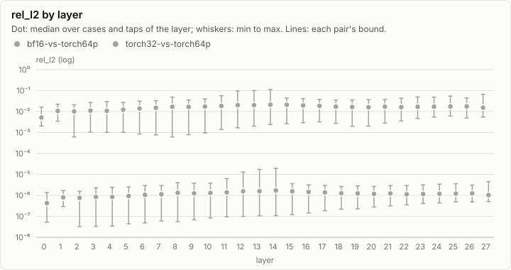
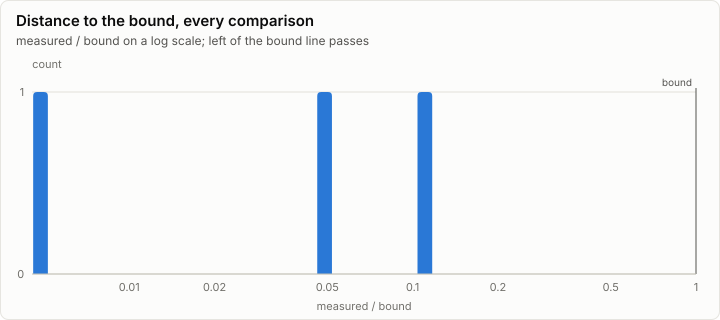
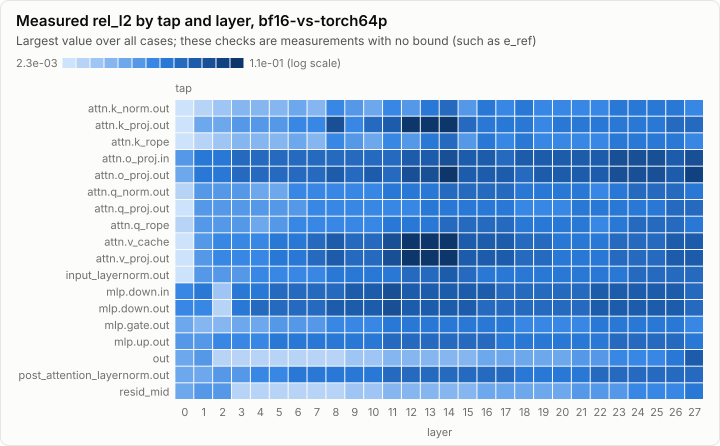
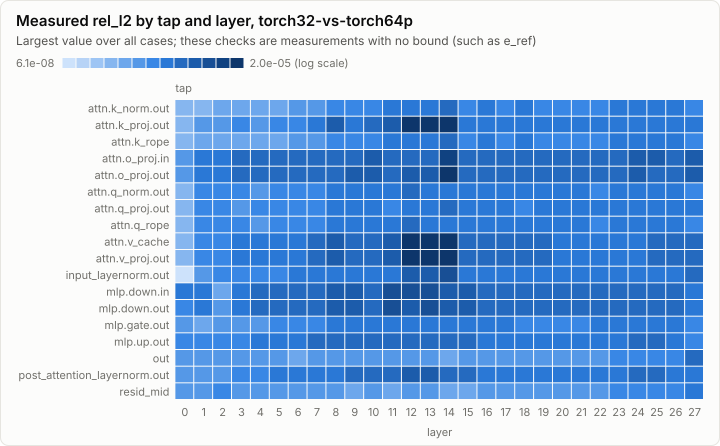
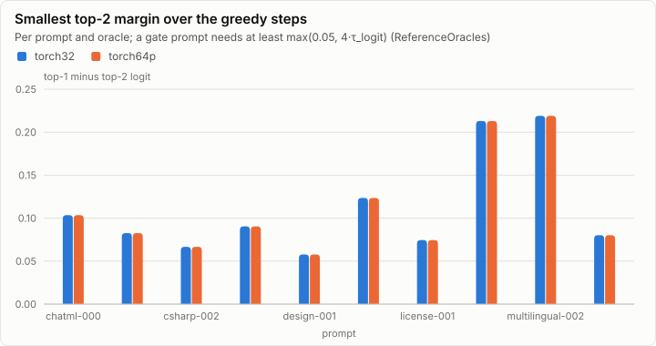

# Parity: make_qwen (tools/goldens/qwen): Qwen3-0.6B goldens and tolerances

**PASS.** All 13,242 comparisons are within their bounds. All 7 oracle self-tests pass.

- Comparisons: 13,242, failed: 0
- Pairs: bf16-vs-torch64p, torch32-vs-torch64p; cases: 21
- Closest to its bound: oracle-selftest (self-test) rmsnorm_fp64 rel_l2: 0.118 of the bound

## Error by layer

Every per-layer tap's rel_l2 against the golden, summarized per layer over all cases and taps. A pair passes when every dot and whisker stays under its bound line.

## Per pair

### bf16-vs-torch64p: PASS

6,084 comparisons, 0 failed, worst ratio n/a of the bound.

### torch32-vs-torch64p: PASS

7,158 comparisons, 0 failed, worst ratio n/a of the bound.

## Per case

| Case | Checks | Failed | Worst comparison | Worst ratio | Logits rel_l2 | Greedy match |
| --- | ---: | ---: | --- | ---: | --- | --- |
| chatml-000 | 1,019 | 0 |  |  | torch32-vs-torch64p 1.78e-06, bf16-vs-torch64p 2.75e-02, torch32-vs-torch64p 1.78e-06 | n/a |
| chatml-002 | 1,016 | 0 |  |  | torch32-vs-torch64p 1.63e-06, bf16-vs-torch64p 2.19e-02 | n/a |
| chatml-027 | 1,019 | 0 |  |  | torch32-vs-torch64p 1.28e-06, bf16-vs-torch64p 2.10e-02, torch32-vs-torch64p 1.28e-06 | n/a |
| csharp-000 | 1,016 | 0 |  |  | torch32-vs-torch64p 1.31e-06, bf16-vs-torch64p 2.07e-02 | n/a |
| csharp-002 | 509 | 0 |  |  | torch32-vs-torch64p 1.52e-06 | n/a |
| csharp-012 | 1,016 | 0 |  |  | torch32-vs-torch64p 1.13e-06, bf16-vs-torch64p 1.74e-02 | n/a |
| csharp-044 | 3 | 0 |  |  | torch32-vs-torch64p 1.12e-06 | n/a |
| design-000 | 1,016 | 0 |  |  | torch32-vs-torch64p 1.20e-06, bf16-vs-torch64p 1.79e-02 | n/a |
| design-001 | 1,019 | 0 |  |  | torch32-vs-torch64p 1.18e-06, bf16-vs-torch64p 1.80e-02, torch32-vs-torch64p 1.18e-06 | n/a |
| design-009 | 3 | 0 |  |  | torch32-vs-torch64p 1.48e-06 | n/a |
| design-013 | 1,016 | 0 |  |  | torch32-vs-torch64p 1.08e-06, bf16-vs-torch64p 1.69e-02 | n/a |
| license-000 | 1,016 | 0 |  |  | torch32-vs-torch64p 2.12e-06, bf16-vs-torch64p 2.98e-02 | n/a |
| license-001 | 3 | 0 |  |  | torch32-vs-torch64p 1.36e-06 | n/a |
| license-002 | 1,016 | 0 |  |  | torch32-vs-torch64p 1.86e-06, bf16-vs-torch64p 2.76e-02 | n/a |
| license-008 | 3 | 0 |  |  | torch32-vs-torch64p 2.25e-06 | n/a |
| long-csharp | 4 | 0 |  |  | torch32-vs-torch64p 1.22e-06 | n/a |
| long-design | 4 | 0 |  |  | torch32-vs-torch64p 1.07e-06 | n/a |
| multilingual-000 | 1,016 | 0 |  |  | torch32-vs-torch64p 1.27e-06, bf16-vs-torch64p 1.89e-02 | n/a |
| multilingual-001 | 1,016 | 0 |  |  | torch32-vs-torch64p 1.94e-06, bf16-vs-torch64p 1.99e-02 | n/a |
| multilingual-002 | 509 | 0 |  |  | torch32-vs-torch64p 1.45e-06 | n/a |
| multilingual-023 | 3 | 0 |  |  | torch32-vs-torch64p 1.42e-06 | n/a |

## Oracle self-tests

7 of 7 pass.

| Self-test | Metric | Measured | Bound | Ratio | Result |
| --- | --- | ---: | ---: | ---: | --- |
| attention_fp64 | rel_l2 | 4.54e-16 | 1.00e-13 | 0.005 | ✓ pass |
| qwen_fp64_forward | rel_l2 | 5.21e-15 | 1.00e-13 | 0.052 | ✓ pass |
| rmsnorm_fp64 | rel_l2 | 1.18e-16 | 1.00e-15 | 0.118 | ✓ pass |
| bf16_rne | exact |  |  |  | ✓ pass |
| rng_kats | exact |  |  |  | ✓ pass |
| rope_t_spec | exact |  |  |  | ✓ pass |
| safetensors | exact |  |  |  | ✓ pass |

## Greedy margins

The smallest margin is 0.0578 (design-001, torch32). The float32 argmax agrees with the oracle at every step of every prompt.

| Prompt | Oracle | Smallest margin | In float32 ulps | float32 argmax agrees |
| --- | --- | ---: | ---: | --- |
| chatml-000 | torch32 | 0.1035 | 54,277 | ✓ pass |
| chatml-000 | torch64p | 0.1035 | 54,281 | ✓ pass |
| chatml-027 | torch32 | 0.0826 | 43,322 | ✓ pass |
| chatml-027 | torch64p | 0.0826 | 43,320 | ✓ pass |
| csharp-002 | torch32 | 0.0666 | 58,588 | ✓ pass |
| csharp-002 | torch64p | 0.0666 | 58,588 | ✓ pass |
| csharp-044 | torch32 | 0.0904 | 47,414 | ✓ pass |
| csharp-044 | torch64p | 0.0904 | 47,411 | ✓ pass |
| design-001 | torch32 | 0.0578 | 30,279 | ✓ pass |
| design-001 | torch64p | 0.0578 | 30,279 | ✓ pass |
| design-009 | torch32 | 0.1235 | 64,773 | ✓ pass |
| design-009 | torch64p | 0.1235 | 64,774 | ✓ pass |
| license-001 | torch32 | 0.0745 | 39,060 | ✓ pass |
| license-001 | torch64p | 0.0745 | 39,063 | ✓ pass |
| license-008 | torch32 | 0.2131 | 111,710 | ✓ pass |
| license-008 | torch64p | 0.2131 | 111,708 | ✓ pass |
| multilingual-002 | torch32 | 0.2191 | 114,862 | ✓ pass |
| multilingual-002 | torch64p | 0.2191 | 114,862 | ✓ pass |
| multilingual-023 | torch32 | 0.0802 | 43,333 | ✓ pass |
| multilingual-023 | torch64p | 0.0802 | 43,329 | ✓ pass |

## Closest to the bound

| Pair | Case | Tap | Metric | Measured | Bound | Ratio | Result |
| --- | --- | --- | --- | ---: | ---: | ---: | --- |
| oracle-selftest | (self-test) | rmsnorm_fp64 | rel_l2 | 1.18e-16 | 1.00e-15 | 0.118 | ✓ pass |
| oracle-selftest | (self-test) | qwen_fp64_forward | rel_l2 | 5.21e-15 | 1.00e-13 | 0.052 | ✓ pass |
| oracle-selftest | (self-test) | attention_fp64 | rel_l2 | 4.54e-16 | 1.00e-13 | 0.005 | ✓ pass |

## Run

| Field | Value |
| --- | --- |
| Run | `20261018-072732-1cc39110` |
| Title | make_qwen (tools/goldens/qwen): Qwen3-0.6B goldens and tolerances |
| Kind | parity |
| Status | ok |
| Started | 2026-10-18T07:27:32.465Z |
| Ended | 2026-10-18T09:15:46.030Z |
| Execution class | not recorded |
| Class id | n/a |
| Driver | n/a |
| Commit | `92e5ba4c5c29be4e436a9586679c8b3b95d0f938` |
| Nodes | 1 |
| Records | 13,722 |
| Synthetic | no |

| Parameter | Value |
| --- | --- |
| check | False |
| quick | False |
| set | qwen3-0.6b/g1 |
| tool | make_qwen |

### Nodes

| Node | Role | Execution class | Records | Finished | Dropped |
| --- | --- | --- | ---: | --- | ---: |
| n0 | creator | not recorded | 13,722 | ok | 0 |

### Log problems

None.
