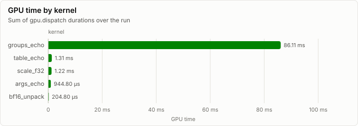
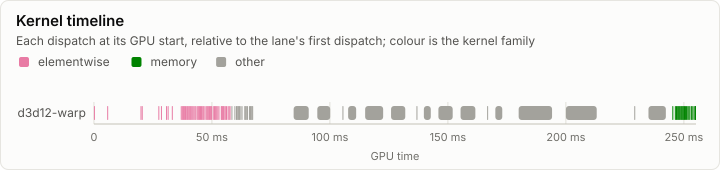
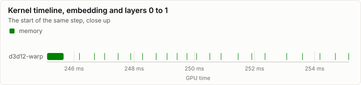
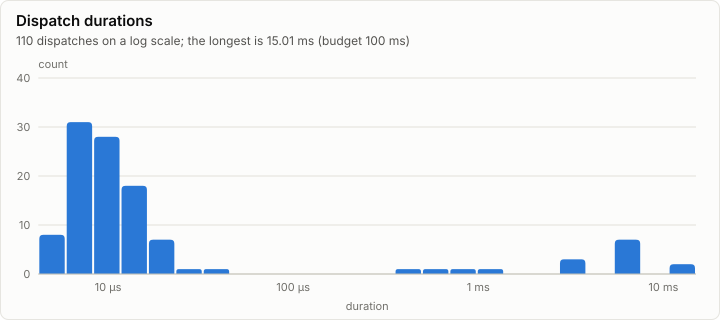

# Kernels: Conformance on d3d12-warp (in-box WARP, R5)

**PASS.** All 28 conformance cases pass. Every dispatch is under the 100 ms budget.

- Conformance cases: 28, failed: 0
- GPU dispatches: 110, total GPU time 89.78 ms

## Conformance matrix

Passing cases out of all cases, per kernel and backend.

| Kernel | Family | d3d12-warp |
| --- | --- | --- |
| scale_f32 | elementwise | ✓ 11/11 |
| bf16_unpack | memory | ✓ 5/5 |
| args_echo | other | ✓ 2/2 |
| groups_echo | other | ✓ 6/6 |
| table_echo | other | ✓ 4/4 |

### Failing cases

_No rows._

## fp32 denormals

The mode each shader backend measured with the `scale_f32` denormal probe right after loading its kernels (GpuBackendInterface). It is fixed within an execution class, and it decides what bit-exact means for a kernel that does fp32 arithmetic (KernelAbiAndCatalog, kernel rules).

| Backend | Node | Blob | fp32 denormals | Bit-exact fp32 arithmetic means |
| --- | --- | --- | --- | --- |
| d3d12-warp | n0 |  | preserve | equal to CpuRef as it is |

The probe's words (`scale_f32`, a = 0.5): each input, what preserve and flush give, and what each measurement returned.

| Input | Preserve | Flush | d3d12-warp n0 |
| --- | --- | --- | --- |
| `3f800000` | 3f000000 | 3f000000 | 3f000000 |
| `01000000` | 00800000 | 00800000 | 00800000 |
| `00800000` | 00400000 | 00000000 | 00400000 |
| `80800000` | 80400000 | 80000000 | 80400000 |
| `00000002` | 00000001 | 00000000 | 00000001 |
| `807ffffe` | 803fffff | 80000000 | 803fffff |
| `00400000` | 00200000 | 00000000 | 00200000 |

## GPU time

## Timeline

### Slowest dispatches

| Kernel | Backend | Layer | Step | Duration | Of budget |
| --- | --- | ---: | ---: | ---: | ---: |
| groups_echo | d3d12-warp |  |  | 15.01 ms | 15.0% |
| groups_echo | d3d12-warp |  |  | 13.32 ms | 13.3% |
| groups_echo | d3d12-warp |  |  | 7.17 ms | 7.2% |
| groups_echo | d3d12-warp |  |  | 6.72 ms | 6.7% |
| groups_echo | d3d12-warp |  |  | 6.59 ms | 6.6% |
| groups_echo | d3d12-warp |  |  | 6.54 ms | 6.5% |
| groups_echo | d3d12-warp |  |  | 6.52 ms | 6.5% |
| groups_echo | d3d12-warp |  |  | 6.48 ms | 6.5% |
| groups_echo | d3d12-warp |  |  | 6.38 ms | 6.4% |
| groups_echo | d3d12-warp |  |  | 3.81 ms | 3.8% |

## Run

| Field | Value |
| --- | --- |
| Run | `20261018-071751-a0558ce5` |
| Title | Conformance on d3d12-warp (in-box WARP, R5) |
| Kind | kernels |
| Status | ok |
| Started | 2026-10-18T07:17:51.245Z |
| Ended | 2026-10-18T07:17:51.722Z |
| Execution class | d3d12-warp pci:1414:008c, 10.0.26100.9711, win-x64+avx2+fma shaders b12cabbf300b |
| Class id | `ab6cc56163bb` |
| Driver | 10.0.26100.9711 |
| Commit | `b13765b8a194149a971511f4bbdee80a789c0520` |
| Nodes | 1 |
| Records | 1,090 |
| Synthetic | no |

| Parameter | Value |
| --- | --- |
| backend | d3d12-warp |
| cases | 54 |
| device | Microsoft Basic Render Driver |
| source | tests/Lrm.Kernels.Conformance (ConformanceHarness) |

### Nodes

| Node | Role | Execution class | Records | Finished | Dropped |
| --- | --- | --- | ---: | --- | ---: |
| n0 | creator | d3d12-warp pci:1414:008c, 10.0.26100.9711, win-x64+avx2+fma shaders b12cabbf300b | 1,090 | ok | 0 |

### Log problems

None.
