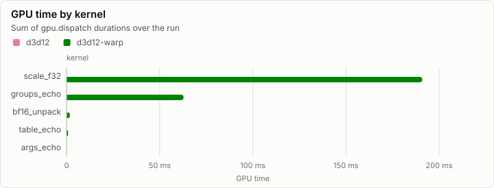
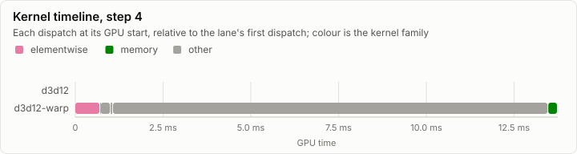
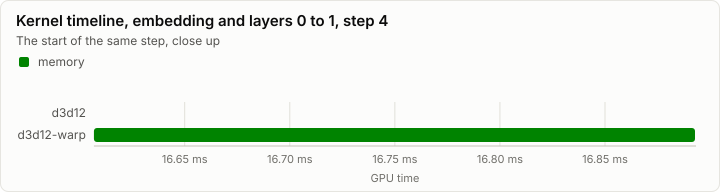
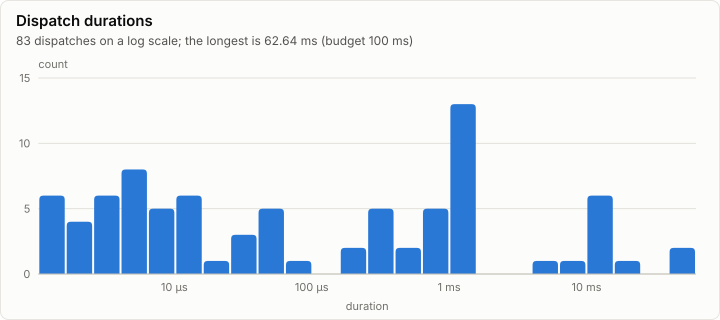

# Kernels: WARP spike: device, denormal probe, D1's selftests (R5)

No conformance cases were recorded. Every dispatch is under the 100 ms budget.

- Conformance cases: 0, failed: 0
- GPU dispatches: 83, total GPU time 256.40 ms

## Conformance matrix

Passing cases out of all cases, per kernel and backend.

_No rows._

### Failing cases

_No rows._

## fp32 denormals

The mode each shader backend measured with the `scale_f32` denormal probe right after loading its kernels (GpuBackendInterface). It is fixed within an execution class, and it decides what bit-exact means for a kernel that does fp32 arithmetic (KernelAbiAndCatalog, kernel rules).

| Backend | Node | Blob | fp32 denormals | Bit-exact fp32 arithmetic means |
| --- | --- | --- | --- | --- |
| d3d12 | hw |  | preserve | equal to CpuRef as it is |
| d3d12-warp | n0 |  | preserve | equal to CpuRef as it is |
| d3d12-warp | n0 | control, no -denorm | flush | equal to CpuRef with every fp32 denormal input and result set to zero of the same sign |

The probe's words (`scale_f32`, a = 0.5): each input, what preserve and flush give, and what each measurement returned.

| Input | Preserve | Flush | d3d12 hw | d3d12-warp n0 | d3d12-warp n0, control, no -denorm |
| --- | --- | --- | --- | --- | --- |
| `3f800000` | 3f000000 | 3f000000 | 3f000000 | 3f000000 | 3f000000 |
| `01000000` | 00800000 | 00800000 | 00800000 | 00800000 | 00800000 |
| `00800000` | 00400000 | 00000000 | 00400000 | 00400000 | 00000000 |
| `80800000` | 80400000 | 80000000 | 80400000 | 80400000 | 80000000 |
| `00000002` | 00000001 | 00000000 | 00000001 | 00000001 | 00000000 |
| `807ffffe` | 803fffff | 80000000 | 803fffff | 803fffff | 80000000 |
| `00400000` | 00200000 | 00000000 | 00200000 | 00200000 | 00000000 |

## GPU time

## Timeline

### Slowest dispatches

| Kernel | Backend | Layer | Step | Duration | Of budget |
| --- | --- | ---: | ---: | ---: | ---: |
| scale_f32 | d3d12-warp |  |  | 62.64 ms | 62.6% |
| scale_f32 | d3d12-warp |  |  | 58.69 ms | 58.7% |
| scale_f32 | d3d12-warp |  |  | 18.25 ms | 18.2% |
| scale_f32 | d3d12-warp |  |  | 15.68 ms | 15.7% |
| groups_echo | d3d12-warp |  | 2 | 13.13 ms | 13.1% |
| groups_echo | d3d12-warp |  | 1 | 13.00 ms | 13.0% |
| groups_echo | d3d12-warp |  | 4 | 12.40 ms | 12.4% |
| groups_echo | d3d12-warp |  | 1 | 12.20 ms | 12.2% |
| groups_echo | d3d12-warp |  | 2 | 11.88 ms | 11.9% |
| scale_f32 | d3d12-warp |  |  | 6.69 ms | 6.7% |

## Run

| Field | Value |
| --- | --- |
| Run | `20261018-071748-c5cfc372` |
| Title | WARP spike: device, denormal probe, D1's selftests (R5) |
| Kind | kernels |
| Status | ok |
| Started | 2026-10-18T07:17:48.334Z |
| Ended | 2026-10-18T07:17:51.720Z |
| Execution class | d3d12-warp pci:1414:008c, 10.0.26100.9711, win-x64+avx2+fma shaders b12cabbf300b |
| Class id | `ab6cc56163bb` |
| Driver | 10.0.26100.9711 |
| Commit | `b13765b8a194149a971511f4bbdee80a789c0520` |
| Nodes | 2 |
| Records | 781 |
| Synthetic | no |

| Parameter | Value |
| --- | --- |
| D3D12Core.dll | 10.0.26100.9549 |
| D3D12SDKLayers.dll | missing |
| affinity_mask | f |
| d3d10warp.dll | 10.0.26100.9711 |
| d3d12.dll | 10.0.26100.9549 |
| device | Microsoft Basic Render Driver |
| driver | 10.0.26100.9711 |
| dxgi.dll | 10.0.26100.9711 |
| dxil_flags | -T cs_6_6 -E main -HV 2021 -O3 -WX -denorm preserve |
| machine_cpus | 32 |
| os | 10.0.26200.9711 |
| os_edition | Professional 25H2 |
| source | spikes/d3d12 (R5 WARP spike) |
| warp_cpus | 4 |
| warp_cpus_requested | 4 |

### Nodes

| Node | Role | Execution class | Records | Finished | Dropped |
| --- | --- | --- | ---: | --- | ---: |
| hw | joined | d3d12 pci:10de:2704, 32.0.16.1692, win-x64 shaders b12cabbf300b | 77 | ok | 0 |
| n0 | creator | d3d12-warp pci:1414:008c, 10.0.26100.9711, win-x64+avx2+fma shaders b12cabbf300b | 704 | ok | 0 |

### Log problems

None.
