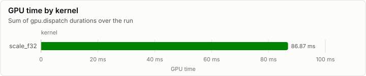
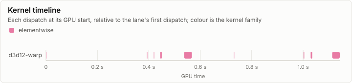
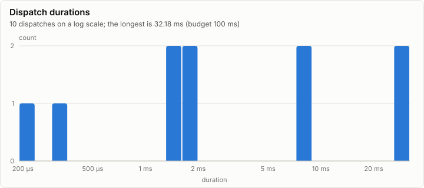

# Kernels: WARP spike: device, denormal probe, D1's selftests (R5)

No conformance cases were recorded. Every dispatch is under the 100 ms budget.

- Conformance cases: 0, failed: 0
- GPU dispatches: 10, total GPU time 86.87 ms

## Conformance matrix

Passing cases out of all cases, per kernel and backend.

_No rows._

### Failing cases

_No rows._

## fp32 denormals

The mode each shader backend measured with the `scale_f32` denormal probe right after loading its kernels (GpuBackendInterface). It is fixed within an execution class, and it decides what bit-exact means for a kernel that does fp32 arithmetic (KernelAbiAndCatalog, kernel rules).

| Backend | Node | Blob | fp32 denormals | Bit-exact fp32 arithmetic means |
| --- | --- | --- | --- | --- |
| d3d12-warp | n0 |  | preserve | equal to CpuRef as it is |

The probe's words (`scale_f32`, a = 0.5): each input, what preserve and flush give, and what each measurement returned.

| Input | Preserve | Flush | d3d12-warp n0 |
| --- | --- | --- | --- |
| `3f800000` | 3f000000 | 3f000000 | 3f000000 |
| `01000000` | 00800000 | 00800000 | 00800000 |
| `00800000` | 00400000 | 00000000 | 00400000 |
| `80800000` | 80400000 | 80000000 | 80400000 |
| `00000002` | 00000001 | 00000000 | 00000001 |
| `807ffffe` | 803fffff | 80000000 | 803fffff |
| `00400000` | 00200000 | 00000000 | 00200000 |

## GPU time

## Timeline

### Slowest dispatches

| Kernel | Backend | Layer | Step | Duration | Of budget |
| --- | --- | ---: | ---: | ---: | ---: |
| scale_f32 | d3d12-warp |  |  | 32.18 ms | 32.2% |
| scale_f32 | d3d12-warp |  |  | 31.48 ms | 31.5% |
| scale_f32 | d3d12-warp |  |  | 8.02 ms | 8.0% |
| scale_f32 | d3d12-warp |  |  | 7.97 ms | 8.0% |
| scale_f32 | d3d12-warp |  |  | 1.99 ms | 2.0% |
| scale_f32 | d3d12-warp |  |  | 1.92 ms | 1.9% |
| scale_f32 | d3d12-warp |  |  | 1.41 ms | 1.4% |
| scale_f32 | d3d12-warp |  |  | 1.40 ms | 1.4% |
| scale_f32 | d3d12-warp |  |  | 322.10 µs | 0.3% |
| scale_f32 | d3d12-warp |  |  | 190.00 µs | 0.2% |

## Run

| Field | Value |
| --- | --- |
| Run | `20261018-064730-b627c7d4` |
| Title | WARP spike: device, denormal probe, D1's selftests (R5) |
| Kind | kernels |
| Status | ok |
| Started | 2026-10-18T06:47:30.320Z |
| Ended | 2026-10-18T06:47:31.747Z |
| Execution class | d3d12-warp pci:1414:008c, 10.0.26100.9711, win-x64+avx2+fma shaders b12cabbf300b |
| Class id | `ab6cc56163bb` |
| Driver | 10.0.26100.9711 |
| Commit | `8051ad650d289d64747adbd29bb029a64f995eac` |
| Nodes | 1 |
| Records | 98 |
| Synthetic | no |

| Parameter | Value |
| --- | --- |
| D3D12Core.dll | 10.0.26100.9549 |
| affinity_mask | ff |
| d3d10warp.dll | 10.0.26100.9711 |
| d3d12.dll | 10.0.26100.9549 |
| device | Microsoft Basic Render Driver |
| driver | 10.0.26100.9711 |
| dxgi.dll | 10.0.26100.9711 |
| dxil_flags | -T cs_6_6 -E main -HV 2021 -O3 -WX -denorm preserve |
| machine_cpus | 32 |
| os | 10.0.26200.9711 |
| os_edition | Professional 25H2 |
| source | spikes/d3d12 (R5 WARP spike) |
| warp_cpus | 8 |
| warp_cpus_requested | 8 |

### Nodes

| Node | Role | Execution class | Records | Finished | Dropped |
| --- | --- | --- | ---: | --- | ---: |
| n0 | creator | d3d12-warp pci:1414:008c, 10.0.26100.9711, win-x64+avx2+fma shaders b12cabbf300b | 98 | ok | 0 |

### Log problems

None.
