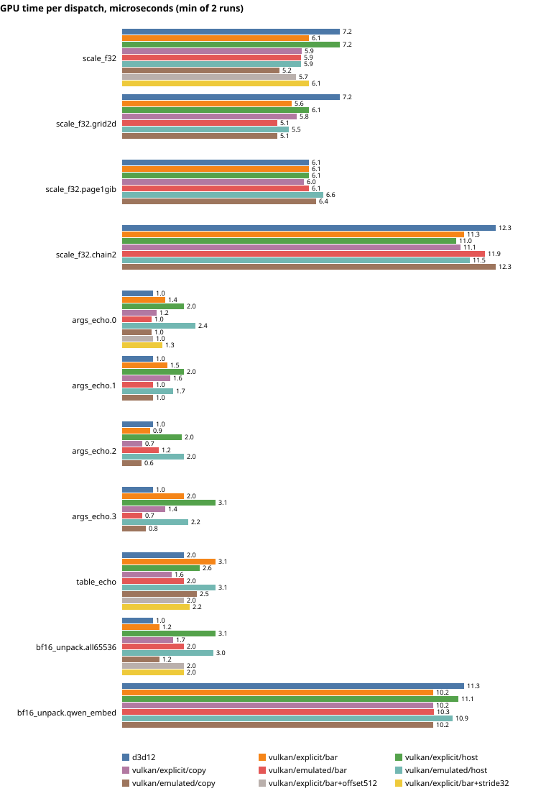

# R1 spike results

Generated by `spikes/vk-heap` (VkHeapSpike) from one gpu-tier run on both backends. Every case runs twice and must give identical bytes; every gating case is compared word by word with the CPU reference.

- Run `20261017-232353-70fcb924` (run log under `LRM_DATA/runs/20261017-232353-70fcb924`)
- Shaders: DXC 1.9.2609.5, ShaderSetHash `6017356f3ff6e3a8d06397f70723eff8cf6a5e41fd3a5330b6f9b0fead5caebd`
- d3d12, vulkan/emulated/bar, vulkan/emulated/copy, vulkan/emulated/host, vulkan/explicit/bar, vulkan/explicit/copy, vulkan/explicit/host (7 configurations): scale_f32.edges (informational): 384 of 1024 words differ from the CPU; first (got/expected) [0] 0x00000000/0x00000001, [1] 0x00000000/0x006487ee, [6] 0x7fffffff/0x7fc00006, [8] 0x00000000/0x00000007, [9] 0x00000000/0x006487f5, [14] 0x7fffffff/0x7fc0000e, [16] 0x00000000/0x0000000d, [17] 0x00000000/0x006487fb
- d3d12: NVIDIA GeForce RTX 4080, UMD 32.0.16.1692, highest SM 0x68, binding tier 3, CBV_SRV_UAV increment 32 B, timestamp 1000000000 Hz
- dxc -fspv-use-descriptor-heap on scale_f32 (RWByteAddressBuffer): does not compile: error: UAV support not implemented with non-emulated heaps.
- dxc: uint d[32] in the ArgBlock is a 500-byte legacy cbuffer on DXIL but 128 bytes (stride 4) on SPIR-V; uint4 d[8] is 128 bytes, stride 16, on both
- spirv args_echo emulated: 2 aliased variables at set 0 binding 0
- spirv bf16_unpack emulated: 3 aliased variables at set 0 binding 0
- spirv scale_f32 emulated: 3 aliased variables at set 0 binding 0
- spirv table_echo emulated: 3 aliased variables at set 0 binding 0
- vulkan heap: bufferDescriptorSize 16 (align 8), imageDescriptorAlignment 32, resourceHeapAlignment 64, minResourceHeapReservedRange 96768, maxResourceHeapSize 33554432, maxPushDataSize 256; geometry: stride 16, slots 1024 B, reserved [1024, +96768), heap 97792 B
- vulkan memory type 1: DEVICE_LOCAL, heap 0 (16048 MiB, DEVICE_LOCAL)
- vulkan memory type 2: HOST_VISIBLE|HOST_COHERENT, heap 1 (32647 MiB)
- vulkan memory type 3: HOST_VISIBLE|HOST_COHERENT|HOST_CACHED, heap 1 (32647 MiB)
- vulkan memory type 4: DEVICE_LOCAL|HOST_VISIBLE|HOST_COHERENT, heap 0 (16048 MiB, DEVICE_LOCAL)
- vulkan memory types used: pages 1, upload 2, readback 3, heap [(Bar, 4); (HostMemory, 2); (CopyToDeviceLocal, 1)]; minStorageBufferOffsetAlignment 16, maxStorageBufferRange 4294967295
- vulkan/emulated/bar, vulkan/emulated/copy, vulkan/emulated/host, vulkan/explicit/bar, vulkan/explicit/copy, vulkan/explicit/host (6 configurations): scale_f32.edges (informational) vs d3d12: identical
- vulkan/emulated/bar, vulkan/explicit/bar (2 configurations): heap at 0x2ffe30000 (buffer alignment 64, memory type 4); reserved range bytes changed by the driver: 0; slot 1 descriptor bytes 00001707000000000000000200000000
- vulkan/emulated/copy, vulkan/explicit/copy (2 configurations): heap at 0x2ffe30000 (buffer alignment 64, memory type 1); reserved range bytes changed by the driver: not observable (device-local); slot 1 descriptor bytes 00001707000000000000000200000000
- vulkan/emulated/host, vulkan/explicit/host (2 configurations): heap at 0x2ffe30000 (buffer alignment 64, memory type 2); reserved range bytes changed by the driver: 0; slot 1 descriptor bytes 00001707000000000000000200000000
- vulkan: NVIDIA GeForce RTX 4080, NVIDIA 616.92, API 1.4.351, queue family 2 (flags 0xe, 64 timestamp bits, 1 ns/tick)

## Bit-exactness and GPU time

Each cell: words that differ from the CPU reference / GPU microseconds for the job's dispatches (minimum of two runs). Every run-twice comparison was identical unless a cell says DIFF.

| Case | Gating | d3d12 | vulkan/explicit/bar | vulkan/explicit/host | vulkan/explicit/copy | vulkan/emulated/bar | vulkan/emulated/host | vulkan/emulated/copy | vulkan/explicit/bar+offset512 | vulkan/explicit/bar+stride32 |
| --- | --- | --- | --- | --- | --- | --- | --- | --- | --- | --- |
| scale_f32 | yes | 0 / 6.1 | 0 / 6.1 | 0 / 7.2 | 0 / 5.7 | 0 / 7.2 | 0 / 7.2 | 0 / 6.1 | 0 / 5.5 | 0 / 6.1 |
| scale_f32.grid2d | yes | 0 / 6.1 | 0 / 5.3 | 0 / 7.2 | 0 / 6.1 | 0 / 5.1 | 0 / 5.9 | 0 / 5.3 |  |  |
| scale_f32.page1gib | yes | 0 / 6.1 | 0 / 6.1 | 0 / 8.2 | 0 / 5.2 | 0 / 6.1 | 0 / 7.0 | 0 / 6.1 |  |  |
| scale_f32.chain2 | yes | 0 / 12.3 | 0 / 11.3 | 0 / 13.3 | 0 / 11.3 | 0 / 11.8 | 0 / 12.3 | 0 / 11.5 |  |  |
| args_echo.0 | yes | 0 / 1.0 | 0 / 1.6 | 0 / 1.8 | 0 / 1.0 | 0 / 1.3 | 0 / 2.0 | 0 / 0.8 | 0 / 1.3 | 0 / 1.0 |
| args_echo.1 | yes | 0 / 1.0 | 0 / 0.7 | 0 / 1.8 | 0 / 1.5 | 0 / 1.3 | 0 / 2.2 | 0 / 1.0 |  |  |
| args_echo.2 | yes | 0 / 1.0 | 0 / 1.0 | 0 / 1.6 | 0 / 1.0 | 0 / 2.0 | 0 / 2.5 | 0 / 1.0 |  |  |
| args_echo.3 | yes | 0 / 1.0 | 0 / 1.0 | 0 / 3.1 | 0 / 1.0 | 0 / 1.5 | 0 / 2.0 | 0 / 1.0 |  |  |
| table_echo | yes | 0 / 2.0 | 0 / 1.9 | 0 / 2.6 | 0 / 2.0 | 0 / 2.9 | 0 / 3.1 | 0 / 1.6 | 0 / 2.1 | 0 / 2.1 |
| bf16_unpack.all65536 | yes | 0 / 2.0 | 0 / 1.0 | 0 / 3.1 | 0 / 1.6 | 0 / 1.5 | 0 / 2.2 | 0 / 1.2 | 0 / 2.0 | 0 / 1.7 |
| bf16_unpack.qwen_embed | yes | 0 / 11.3 | 0 / 10.2 | 0 / 11.3 | 0 / 10.2 | 0 / 9.9 | 0 / 11.3 | 0 / 10.2 |  |  |
| scale_f32.edges | no | 384 / 1.0 | 384 / 1.8 | 384 / 2.0 | 384 / 1.6 | 384 / 1.7 | 384 / 1.6 | 384 / 1.0 |  |  |

## Output digests

SHA-256 of each case's output bytes. One digest per case means every configuration, on both backends, produced the same bits.

| Case | SHA-256 (first 16 hex) | Configurations |
| --- | --- | --- |
| scale_f32 | `318f85de8df292a3` | 9: d3d12, vulkan/explicit/bar, vulkan/explicit/host, vulkan/explicit/copy, vulkan/emulated/bar, vulkan/emulated/host, vulkan/emulated/copy, vulkan/explicit/bar+offset512, vulkan/explicit/bar+stride32 |
| scale_f32.grid2d | `318f85de8df292a3` | 7: d3d12, vulkan/explicit/bar, vulkan/explicit/host, vulkan/explicit/copy, vulkan/emulated/bar, vulkan/emulated/host, vulkan/emulated/copy |
| scale_f32.page1gib | `bb736613212c2889` | 7: d3d12, vulkan/explicit/bar, vulkan/explicit/host, vulkan/explicit/copy, vulkan/emulated/bar, vulkan/emulated/host, vulkan/emulated/copy |
| scale_f32.chain2 | `8f6bc4a024e46f9d` | 7: d3d12, vulkan/explicit/bar, vulkan/explicit/host, vulkan/explicit/copy, vulkan/emulated/bar, vulkan/emulated/host, vulkan/emulated/copy |
| args_echo.0 | `74f5e898a05c7e20` | 9: d3d12, vulkan/explicit/bar, vulkan/explicit/host, vulkan/explicit/copy, vulkan/emulated/bar, vulkan/emulated/host, vulkan/emulated/copy, vulkan/explicit/bar+offset512, vulkan/explicit/bar+stride32 |
| args_echo.1 | `068779f0d6553071` | 7: d3d12, vulkan/explicit/bar, vulkan/explicit/host, vulkan/explicit/copy, vulkan/emulated/bar, vulkan/emulated/host, vulkan/emulated/copy |
| args_echo.2 | `7c6f5a768bb41d1e` | 7: d3d12, vulkan/explicit/bar, vulkan/explicit/host, vulkan/explicit/copy, vulkan/emulated/bar, vulkan/emulated/host, vulkan/emulated/copy |
| args_echo.3 | `b549392684e3316f` | 7: d3d12, vulkan/explicit/bar, vulkan/explicit/host, vulkan/explicit/copy, vulkan/emulated/bar, vulkan/emulated/host, vulkan/emulated/copy |
| table_echo | `aa059945b67926fb` | 9: d3d12, vulkan/explicit/bar, vulkan/explicit/host, vulkan/explicit/copy, vulkan/emulated/bar, vulkan/emulated/host, vulkan/emulated/copy, vulkan/explicit/bar+offset512, vulkan/explicit/bar+stride32 |
| bf16_unpack.all65536 | `9207d7eb28680a09` | 9: d3d12, vulkan/explicit/bar, vulkan/explicit/host, vulkan/explicit/copy, vulkan/emulated/bar, vulkan/emulated/host, vulkan/emulated/copy, vulkan/explicit/bar+offset512, vulkan/explicit/bar+stride32 |
| bf16_unpack.qwen_embed | `84975a44c765aaca` | 7: d3d12, vulkan/explicit/bar, vulkan/explicit/host, vulkan/explicit/copy, vulkan/emulated/bar, vulkan/emulated/host, vulkan/emulated/copy |
| scale_f32.edges | `c5d2ce0fc7091ffe` | 7: d3d12, vulkan/explicit/bar, vulkan/explicit/host, vulkan/explicit/copy, vulkan/emulated/bar, vulkan/emulated/host, vulkan/emulated/copy |
