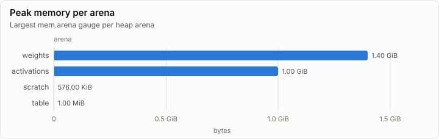

# Inference: D3D12 backend: selftests, probe, soak and transfers (D1)

| Prefill | Decode | First token | FLOPs per token | Achieved |
| ---: | ---: | ---: | ---: | ---: |
| n/a | n/a | n/a | n/a | n/a |

## Speed

_No rows._

## Layers

## Memory

| Node | Arena | Peak | Last | Samples |
| --- | --- | ---: | ---: | ---: |
| n0 | weights | 1.40 GiB | 128.00 KiB | 11 |
| n0 | activations | 1.00 GiB | 320.00 KiB | 15 |
| n0 | scratch | 576.00 KiB | 576.00 KiB | 11 |
| n0 | table | 1.00 MiB | 1.00 MiB | 17 |

## Metering

Resource use attributed to node, component and stage (layers summed). Wall time is span self time, so nested spans are not counted twice.

| Node | Component | Stage | Wall (self) | GPU | FLOPs | Bytes moved | Tokens | Records |
| --- | --- | --- | ---: | ---: | ---: | ---: | ---: | ---: |
| n0 | (none) |  | 2.09 s | 34.72 ms | 0 | 5.64 GiB | 0 | 20,896 |

## Run

| Field | Value |
| --- | --- |
| Run | `20261018-051521-4e953457` |
| Title | D3D12 backend: selftests, probe, soak and transfers (D1) |
| Kind | kernels |
| Status | ok |
| Started | 2026-10-18T05:15:21.370Z |
| Ended | 2026-10-18T05:15:33.793Z |
| Execution class | d3d12 pci:10de:2704, 32.0.16.1692, win-x64 shaders b12cabbf300b |
| Class id | `9469669b5935` |
| Driver | 32.0.16.1692 |
| Commit | `2095ab0bfc468e33185c07f77892179623b88fb4` |
| Nodes | 1 |
| Records | 21,279 |
| Synthetic | no |

| Parameter | Value |
| --- | --- |
| device | NVIDIA GeForce RTX 4080 |
| driver | 32.0.16.1692 |
| dxil_flags | -T cs_6_6 -E main -HV 2021 -O3 -WX -denorm preserve |
| source | tests/Lrm.Gpu.D3D12.Tests (gpu tier) |

### Nodes

| Node | Role | Execution class | Records | Finished | Dropped |
| --- | --- | --- | ---: | --- | ---: |
| n0 | creator | d3d12 pci:10de:2704, 32.0.16.1692, win-x64 shaders b12cabbf300b | 21,279 | ok | 0 |

### Log problems

None.
