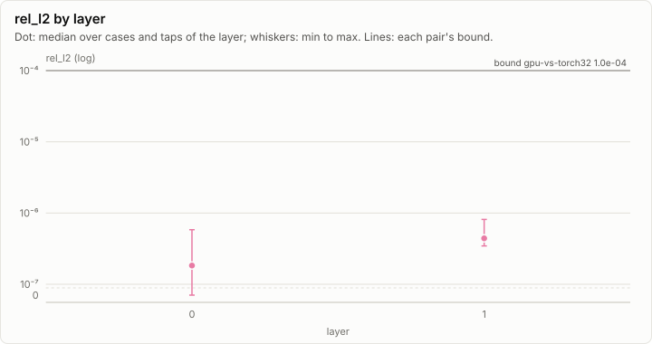
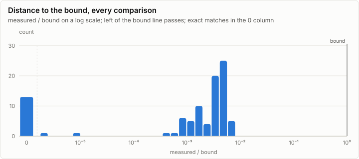
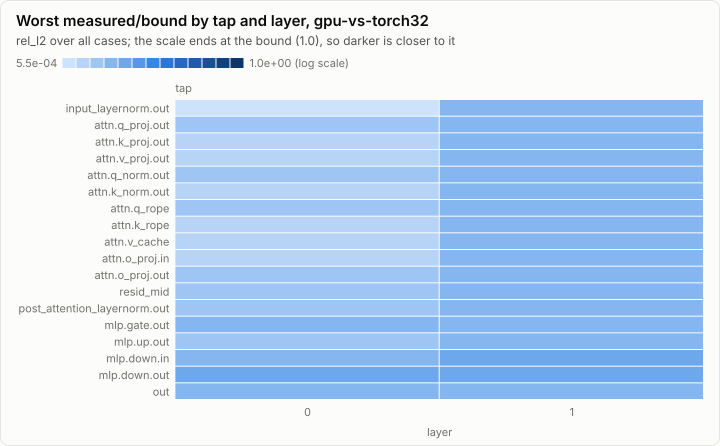

# Parity: Tiny model: the GPU executor (X1a) on cpu-device against cpu-f32 and torch32

**PASS.** All 84 comparisons are within their bounds. All 10 oracle self-tests pass.

- Comparisons: 84, failed: 0
- Pairs: gpu-vs-torch32; cases: 2
- Closest to its bound: gpu-vs-torch32 p0 L1.mlp.down.out rel_l2: 0.008 of the bound

## Error by layer

Every per-layer tap's rel_l2 against the golden, summarized per layer over all cases and taps. A pair passes when every dot and whisker stays under its bound line.

## Per pair

### gpu-vs-torch32: PASS

84 comparisons, 0 failed, worst ratio 0.008 of the bound.

## Per case

| Case | Checks | Failed | Worst comparison | Worst ratio | Logits rel_l2 | Greedy match |
| --- | ---: | ---: | --- | ---: | --- | --- |
| p0 | 42 | 0 | gpu-vs-torch32 L1.mlp.down.out rel_l2 | 0.008 | gpu-vs-torch32 5.57e-07 | 16/16 |
| p1 | 42 | 0 | gpu-vs-torch32 L1.mlp.down.in rel_l2 | 0.007 | gpu-vs-torch32 3.90e-07 | 16/16 |

## Oracle self-tests

10 of 10 pass.

| Self-test | Metric | Measured | Bound | Ratio | Result |
| --- | --- | ---: | ---: | ---: | --- |
| cpu-device last-row head = last row of the full head (p2) | exact | 0 | 0 | 0.000 | ✓ pass |
| cpu-device 1 thread = 8 threads (p2, prefill + 3 steps) | exact | 0 | 0 | 0.000 | ✓ pass |
| cpu-device = cpu-f32 (p1, a 1-token prefill + 15 decode steps: logits, 39 taps, caches) | exact | 0 | 0 | 0.000 | ✓ pass |
| cpu-device = cpu-f32 (p0, a 13-token prefill + 15 decode steps: logits, 39 taps, caches) | exact | 0 | 0 | 0.000 | ✓ pass |
| cpu-device two stages = one stage = cpu-f32 two stages (p0, prefill + 15 steps) | exact | 0 | 0 | 0.000 | ✓ pass |
| cpu-device with split dispatches = without (p2, prefill + 15 steps) | exact | 0 | 0 | 0.000 | ✓ pass |
| cpu-device prefill = decode (p2, 70 tokens: logits, caches, 39 taps) | exact | 0 | 0 | 0.000 | ✓ pass |
| cpu-device prefill = 64 + 6 (p2, 70 tokens: logits, caches, 39 taps) | exact | 0 | 0 | 0.000 | ✓ pass |
| cpu-device prefill = 10 + 31 + 1 + 28 (p2, 70 tokens: logits, caches, 39 taps) | exact | 0 | 0 | 0.000 | ✓ pass |
| cpu-device = cpu-f32 (p2, 70-token prefill: logits, caches, 39 taps) | exact | 0 | 0 | 0.000 | ✓ pass |

## Closest to the bound

| Pair | Case | Tap | Metric | Measured | Bound | Ratio | Result |
| --- | --- | --- | --- | ---: | ---: | ---: | --- |
| gpu-vs-torch32 | p0 | L1.mlp.down.out | rel_l2 | 8.13e-07 | 1.00e-04 | 0.008 | ✓ pass |
| gpu-vs-torch32 | p0 | L1.mlp.down.in | rel_l2 | 7.58e-07 | 1.00e-04 | 0.008 | ✓ pass |
| gpu-vs-torch32 | p1 | L1.mlp.down.in | rel_l2 | 7.33e-07 | 1.00e-04 | 0.007 | ✓ pass |
| gpu-vs-torch32 | p1 | L1.mlp.down.out | rel_l2 | 6.77e-07 | 1.00e-04 | 0.007 | ✓ pass |
| gpu-vs-torch32 | p0 | L0.mlp.down.out | rel_l2 | 5.83e-07 | 1.00e-04 | 0.006 | ✓ pass |
| gpu-vs-torch32 | p0 | logits | rel_l2 | 5.57e-07 | 1.00e-04 | 0.006 | ✓ pass |
| gpu-vs-torch32 | p0 | L0.mlp.down.in | rel_l2 | 5.49e-07 | 1.00e-04 | 0.005 | ✓ pass |
| gpu-vs-torch32 | p1 | L1.attn.o_proj.out | rel_l2 | 5.42e-07 | 1.00e-04 | 0.005 | ✓ pass |
| gpu-vs-torch32 | p0 | final_norm.out | rel_l2 | 5.36e-07 | 1.00e-04 | 0.005 | ✓ pass |
| gpu-vs-torch32 | p1 | L0.mlp.down.out | rel_l2 | 5.18e-07 | 1.00e-04 | 0.005 | ✓ pass |
| gpu-vs-torch32 | p0 | L1.mlp.up.out | rel_l2 | 5.09e-07 | 1.00e-04 | 0.005 | ✓ pass |
| gpu-vs-torch32 | p0 | L1.attn.q_rope | rel_l2 | 5.04e-07 | 1.00e-04 | 0.005 | ✓ pass |
| gpu-vs-torch32 | p0 | L1.attn.q_proj.out | rel_l2 | 5.02e-07 | 1.00e-04 | 0.005 | ✓ pass |
| gpu-vs-torch32 | p0 | L1.attn.q_norm.out | rel_l2 | 5.02e-07 | 1.00e-04 | 0.005 | ✓ pass |
| gpu-vs-torch32 | p0 | L1.attn.v_cache | rel_l2 | 4.90e-07 | 1.00e-04 | 0.005 | ✓ pass |

## Run

| Field | Value |
| --- | --- |
| Run | `20261018-153024-802629be` |
| Title | Tiny model: the GPU executor (X1a) on cpu-device against cpu-f32 and torch32 |
| Kind | parity |
| Status | ok |
| Started | 2026-10-18T15:30:24.706Z |
| Ended | 2026-10-18T15:30:26.239Z |
| Execution class | cpu-device cpu, .NET 10.0.13, win-x64+avx2+fma |
| Class id | `00f093f75ec2` |
| Driver | .NET 10.0.13 |
| Commit | `58c7f2618228b2e9a3971dacae53a802665fd9f0` |
| Nodes | 1 |
| Records | 44,379 |
| Synthetic | no |

| Parameter | Value |
| --- | --- |
| backend | cpu-device |
| model | goldens/tiny/g1/model |
| tests | tests/Lrm.Gpu.Exec.Tests (cpu tier, acceptance) |
| threads | 8 |

### Nodes

| Node | Role | Execution class | Records | Finished | Dropped |
| --- | --- | --- | ---: | --- | ---: |
| n0 | creator | cpu-device cpu, .NET 10.0.13, win-x64+avx2+fma | 44,379 | ok | 0 |

### Log problems

None.
