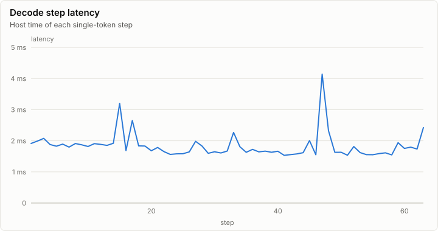
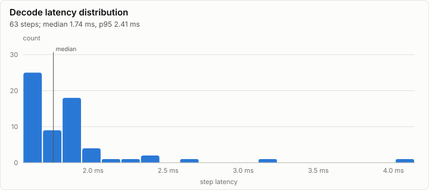
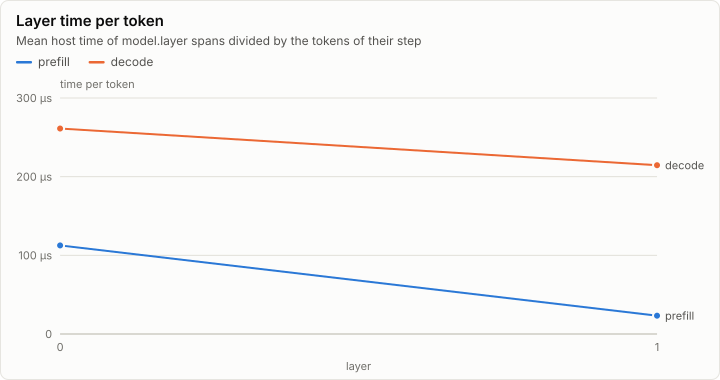
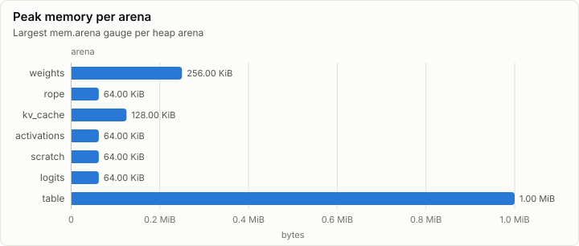

# Inference: Tiny model: greedy decoding of p0, 64 steps (X1a)

| Prefill | Decode | First token | FLOPs per token | Achieved |
| ---: | ---: | ---: | ---: | ---: |
| 874.7 tok/s | 544.7 tok/s | 14.86 ms | 270.30 KFLOP | 157.39 MFLOP/s |

## Speed

| Phase | Steps | Tokens | Time | Rate | Median step |
| --- | ---: | ---: | ---: | ---: | ---: |
| prefill | 1 | 13 | 14.86 ms | 874.7 tok/s | 14.86 ms |
| decode | 63 | 63 | 115.66 ms | 544.7 tok/s | 1.74 ms |

## Layers

## Memory

| Node | Arena | Peak | Last | Samples |
| --- | --- | ---: | ---: | ---: |
| n0 | weights | 256.00 KiB | 256.00 KiB | 1 |
| n0 | rope | 64.00 KiB | 64.00 KiB | 1 |
| n0 | kv_cache | 128.00 KiB | 128.00 KiB | 1 |
| n0 | activations | 64.00 KiB | 64.00 KiB | 1 |
| n0 | scratch | 64.00 KiB | 64.00 KiB | 1 |
| n0 | logits | 64.00 KiB | 64.00 KiB | 1 |
| n0 | table | 1.00 MiB | 1.00 MiB | 1 |

## Metering

Resource use attributed to node, component and stage (layers summed). Wall time is span self time, so nested spans are not counted twice.

| Node | Component | Stage | Wall (self) | GPU | FLOPs | Bytes moved | Tokens | Records |
| --- | --- | --- | ---: | ---: | ---: | ---: | ---: | ---: |
| n0 | (none) |  | 269.80 µs | 0 ns | 0 | 76.25 KiB | 0 | 132 |
| n0 | forward | 0 | 130.53 ms | 73.82 ms | 20.54M | 18.97 MiB | 76 | 7,937 |
| n0 | generate |  | 4.69 ms | 0 ns | 0 | 0 B | 0 | 1 |

## Run

| Field | Value |
| --- | --- |
| Run | `20261018-153042-bac6acca` |
| Title | Tiny model: greedy decoding of p0, 64 steps (X1a) |
| Kind | inference |
| Status | ok |
| Started | 2026-10-18T15:30:42.603Z |
| Ended | 2026-10-18T15:30:42.760Z |
| Execution class | cpu-device cpu, .NET 10.0.13, win-x64+avx2+fma |
| Class id | `00f093f75ec2` |
| Driver | .NET 10.0.13 |
| Commit | `58c7f2618228b2e9a3971dacae53a802665fd9f0` |
| Nodes | 1 |
| Records | 8,207 |
| Synthetic | no |

| Parameter | Value |
| --- | --- |
| backend | cpu-device |
| backends | cpu-device |
| command | lrm generate |
| model | goldens/tiny/g1/model |
| model_sha256 | 7ade5616bee29bf1008e4a2902cd7aa6b334e3571aa978356d7adfe08e058b2e |
| prompt | goldens/tiny/g1/fwd_f32.p0.safetensors |
| prompt_tokens | 13 |
| revision | local:tiny-g1 |
| steps | 64 |
| stop_at_eos | false |
| threads | 8 |
| warmup_steps | 2 |

### Nodes

| Node | Role | Execution class | Records | Finished | Dropped |
| --- | --- | --- | ---: | --- | ---: |
| n0 | creator | cpu-device cpu, .NET 10.0.13, win-x64+avx2+fma | 8,207 | ok | 0 |

### Log problems

None.
