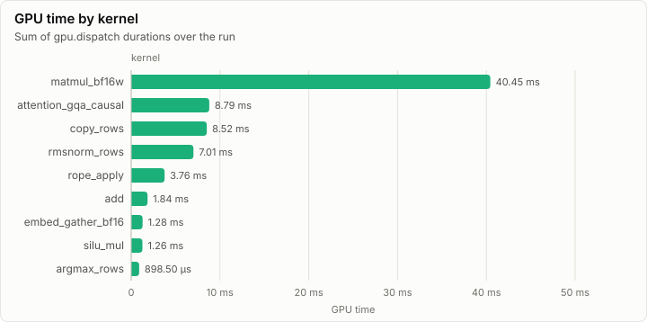
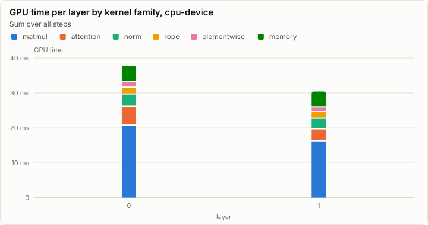
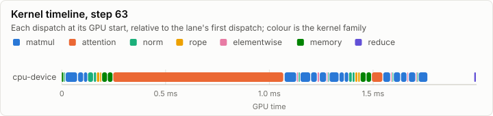
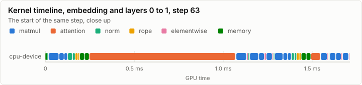
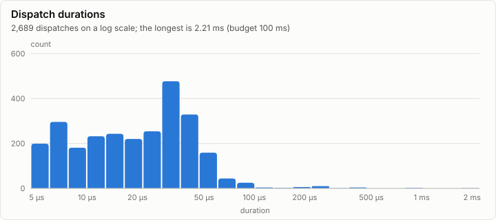

# Kernels: Tiny model: greedy decoding of p0, 64 steps (X1a)

No conformance cases were recorded. Every dispatch is under the 100 ms budget.

- Conformance cases: 0, failed: 0
- GPU dispatches: 2,689, total GPU time 73.82 ms

## Conformance matrix

Passing cases out of all cases, per kernel and backend.

_No rows._

### Failing cases

_No rows._

## fp32 denormals

The mode each shader backend measured with the `scale_f32` denormal probe right after loading its kernels (GpuBackendInterface). It is fixed within an execution class, and it decides what bit-exact means for a kernel that does fp32 arithmetic (KernelAbiAndCatalog, kernel rules).

_No rows._

The probe's words (`scale_f32`, a = 0.5): each input, what preserve and flush give, and what each measurement returned.

_No rows._

## GPU time

## Timeline

### Slowest dispatches

| Kernel | Backend | Layer | Step | Duration | Of budget |
| --- | --- | ---: | ---: | ---: | ---: |
| matmul_bf16w | cpu-device | 0 | 47 | 2.21 ms | 2.2% |
| attention_gqa_causal | cpu-device | 0 | 17 | 872.40 µs | 0.9% |
| attention_gqa_causal | cpu-device | 0 | 63 | 822.60 µs | 0.8% |
| matmul_bf16w | cpu-device | 0 | 0 | 375.80 µs | 0.4% |
| matmul_bf16w | cpu-device | 0 | 0 | 374.50 µs | 0.4% |
| matmul_bf16w | cpu-device | 1 | 0 | 374.10 µs | 0.4% |
| matmul_bf16w | cpu-device | 1 | 0 | 371.90 µs | 0.4% |
| matmul_bf16w | cpu-device | 0 | 0 | 285.80 µs | 0.3% |
| copy_rows | cpu-device | 0 | 0 | 281.80 µs | 0.3% |
| copy_rows | cpu-device | 0 | 0 | 278.40 µs | 0.3% |

## Run

| Field | Value |
| --- | --- |
| Run | `20261018-153042-bac6acca` |
| Title | Tiny model: greedy decoding of p0, 64 steps (X1a) |
| Kind | inference |
| Status | ok |
| Started | 2026-10-18T15:30:42.603Z |
| Ended | 2026-10-18T15:30:42.760Z |
| Execution class | cpu-device cpu, .NET 10.0.13, win-x64+avx2+fma |
| Class id | `00f093f75ec2` |
| Driver | .NET 10.0.13 |
| Commit | `58c7f2618228b2e9a3971dacae53a802665fd9f0` |
| Nodes | 1 |
| Records | 8,207 |
| Synthetic | no |

| Parameter | Value |
| --- | --- |
| backend | cpu-device |
| backends | cpu-device |
| command | lrm generate |
| model | goldens/tiny/g1/model |
| model_sha256 | 7ade5616bee29bf1008e4a2902cd7aa6b334e3571aa978356d7adfe08e058b2e |
| prompt | goldens/tiny/g1/fwd_f32.p0.safetensors |
| prompt_tokens | 13 |
| revision | local:tiny-g1 |
| steps | 64 |
| stop_at_eos | false |
| threads | 8 |
| warmup_steps | 2 |

### Nodes

| Node | Role | Execution class | Records | Finished | Dropped |
| --- | --- | --- | ---: | --- | ---: |
| n0 | creator | cpu-device cpu, .NET 10.0.13, win-x64+avx2+fma | 8,207 | ok | 0 |

### Log problems

None.
