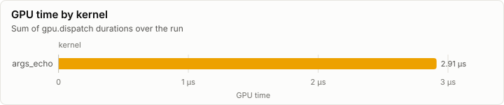
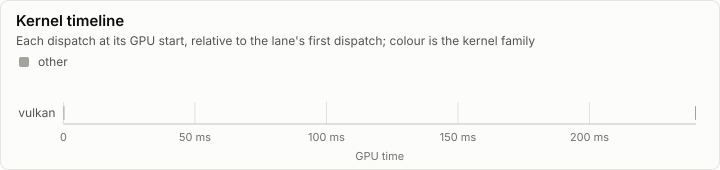
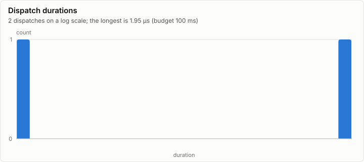

# Kernels: Vulkan interop: device creation and hello-compute (R2)

No conformance cases were recorded. Every dispatch is under the 100 ms budget.

- Conformance cases: 0, failed: 0
- GPU dispatches: 2, total GPU time 2.98 µs

## Conformance matrix

Passing cases out of all cases, per kernel and backend.

_No rows._

### Failing cases

_No rows._

## fp32 denormals

The mode each shader backend measured with the `scale_f32` denormal probe right after loading its kernels (GpuBackendInterface). It is fixed within an execution class, and it decides what bit-exact means for a kernel that does fp32 arithmetic (KernelAbiAndCatalog, kernel rules).

_No rows._

The probe's words (`scale_f32`, a = 0.5): each input, what preserve and flush give, and what each measurement returned.

_No rows._

## GPU time

## Timeline

### Slowest dispatches

| Kernel | Backend | Layer | Step | Duration | Of budget |
| --- | --- | ---: | ---: | ---: | ---: |
| args_echo | vulkan |  |  | 1.95 µs | 0.0% |
| args_echo | vulkan |  |  | 1.02 µs | 0.0% |

## Run

| Field | Value |
| --- | --- |
| Run | `20261018-144112-f93fa5d9` |
| Title | Vulkan interop: device creation and hello-compute (R2) |
| Kind | kernels |
| Status | ok |
| Started | 2026-10-18T14:41:12.819Z |
| Ended | 2026-10-18T14:41:13.521Z |
| Execution class | vulkan pci:10de:2704, 616.92, win-x64 shaders a1a15c99c3fb |
| Class id | `9c41399f5fa9` |
| Driver | 616.92 |
| Commit | `2b77c602cc52f6c883949b2613763a01a3723352` |
| Nodes | 1 |
| Records | 102 |
| Synthetic | no |

| Parameter | Value |
| --- | --- |
| api | 1.4.351 |
| device | NVIDIA GeForce RTX 4080 |
| driver | 616.92 |
| source | tests/Lrm.Gpu.Vulkan.Interop.Tests (gpu tier) |
| vk_header_version | 365 |

### Nodes

| Node | Role | Execution class | Records | Finished | Dropped |
| --- | --- | --- | ---: | --- | ---: |
| n0 | creator | vulkan pci:10de:2704, 616.92, win-x64 shaders a1a15c99c3fb | 102 | ok | 0 |

### Log problems

None.
