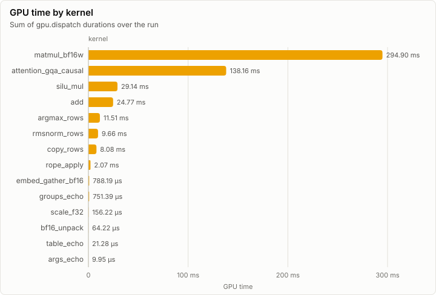
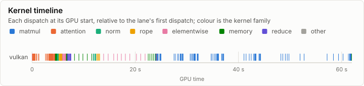
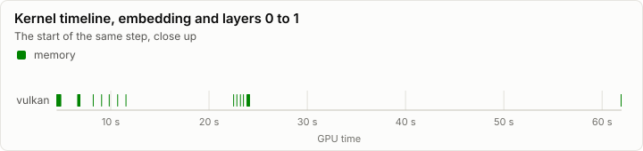
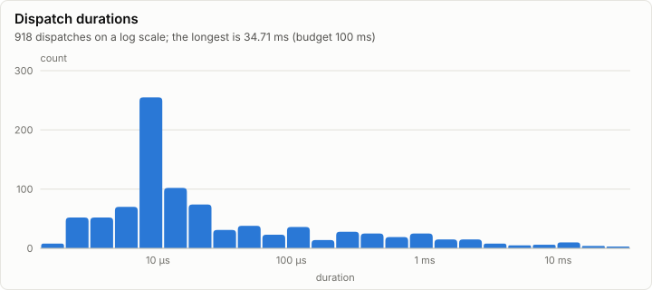

# Kernels: Conformance on vulkan

**FAIL.** 1 of 214 conformance cases fail. Every dispatch is under the 100 ms budget.

- Conformance cases: 214, failed: 1
- GPU dispatches: 918, total GPU time 520.08 ms

## Conformance matrix

Passing cases out of all cases, per kernel and backend.

| Kernel | Family | vulkan |
| --- | --- | --- |
| matmul_bf16w | matmul | ✓ 45/45 |
| attention_gqa_causal | attention | ✓ 36/36 |
| rmsnorm_rows | norm | ✓ 22/22 |
| rope_apply | rope | ✓ 15/15 |
| add | elementwise | ✓ 14/14 |
| scale_f32 | elementwise | ✗ 10/11 |
| silu_mul | elementwise | ✓ 18/18 |
| bf16_unpack | memory | ✓ 5/5 |
| copy_rows | memory | ✓ 14/14 |
| embed_gather_bf16 | memory | ✓ 10/10 |
| argmax_rows | reduce | ✓ 12/12 |
| args_echo | other | ✓ 2/2 |
| groups_echo | other | ✓ 6/6 |
| table_echo | other | ✓ 4/4 |

### Failing cases

| Kernel | Case | Backend | Measured | Bound | Detail |
| --- | --- | --- | ---: | ---: | --- |
| scale_f32 | denormals | vulkan | 1.00e+00 | 0 | 1 of 13 elements differ from CpuRef F32 (flush), first at element 11 |

## fp32 denormals

The mode each shader backend measured with the `scale_f32` denormal probe right after loading its kernels (GpuBackendInterface). It is fixed within an execution class, and it decides what bit-exact means for a kernel that does fp32 arithmetic (KernelAbiAndCatalog, kernel rules).

| Backend | Node | Blob | fp32 denormals | Bit-exact fp32 arithmetic means |
| --- | --- | --- | --- | --- |
| vulkan | n0 |  | flush | equal to CpuRef with every fp32 denormal input and result set to zero of the same sign |

The probe's words (`scale_f32`, a = 0.5): each input, what preserve and flush give, and what each measurement returned.

| Input | Preserve | Flush | vulkan n0 |
| --- | --- | --- | --- |
| `3f800000` | 3f000000 | 3f000000 | 3f000000 |
| `01000000` | 00800000 | 00800000 | 00800000 |
| `00800000` | 00400000 | 00000000 | 00000000 |
| `80800000` | 80400000 | 80000000 | 80000000 |
| `00000002` | 00000001 | 00000000 | 00000000 |
| `807ffffe` | 803fffff | 80000000 | 80000000 |
| `00400000` | 00200000 | 00000000 | 00000000 |

## GPU time

## Timeline

### Slowest dispatches

| Kernel | Backend | Layer | Step | Duration | Of budget |
| --- | --- | ---: | ---: | ---: | ---: |
| attention_gqa_causal | vulkan |  |  | 34.71 ms | 34.7% |
| attention_gqa_causal | vulkan |  |  | 34.63 ms | 34.6% |
| matmul_bf16w | vulkan |  |  | 23.94 ms | 23.9% |
| matmul_bf16w | vulkan |  |  | 20.92 ms | 20.9% |
| matmul_bf16w | vulkan |  |  | 19.73 ms | 19.7% |
| matmul_bf16w | vulkan |  |  | 18.97 ms | 19.0% |
| matmul_bf16w | vulkan |  |  | 17.71 ms | 17.7% |
| silu_mul | vulkan |  |  | 13.63 ms | 13.6% |
| add | vulkan |  |  | 13.50 ms | 13.5% |
| matmul_bf16w | vulkan |  |  | 13.29 ms | 13.3% |

## Run

| Field | Value |
| --- | --- |
| Run | `20261018-154101-9eb7a6c2` |
| Title | Conformance on vulkan |
| Kind | kernels |
| Status | failed |
| Started | 2026-10-18T15:41:01.797Z |
| Ended | 2026-10-18T15:43:03.893Z |
| Execution class | vulkan pci:10de:2704, 616.92, win-x64 shaders 4a132ec97ed8 |
| Class id | `515029c85dba` |
| Driver | 616.92 |
| Commit | `42a93ba4a7bcb1705a7fbd7329a77ad69c7fd178` |
| Nodes | 1 |
| Records | 13,805 |
| Synthetic | no |

| Parameter | Value |
| --- | --- |
| backend | vulkan |
| cases | 214 |
| device | NVIDIA GeForce RTX 4080 |
| source | tests/Lrm.Kernels.Conformance (ConformanceHarness) |

### Nodes

| Node | Role | Execution class | Records | Finished | Dropped |
| --- | --- | --- | ---: | --- | ---: |
| n0 | creator | vulkan pci:10de:2704, 616.92, win-x64 shaders 4a132ec97ed8 | 13,805 | failed | 0 |

### Log problems

None.
