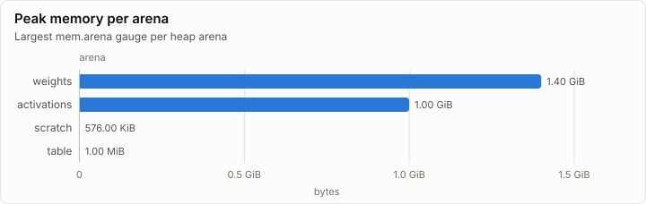

# Inference: Vulkan backend: selftests, probe, soak and transfers (V1)

| Prefill | Decode | First token | FLOPs per token | Achieved |
| ---: | ---: | ---: | ---: | ---: |
| n/a | n/a | n/a | n/a | n/a |

## Speed

_No rows._

## Layers

## Memory

| Node | Arena | Peak | Last | Samples |
| --- | --- | ---: | ---: | ---: |
| n0 | weights | 1.40 GiB | 128.00 KiB | 17 |
| n0 | activations | 1.00 GiB | 320.00 KiB | 25 |
| n0 | scratch | 576.00 KiB | 576.00 KiB | 21 |
| n0 | table | 1.00 MiB | 1.00 MiB | 31 |

## Metering

Resource use attributed to node, component and stage (layers summed). Wall time is span self time, so nested spans are not counted twice.

| Node | Component | Stage | Wall (self) | GPU | FLOPs | Bytes moved | Tokens | Records |
| --- | --- | --- | ---: | ---: | ---: | ---: | ---: | ---: |
| n0 | (none) |  | 2.98 s | 63.66 ms | 0 | 5.65 GiB | 0 | 23,826 |

## Run

| Field | Value |
| --- | --- |
| Run | `20261018-154459-f8574c3a` |
| Title | Vulkan backend: selftests, probe, soak and transfers (V1) |
| Kind | kernels |
| Status | ok |
| Started | 2026-10-18T15:44:59.394Z |
| Ended | 2026-10-18T15:45:05.630Z |
| Execution class | vulkan pci:10de:2704, 616.92, win-x64 shaders a1a15c99c3fb |
| Class id | `9c41399f5fa9` |
| Driver | 616.92 |
| Commit | `42a93ba4a7bcb1705a7fbd7329a77ad69c7fd178` |
| Nodes | 1 |
| Records | 27,375 |
| Synthetic | no |

| Parameter | Value |
| --- | --- |
| api | 1.4.351 |
| device | NVIDIA GeForce RTX 4080 |
| driver | 616.92 |
| fp32_denormals | flush |
| memory_types | page=1(device_local) resource_heap=4(device_local\|host_visible\|host_coherent) upload_staging=2(host_visible\|host_coherent) readback_staging=3(host_visible\|host_coherent\|host_cached) |
| queue_family | 2 |
| source | tests/Lrm.Gpu.Vulkan.Tests (gpu tier) |
| spirv_flags | -T cs_6_6 -E main -HV 2021 -O3 -WX -spirv -fspv-target-env=vulkan1.3 |

### Nodes

| Node | Role | Execution class | Records | Finished | Dropped |
| --- | --- | --- | ---: | --- | ---: |
| n0 | creator | vulkan pci:10de:2704, 616.92, win-x64 shaders a1a15c99c3fb | 27,375 | ok | 0 |

### Log problems

None.
