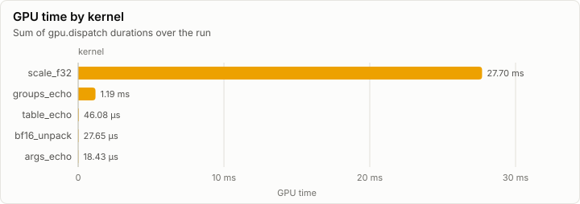
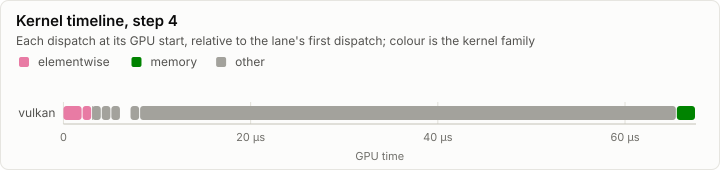
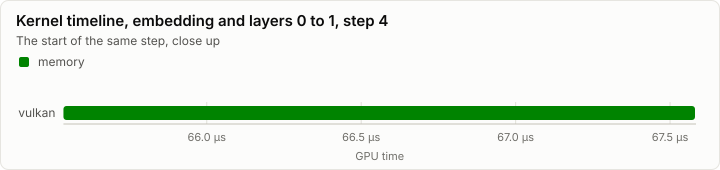
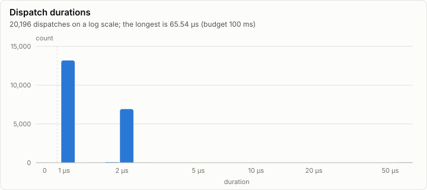

# Kernels: Vulkan backend: selftests, probe, soak and transfers (V1)

No conformance cases were recorded. Every dispatch is under the 100 ms budget.

- Conformance cases: 0, failed: 0
- GPU dispatches: 20,196, total GPU time 28.98 ms

## Conformance matrix

Passing cases out of all cases, per kernel and backend.

_No rows._

### Failing cases

_No rows._

## fp32 denormals

The mode each shader backend measured with the `scale_f32` denormal probe right after loading its kernels (GpuBackendInterface). It is fixed within an execution class, and it decides what bit-exact means for a kernel that does fp32 arithmetic (KernelAbiAndCatalog, kernel rules).

| Backend | Node | Blob | fp32 denormals | Bit-exact fp32 arithmetic means |
| --- | --- | --- | --- | --- |
| vulkan | n0 |  | flush | equal to CpuRef with every fp32 denormal input and result set to zero of the same sign |

The probe's words (`scale_f32`, a = 0.5): each input, what preserve and flush give, and what each measurement returned.

| Input | Preserve | Flush | vulkan n0 |
| --- | --- | --- | --- |
| `3f800000` | 3f000000 | 3f000000 | 3f000000 |
| `01000000` | 00800000 | 00800000 | 00800000 |
| `00800000` | 00400000 | 00000000 | 00000000 |
| `80800000` | 80400000 | 80000000 | 80000000 |
| `00000002` | 00000001 | 00000000 | 00000000 |
| `807ffffe` | 803fffff | 80000000 | 80000000 |
| `00400000` | 00200000 | 00000000 | 00000000 |

## GPU time

## Timeline

### Slowest dispatches

| Kernel | Backend | Layer | Step | Duration | Of budget |
| --- | --- | ---: | ---: | ---: | ---: |
| groups_echo | vulkan |  | 1 | 65.54 µs | 0.1% |
| groups_echo | vulkan |  | 1 | 65.54 µs | 0.1% |
| groups_echo | vulkan |  | 1 | 65.54 µs | 0.1% |
| groups_echo | vulkan |  | 1 | 65.54 µs | 0.1% |
| groups_echo | vulkan |  | 1 | 65.54 µs | 0.1% |
| groups_echo | vulkan |  | 1 | 65.54 µs | 0.1% |
| groups_echo | vulkan |  | 2 | 65.54 µs | 0.1% |
| groups_echo | vulkan |  | 1 | 65.54 µs | 0.1% |
| groups_echo | vulkan |  | 2 | 65.54 µs | 0.1% |
| groups_echo | vulkan |  | 1 | 65.54 µs | 0.1% |

## Run

| Field | Value |
| --- | --- |
| Run | `20261018-155431-a38f1165` |
| Title | Vulkan backend: selftests, probe, soak and transfers (V1) |
| Kind | kernels |
| Status | ok |
| Started | 2026-10-18T15:54:31.497Z |
| Ended | 2026-10-18T15:54:36.382Z |
| Execution class | vulkan pci:10de:2704, 616.92, win-x64 shaders a1a15c99c3fb |
| Class id | `9c41399f5fa9` |
| Driver | 616.92 |
| Commit | `d6493b708775ebc8648102db781198eed5465b88` |
| Nodes | 1 |
| Records | 27,665 |
| Synthetic | no |

| Parameter | Value |
| --- | --- |
| api | 1.4.351 |
| device | NVIDIA GeForce RTX 4080 |
| driver | 616.92 |
| fp32_denormals | flush |
| memory_types | page=1(device_local) resource_heap=4(device_local\|host_visible\|host_coherent) upload_staging=2(host_visible\|host_coherent) readback_staging=3(host_visible\|host_coherent\|host_cached) |
| queue_family | 2 |
| source | tests/Lrm.Gpu.Vulkan.Tests (gpu tier) |
| spirv_flags | -T cs_6_6 -E main -HV 2021 -O3 -WX -spirv -fspv-target-env=vulkan1.3 |

### Nodes

| Node | Role | Execution class | Records | Finished | Dropped |
| --- | --- | --- | ---: | --- | ---: |
| n0 | creator | vulkan pci:10de:2704, 616.92, win-x64 shaders a1a15c99c3fb | 27,665 | ok | 0 |

### Log problems

None.
