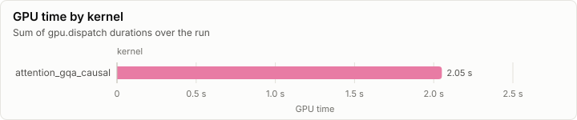
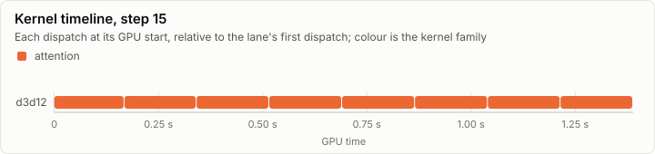
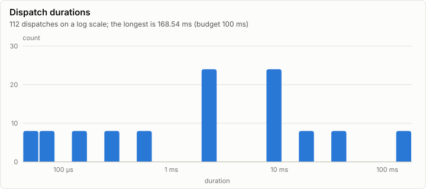

# Kernels: attention_gqa_causal bench on d3d12 (warm GPU)

No conformance cases were recorded. **8 dispatches exceed the 100 ms budget.**

- Conformance cases: 0, failed: 0
- GPU dispatches: 112, total GPU time 2.05 s

## Conformance matrix

Passing cases out of all cases, per kernel and backend.

_No rows._

### Failing cases

_No rows._

## fp32 denormals

The mode each shader backend measured with the `scale_f32` denormal probe right after loading its kernels (GpuBackendInterface). It is fixed within an execution class, and it decides what bit-exact means for a kernel that does fp32 arithmetic (KernelAbiAndCatalog, kernel rules).

_No rows._

The probe's words (`scale_f32`, a = 0.5): each input, what preserve and flush give, and what each measurement returned.

_No rows._

## GPU time

## Timeline

### Slowest dispatches

| Kernel | Backend | Layer | Step | Duration | Of budget |
| --- | --- | ---: | ---: | ---: | ---: |
| attention_gqa_causal | d3d12 |  | 13 | 168.54 ms | 168.5% |
| attention_gqa_causal | d3d12 |  | 13 | 167.02 ms | 167.0% |
| attention_gqa_causal | d3d12 |  | 13 | 166.59 ms | 166.6% |
| attention_gqa_causal | d3d12 |  | 13 | 166.35 ms | 166.3% |
| attention_gqa_causal | d3d12 |  | 13 | 166.35 ms | 166.3% |
| attention_gqa_causal | d3d12 |  | 13 | 166.35 ms | 166.3% |
| attention_gqa_causal | d3d12 |  | 13 | 166.34 ms | 166.3% |
| attention_gqa_causal | d3d12 |  | 13 | 166.33 ms | 166.3% |
| attention_gqa_causal | d3d12 |  | 10 | 36.72 ms | 36.7% |
| attention_gqa_causal | d3d12 |  | 10 | 36.72 ms | 36.7% |

## Run

| Field | Value |
| --- | --- |
| Run | `20261018-131553-c3e46607` |
| Title | attention_gqa_causal bench on d3d12 (warm GPU) |
| Kind | kernels |
| Status | ok |
| Started | 2026-10-18T13:15:53.984Z |
| Ended | 2026-10-18T13:15:58.184Z |
| Execution class | d3d12 pci:10de:2704, 32.0.16.1692, win-x64 shaders a9ac4697732f |
| Class id | `35e521522c3b` |
| Driver | 32.0.16.1692 |
| Commit | `7817370b1fb3988a09ca2d39dfb1511103bba389` |
| Nodes | 1 |
| Records | 140 |
| Synthetic | no |

| Parameter | Value |
| --- | --- |
| backend | d3d12 |
| device | NVIDIA GeForce RTX 4080 |
| reps | 8 |
| source | tests/Lrm.Kernels.Conformance/Cases/attention/bench/attention-bench.fsx |
| step 0 | decode_p511: rows 1, past 511, heads 16:8, head_dim 128 |
| step 1 | decode_p1023: rows 1, past 1023, heads 16:8, head_dim 128 |
| step 10 | prefill_t4096: rows 4096, past 0, heads 16:8, head_dim 128 |
| step 11 | hd1_rows8192: rows 8192, past 0, heads 1:1, head_dim 1 |
| step 12 | hd1_rows16384: rows 16384, past 0, heads 1:1, head_dim 1 |
| step 13 | hd1_rows65535: rows 65535, past 0, heads 1:1, head_dim 1 |
| step 2 | decode_p2047: rows 1, past 2047, heads 16:8, head_dim 128 |
| step 3 | decode_p4095: rows 1, past 4095, heads 16:8, head_dim 128 |
| step 4 | chunk_t128_past3968: rows 128, past 3968, heads 16:8, head_dim 128 |
| step 5 | chunk_t512_past3584: rows 512, past 3584, heads 16:8, head_dim 128 |
| step 6 | chunk_t1024_past3072: rows 1024, past 3072, heads 16:8, head_dim 128 |
| step 7 | prefill_t512: rows 512, past 0, heads 16:8, head_dim 128 |
| step 8 | prefill_t1024: rows 1024, past 0, heads 16:8, head_dim 128 |
| step 9 | prefill_t2048: rows 2048, past 0, heads 16:8, head_dim 128 |

### Nodes

| Node | Role | Execution class | Records | Finished | Dropped |
| --- | --- | --- | ---: | --- | ---: |
| n0 | creator | d3d12 pci:10de:2704, 32.0.16.1692, win-x64 shaders a9ac4697732f | 140 | ok | 0 |

### Log problems

None.
