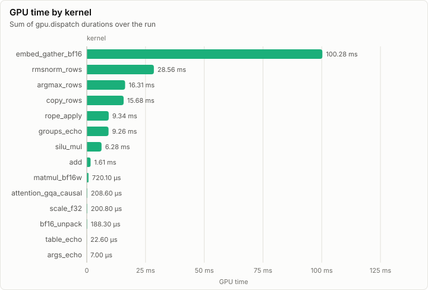
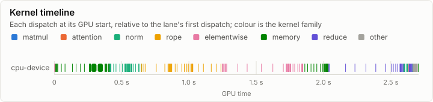
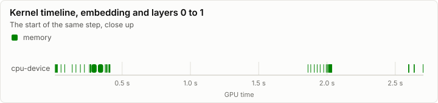
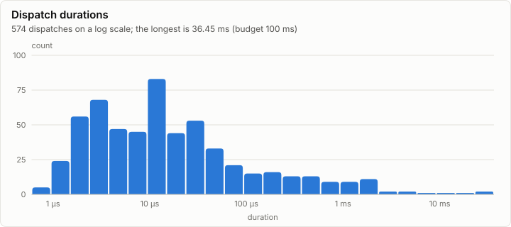

# Kernels: Conformance on CpuDevice (every case, bit-exact to CpuRef F32)

**PASS.** All 126 conformance cases pass. Every dispatch is under the 100 ms budget.

- Conformance cases: 126, failed: 0
- GPU dispatches: 539, total GPU time 188.68 ms

## Conformance matrix

Passing cases out of all cases, per kernel and backend.

| Kernel | Family | cpu-device |
| --- | --- | --- |
| matmul_bf16w | matmul | ✓ 4/4 |
| attention_gqa_causal | attention | ✓ 2/2 |
| rmsnorm_rows | norm | ✓ 21/21 |
| rope_apply | rope | ✓ 14/14 |
| add | elementwise | ✓ 13/13 |
| scale_f32 | elementwise | ✓ 11/11 |
| silu_mul | elementwise | ✓ 10/10 |
| bf16_unpack | memory | ✓ 5/5 |
| copy_rows | memory | ✓ 13/13 |
| embed_gather_bf16 | memory | ✓ 9/9 |
| argmax_rows | reduce | ✓ 12/12 |
| args_echo | other | ✓ 2/2 |
| groups_echo | other | ✓ 6/6 |
| table_echo | other | ✓ 4/4 |

### Failing cases

_No rows._

## fp32 denormals

The mode each shader backend measured with the `scale_f32` denormal probe right after loading its kernels (GpuBackendInterface). It is fixed within an execution class, and it decides what bit-exact means for a kernel that does fp32 arithmetic (KernelAbiAndCatalog, kernel rules).

| Backend | Node | Blob | fp32 denormals | Bit-exact fp32 arithmetic means |
| --- | --- | --- | --- | --- |
| cpu-device | n0 |  | preserve | equal to CpuRef as it is |

The probe's words (`scale_f32`, a = 0.5): each input, what preserve and flush give, and what each measurement returned.

| Input | Preserve | Flush | cpu-device n0 |
| --- | --- | --- | --- |
| `3f800000` | 3f000000 | 3f000000 | 3f000000 |
| `01000000` | 00800000 | 00800000 | 00800000 |
| `00800000` | 00400000 | 00000000 | 00400000 |
| `80800000` | 80400000 | 80000000 | 80400000 |
| `00000002` | 00000001 | 00000000 | 00000001 |
| `807ffffe` | 803fffff | 80000000 | 803fffff |
| `00400000` | 00200000 | 00000000 | 00200000 |

## GPU time

## Timeline

### Slowest dispatches

| Kernel | Backend | Layer | Step | Duration | Of budget |
| --- | --- | ---: | ---: | ---: | ---: |
| embed_gather_bf16 | cpu-device |  |  | 42.81 ms | 42.8% |
| embed_gather_bf16 | cpu-device |  |  | 42.26 ms | 42.3% |
| embed_gather_bf16 | cpu-device |  |  | 13.39 ms | 13.4% |
| rmsnorm_rows | cpu-device |  |  | 6.83 ms | 6.8% |
| rmsnorm_rows | cpu-device |  |  | 6.62 ms | 6.6% |
| rmsnorm_rows | cpu-device |  |  | 5.25 ms | 5.2% |
| copy_rows | cpu-device |  |  | 4.60 ms | 4.6% |
| rope_apply | cpu-device |  |  | 2.76 ms | 2.8% |
| rope_apply | cpu-device |  |  | 2.72 ms | 2.7% |
| copy_rows | cpu-device |  |  | 2.28 ms | 2.3% |

## Run

| Field | Value |
| --- | --- |
| Run | `20261018-130019-da5f259d` |
| Title | Conformance on CpuDevice (every case, bit-exact to CpuRef F32) |
| Kind | kernels |
| Status | ok |
| Started | 2026-10-18T13:00:19.653Z |
| Ended | 2026-10-18T13:00:24.896Z |
| Execution class | cpu-device cpu, .NET 10.0.13, win-x64+avx2+fma |
| Class id | `00f093f75ec2` |
| Driver | .NET 10.0.13 |
| Commit | `74b14a7394a307c7ffab5e7108b8b11955140c67` |
| Nodes | 1 |
| Records | 4,585 |
| Synthetic | no |

| Parameter | Value |
| --- | --- |
| backend | cpu-device |
| cases | 126 |
| device | CPU device (emulated kernel catalog) |
| source | tests/Lrm.Kernels.Conformance (ConformanceHarness) |

### Nodes

| Node | Role | Execution class | Records | Finished | Dropped |
| --- | --- | --- | ---: | --- | ---: |
| n0 | creator | cpu-device cpu, .NET 10.0.13, win-x64+avx2+fma | 4,585 | ok | 0 |

### Log problems

None.
