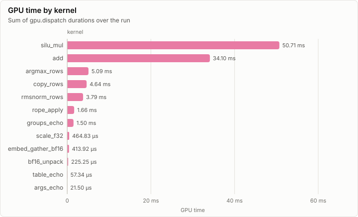
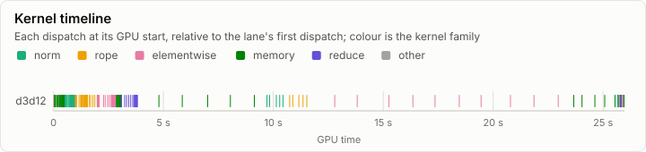
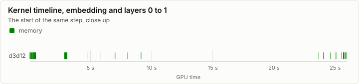
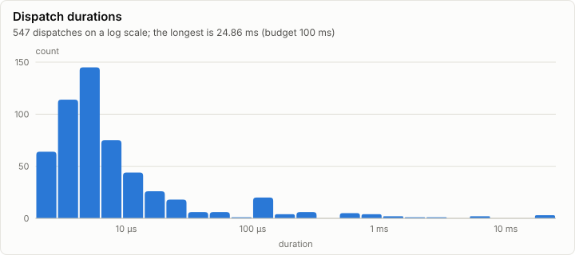

# Kernels: Conformance on d3d12

**FAIL.** 51 of 126 conformance cases fail. Every dispatch is under the 100 ms budget.

- Conformance cases: 126, failed: 51
- GPU dispatches: 547, total GPU time 102.68 ms

## Conformance matrix

Passing cases out of all cases, per kernel and backend.

| Kernel | Family | d3d12 |
| --- | --- | --- |
| rmsnorm_rows | norm | ✗ 11/22 |
| rope_apply | rope | ✗ 1/15 |
| add | elementwise | ✗ 0/14 |
| scale_f32 | elementwise | ✓ 11/11 |
| silu_mul | elementwise | ✗ 10/11 |
| bf16_unpack | memory | ✓ 5/5 |
| copy_rows | memory | ✗ 10/14 |
| embed_gather_bf16 | memory | ✗ 5/10 |
| argmax_rows | reduce | ✗ 10/12 |
| args_echo | other | ✓ 2/2 |
| groups_echo | other | ✓ 6/6 |
| table_echo | other | ✓ 4/4 |

### Failing cases

| Kernel | Case | Backend | Measured | Bound | Detail |
| --- | --- | --- | ---: | ---: | --- |
| embed_gather_bf16 | qwen_vocab_cols4 | d3d12 | 4.00e+00 | 0 | runs 1 and 2 differ at element 4; 4 of 36 elements differ from CpuRef F32 (preserve), first at element 4 |
| embed_gather_bf16 | qwen_hidden_prefill37 | d3d12 | 1.02e+03 | 0 | runs 1 and 2 differ at element 2048; 1024 of 37888 elements differ from CpuRef F32 (preserve), first at element 2048 |
| embed_gather_bf16 | cols1 | d3d12 | 1.00e+00 | 0 | runs 1 and 2 differ at element 3; 1 of 4 elements differ from CpuRef F32 (preserve), first at element 3; batch invariance: split row 3 alone gives d0f50000 at element 3, the whole case 97130000 |
| embed_gather_bf16 | rows65535_cols3 | d3d12 | 3.00e+00 | 0 | runs 1 and 2 differ at element 3; 3 of 196605 elements differ from CpuRef F32 (preserve), first at element 3 |
| rmsnorm_rows | qwen_hidden_decode | d3d12 | 1.59e+00 | 1.00e-06 | relL2 1.5880608455550314 exceeds the bound 1E-06 (reference error 7.342257425865915E-08) |
| rmsnorm_rows | qwen_hidden_prefill37 | d3d12 | 2.29e+00 | 1.00e-06 | relL2 2.290209769675216 exceeds the bound 1E-06 (reference error 2.3128549966579458E-07) |
| rmsnorm_rows | qwen_hidden_prefill512 | d3d12 | 1.34e+00 | 1.00e-06 | relL2 1.3447125253435213 exceeds the bound 1E-06 (reference error 2.9576897389113196E-07) |
| rmsnorm_rows | qwen_final_norm_in_place | d3d12 | 3.52e+00 | 1.00e-06 | relL2 3.523155946554554 exceeds the bound 1E-06 (reference error 2.962533465009623E-07) |
| rmsnorm_rows | cols255 | d3d12 | 4.36e-01 | 1.00e-06 | relL2 0.43625789299515133 exceeds the bound 1E-06 (reference error 2.0012941560836863E-07) |
| rmsnorm_rows | cols257 | d3d12 | 4.30e-01 | 1.00e-06 | relL2 0.4301650217616697 exceeds the bound 1E-06 (reference error 8.545236720392092E-08) |
| rmsnorm_rows | cols1000_rows3 | d3d12 | 4.00e-01 | 1.00e-06 | relL2 0.4002307408782877 exceeds the bound 1E-06 (reference error 2.744198737349671E-07) |
| rmsnorm_rows | cols3072 | d3d12 | 4.11e-01 | 1.00e-06 | relL2 0.41071323029812495 exceeds the bound 1E-06 (reference error 4.6265600916952964E-07) |
| rmsnorm_rows | cols8191_rows2 | d3d12 | 4.11e-01 | 1.00e-06 | relL2 0.4109524378325679 exceeds the bound 1E-06 (reference error 4.3576007830308744E-07) |
| rope_apply | qwen_q_decode_pos8191 | d3d12 | NaN | 1.00e-06 | relL2 NaN exceeds the bound 1E-06 (reference error 3.389596786357158E-08) |
| rope_apply | qwen_k_decode_pos40959 | d3d12 | NaN | 1.00e-06 | relL2 NaN exceeds the bound 1E-06 (reference error 3.3463167709470605E-08) |
| rope_apply | qwen_q_prefill37_pos0 | d3d12 | 3.14e-08 | 1.00e-06 | batch invariance: split token 36 alone gives 3fa44110 at element 73728, the whole case c03d5259; batch invariance: split tokens 12 to 23 gives bfb7a008 at element 24576, the whole case bff8234b |
| rope_apply | qwen_k_prefill37_pos512 | d3d12 | NaN | 1.00e-06 | relL2 NaN exceeds the bound 1E-06 (reference error 3.4283747289318496E-08) |
| rope_apply | qwen_q_prefill512_in_place | d3d12 | 3.39e-08 | 1.00e-06 | batch invariance: split token 511 alone gives 3ff1e8f8 at element 1046528, the whole case 3f577fbe; batch invariance: split tokens 170 to 340 gives 4009a828 at element 348160, the whole case 3f2bd346 |
| rope_apply | qwen_k_prefill7_pos3000_in_place | d3d12 | NaN | 1.00e-06 | relL2 NaN exceeds the bound 1E-06 (reference error 3.477437132624265E-08) |
| rope_apply | head_dim2_heads1 | d3d12 | 1.79e-08 | 1.00e-06 | batch invariance: split token 4 alone gives beab2448 at element 8, the whole case 3f0a298e; batch invariance: split tokens 1 to 2 gives bf8afb4c at element 2, the whole case bfd0b24e |
| rope_apply | head_dim6_heads5_pos7 | d3d12 | NaN | 1.00e-06 | relL2 NaN exceeds the bound 1E-06 (reference error 3.586586810007811E-08) |
| rope_apply | head_dim130_heads3 | d3d12 | NaN | 1.00e-06 | relL2 NaN exceeds the bound 1E-06 (reference error 3.2946807816189234E-08); batch invariance: split token 3 alone gives 7fffffff at element 1170, the whole case 3f9e0ee6 |
| rope_apply | head_dim256_heads2 | d3d12 | NaN | 1.00e-06 | relL2 NaN exceeds the bound 1E-06 (reference error 3.337949445482564E-08) |
| rope_apply | heads64_head_dim16_tokens1025 | d3d12 | NaN | 1.00e-06 | relL2 NaN exceeds the bound 1E-06 (reference error 3.579998021193036E-08); batch invariance: split token 1024 alone gives 7fffffff at element 1048576, the whole case bf5620e7; batch invariance: split tokens 341 to 682 gives 7fffffff at element 349184, the whole case 3ebfa2ea |
| add | qwen_residual_decode | d3d12 | 1.02e+03 | 0 | 1024 of 1024 elements differ from CpuRef F32 (preserve), first at element 0 |
| add | qwen_residual_prefill37 | d3d12 | 3.79e+04 | 0 | 37888 of 37888 elements differ from CpuRef F32 (preserve), first at element 0 |
| add | qwen_residual_prefill512_in_place | d3d12 | 5.24e+05 | 0 | 524288 of 524288 elements differ from CpuRef F32 (preserve), first at element 0 |
| add | in_place_b | d3d12 | 1.00e+03 | 0 | 1000 of 1000 elements differ from CpuRef F32 (preserve), first at element 0 |
| add | special_pairs | d3d12 | 2.59e+02 | 0 | 259 of 576 elements differ from CpuRef F32 (preserve), first at element 1 |
| add | cancellation | d3d12 | 1.00e+03 | 0 | 1000 of 1000 elements differ from CpuRef F32 (preserve), first at element 0 |
| add | n1 | d3d12 | 1.00e+00 | 0 | 1 of 1 elements differ from CpuRef F32 (preserve), first at element 0 |
| add | n255 | d3d12 | 2.55e+02 | 0 | 255 of 255 elements differ from CpuRef F32 (preserve), first at element 0 |
| add | n257_capacity | d3d12 | 2.57e+02 | 0 | 257 of 257 elements differ from CpuRef F32 (preserve), first at element 0 |
| copy_rows | strided_gaps | d3d12 | 4.00e+02 | 0 | run 1: 112 written word(s) of dst still hold their poison, first at element 550 (nothing was written there); run 1: 112 word(s) of dst changed, first at element 150 (written outside the written elements); run 2: 112 written word(s) of dst still hold their poison, first at element 550 (nothing was written there); run 2: 112 word(s) of dst changed, first at element 150 (written outside the written elements); runs 1 and 2 differ at element 550; 400 of 400 elements differ from CpuRef F32 (preserve), first at element 192; split row 0 alone: 42 written word(s) of dst still hold their poison, first at element 200 (nothing was written there); split row 0 alone: 42 word(s) of dst changed, first at element 150 (written outside the written elements); batch invariance: split row 0 alone gives ff86f8df at element 200, the whole case b03f119f; split row 7 alone: 50 written word(s) of dst still hold their poison, first at element 640 (nothing was written there); split row 7 alone: 50 word(s) of dst changed, first at element 500 (written outside the written elements); batch invariance: split row 7 alone gives 7fa77174 at element 640, the whole case ff8a79d5; split rows 2 to 4: 84 written word(s) of dst still hold their poison, first at element 400 (nothing was written there); split rows 2 to 4: 84 word(s) of dst changed, first at element 250 (written outside the written elements); batch invariance: split rows 2 to 4 gives 7fab29ce at element 400, the whole case 005479ff |
| copy_rows | cols1_rows1000 | d3d12 | 1.00e+03 | 0 | run 1: 550 written word(s) of dst still hold their poison, first at element 1100 (nothing was written there); run 1: 550 word(s) of dst changed, first at element 100 (written outside the written elements); run 2: 550 written word(s) of dst still hold their poison, first at element 1100 (nothing was written there); run 2: 550 word(s) of dst changed, first at element 100 (written outside the written elements); runs 1 and 2 differ at element 1100; 1000 of 1000 elements differ from CpuRef F32 (preserve), first at element 200; split row 0 alone: 1 written word(s) of dst still hold their poison, first at element 200 (nothing was written there); split row 0 alone: 1 word(s) of dst changed, first at element 100 (written outside the written elements); batch invariance: split row 0 alone gives ffa617c5 at element 200, the whole case a04c3a75; split row 999 alone: 1 written word(s) of dst still hold their poison, first at element 2198 (nothing was written there); split row 999 alone: 1 word(s) of dst changed, first at element 1099 (written outside the written elements); batch invariance: split row 999 alone gives 7f836c82 at element 2198, the whole case 7f9ea113; split rows 333 to 665: 333 written word(s) of dst still hold their poison, first at element 866 (nothing was written there); split rows 333 to 665: 333 word(s) of dst changed, first at element 433 (written outside the written elements); batch invariance: split rows 333 to 665 gives 7fbc867d at element 866, the whole case 352bd4dd |
| copy_rows | high_row0 | d3d12 | 5.00e+00 | 0 | run 1: 5 written word(s) of dst still hold their poison, first at element 60000 (nothing was written there); run 2: 5 written word(s) of dst still hold their poison, first at element 60000 (nothing was written there); runs 1 and 2 differ at element 60000; 5 of 5 elements differ from CpuRef F32 (preserve), first at element 60000 |
| argmax_rows | qwen_vocab_ties | d3d12 | 7.00e+00 | 0 | 7 of 8 elements differ from CpuRef F32 (preserve), first at element 0 |
| embed_gather_bf16 | qwen_vocab_prefill37 | d3d12 | 1.02e+03 | 0 | runs 1 and 2 differ at element 4096; 1024 of 37888 elements differ from CpuRef F32 (preserve), first at element 4096 |
| rope_apply | qwen_q_4097_tokens_in_place | d3d12 | 3.59e-08 | 1.00e-06 | batch invariance: split token 4096 alone gives c006ca28 at element 8388608, the whole case bee8cd46; batch invariance: split tokens 1365 to 2730 gives 40478f16 at element 2795520, the whole case 3df148f0 |
| silu_mul | folded_n16777472 | d3d12 | NaN | 1.00e-06 | run 1: 8388608 written word(s) of y still hold their poison, first at element 8388864 (nothing was written there); run 2: 8388608 written word(s) of y still hold their poison, first at element 8388864 (nothing was written there); runs 1 and 2 differ at element 8388864; relL2 NaN exceeds the bound 1E-06 (reference error 4.779164830105703E-08); batch invariance: split row 16777471 alone gives c044f6d8 at element 16777471, the whole case ff897e66; batch invariance: split rows 5592490 to 11184980 gives 3ff79628 at element 8388864, the whole case 7faea727 |
| add | folded_n16777472 | d3d12 | 1.68e+07 | 0 | 16777463 of 16777472 elements differ from CpuRef F32 (preserve), first at element 0 |
| rmsnorm_rows | e1_rows7_cols300 | d3d12 | 3.23e-01 | 1.00e-06 | relL2 0.3227189508584601 exceeds the bound 1E-06 (reference error 1.0157413891370446E-07) |
| rmsnorm_rows | e1_rows1_cols1024 | d3d12 | 3.84e-01 | 1.00e-06 | relL2 0.3843594507611324 exceeds the bound 1E-06 (reference error 7.981048695067233E-08) |
| rope_apply | e1_tokens5_heads4_pos3 | d3d12 | 6.89e-01 | 1.00e-06 | relL2 0.6894490361543967 exceeds the bound 1E-06 (reference error 3.307861576878719E-08); batch invariance: split token 4 alone gives 3fcaf592 at element 512, the whole case bef0d4d6; batch invariance: split tokens 1 to 2 gives bf95062e at element 128, the whole case bd177d60 |
| rope_apply | e1_tokens1_heads2_pos15 | d3d12 | 9.72e-01 | 1.00e-06 | relL2 0.9719717302214018 exceeds the bound 1E-06 (reference error 3.666586935636235E-08) |
| add | e1_n1000 | d3d12 | 1.00e+03 | 0 | 1000 of 1000 elements differ from CpuRef F32 (preserve), first at element 0 |
| add | e1_specials | d3d12 | 5.00e+00 | 0 | 5 of 6 elements differ from CpuRef F32 (preserve), first at element 0 |
| add | e1_both_nan | d3d12 | 1.00e+02 | 0 | 100 of 600 elements differ from CpuRef F32 (preserve), first at element 0 |
| add | e1_in_place | d3d12 | 5.13e+02 | 0 | 513 of 513 elements differ from CpuRef F32 (preserve), first at element 0 |
| copy_rows | e1_f32_strided | d3d12 | 3.50e+01 | 0 | run 1: 6 written word(s) of dst still hold their poison, first at element 49 (nothing was written there); run 1: 6 word(s) of dst changed, first at element 14 (written outside the written elements); run 2: 6 written word(s) of dst still hold their poison, first at element 49 (nothing was written there); run 2: 6 word(s) of dst changed, first at element 14 (written outside the written elements); runs 1 and 2 differ at element 49; 35 of 35 elements differ from CpuRef F32 (preserve), first at element 16; split row 0 alone: 2 written word(s) of dst still hold their poison, first at element 21 (nothing was written there); split row 0 alone: 2 word(s) of dst changed, first at element 14 (written outside the written elements); batch invariance: split row 0 alone gives 7f826baf at element 21, the whole case 569199cd; split row 4 alone: 6 written word(s) of dst still hold their poison, first at element 49 (nothing was written there); split row 4 alone: 6 word(s) of dst changed, first at element 42 (written outside the written elements); batch invariance: split row 4 alone gives 7f80734c at element 49, the whole case ff98969a; split rows 1 to 2: 4 written word(s) of dst still hold their poison, first at element 35 (nothing was written there); split rows 1 to 2: 4 word(s) of dst changed, first at element 21 (written outside the written elements); batch invariance: split rows 1 to 2 gives ff8e27a8 at element 35, the whole case 997258fa |
| argmax_rows | e1_rows6_specials | d3d12 | 3.00e+00 | 0 | 3 of 6 elements differ from CpuRef F32 (preserve), first at element 1 |

## fp32 denormals

The mode each shader backend measured with the `scale_f32` denormal probe right after loading its kernels (GpuBackendInterface). It is fixed within an execution class, and it decides what bit-exact means for a kernel that does fp32 arithmetic (KernelAbiAndCatalog, kernel rules).

| Backend | Node | Blob | fp32 denormals | Bit-exact fp32 arithmetic means |
| --- | --- | --- | --- | --- |
| d3d12 | n0 |  | preserve | equal to CpuRef as it is |

The probe's words (`scale_f32`, a = 0.5): each input, what preserve and flush give, and what each measurement returned.

| Input | Preserve | Flush | d3d12 n0 |
| --- | --- | --- | --- |
| `3f800000` | 3f000000 | 3f000000 | 3f000000 |
| `01000000` | 00800000 | 00800000 | 00800000 |
| `00800000` | 00400000 | 00000000 | 00400000 |
| `80800000` | 80400000 | 80000000 | 80400000 |
| `00000002` | 00000001 | 00000000 | 00000001 |
| `807ffffe` | 803fffff | 80000000 | 803fffff |
| `00400000` | 00200000 | 00000000 | 00200000 |

## GPU time

## Timeline

### Slowest dispatches

| Kernel | Backend | Layer | Step | Duration | Of budget |
| --- | --- | ---: | ---: | ---: | ---: |
| silu_mul | d3d12 |  |  | 24.86 ms | 24.9% |
| silu_mul | d3d12 |  |  | 22.87 ms | 22.9% |
| add | d3d12 |  |  | 19.53 ms | 19.5% |
| add | d3d12 |  |  | 7.41 ms | 7.4% |
| add | d3d12 |  |  | 6.72 ms | 6.7% |
| silu_mul | d3d12 |  |  | 2.50 ms | 2.5% |
| copy_rows | d3d12 |  |  | 1.78 ms | 1.8% |
| copy_rows | d3d12 |  |  | 1.25 ms | 1.3% |
| copy_rows | d3d12 |  |  | 1.25 ms | 1.3% |
| rope_apply | d3d12 |  |  | 851.97 µs | 0.9% |

## Run

| Field | Value |
| --- | --- |
| Run | `20261018-125623-babc5f61` |
| Title | Conformance on d3d12 |
| Kind | kernels |
| Status | failed |
| Started | 2026-10-18T12:56:23.192Z |
| Ended | 2026-10-18T12:57:14.646Z |
| Execution class | d3d12 pci:10de:2704, 32.0.16.1692, win-x64 shaders 9c10642e160d |
| Class id | `11247c49cb6d` |
| Driver | 32.0.16.1692 |
| Commit | `74b14a7394a307c7ffab5e7108b8b11955140c67` |
| Nodes | 1 |
| Records | 7,395 |
| Synthetic | no |

| Parameter | Value |
| --- | --- |
| backend | d3d12 |
| cases | 132 |
| device | NVIDIA GeForce RTX 4080 |
| source | tests/Lrm.Kernels.Conformance (ConformanceHarness) |

### Nodes

| Node | Role | Execution class | Records | Finished | Dropped |
| --- | --- | --- | ---: | --- | ---: |
| n0 | creator | d3d12 pci:10de:2704, 32.0.16.1692, win-x64 shaders 9c10642e160d | 7,395 | failed | 0 |

### Log problems

None.
