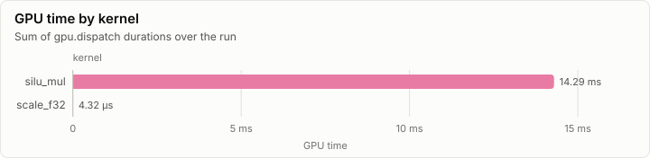
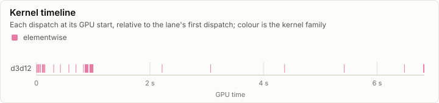
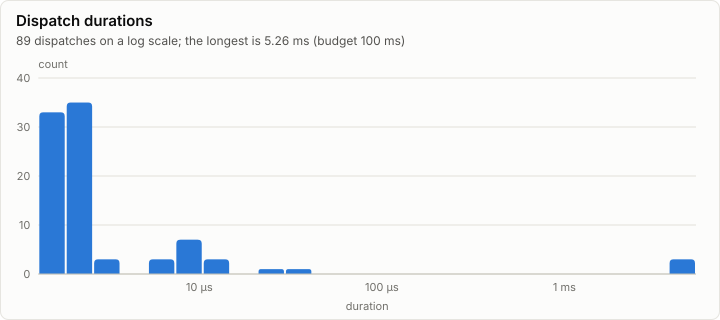

# Kernels: Conformance on d3d12

**FAIL.** 4 of 18 conformance cases fail. Every dispatch is under the 100 ms budget.

- Conformance cases: 18, failed: 4
- GPU dispatches: 89, total GPU time 14.30 ms

## Conformance matrix

Passing cases out of all cases, per kernel and backend.

| Kernel | Family | d3d12 |
| --- | --- | --- |
| silu_mul | elementwise | ✗ 14/18 |

### Failing cases

| Kernel | Case | Backend | Measured | Bound | Detail |
| --- | --- | --- | ---: | ---: | --- |
| silu_mul | gates_m88p7_m87p4 | d3d12 | 1.00e+00 | 6.62e-04 | relL2 1 exceeds the bound 0.0006622228641545316 (reference error 4.56279532655843E-08) |
| silu_mul | gates_m88p7_m87p4_up_huge | d3d12 | 1.00e+00 | 1.00e-06 | relL2 1 exceeds the bound 1E-06 (reference error 4.505533717355919E-08) |
| silu_mul | gates_m87p3_m80 | d3d12 | 1.93e-06 | 1.00e-06 | relL2 1.927184607966711E-06 exceeds the bound 1E-06 (reference error 4.163332892674704E-08) |
| silu_mul | gates_m200_m88p8 | d3d12 | NaN | 2.24e+00 | relL2 NaN exceeds the bound 2.2388677783546846 (reference error 1) |

## fp32 denormals

The mode each shader backend measured with the `scale_f32` denormal probe right after loading its kernels (GpuBackendInterface). It is fixed within an execution class, and it decides what bit-exact means for a kernel that does fp32 arithmetic (KernelAbiAndCatalog, kernel rules).

| Backend | Node | Blob | fp32 denormals | Bit-exact fp32 arithmetic means |
| --- | --- | --- | --- | --- |
| d3d12 | n0 |  | preserve | equal to CpuRef as it is |

The probe's words (`scale_f32`, a = 0.5): each input, what preserve and flush give, and what each measurement returned.

| Input | Preserve | Flush | d3d12 n0 |
| --- | --- | --- | --- |
| `3f800000` | 3f000000 | 3f000000 | 3f000000 |
| `01000000` | 00800000 | 00800000 | 00800000 |
| `00800000` | 00400000 | 00000000 | 00400000 |
| `80800000` | 80400000 | 80000000 | 80400000 |
| `00000002` | 00000001 | 00000000 | 00000001 |
| `807ffffe` | 803fffff | 80000000 | 803fffff |
| `00400000` | 00200000 | 00000000 | 00200000 |

## GPU time

## Timeline

### Slowest dispatches

| Kernel | Backend | Layer | Step | Duration | Of budget |
| --- | --- | ---: | ---: | ---: | ---: |
| silu_mul | d3d12 |  |  | 5.26 ms | 5.3% |
| silu_mul | d3d12 |  |  | 4.46 ms | 4.5% |
| silu_mul | d3d12 |  |  | 4.27 ms | 4.3% |
| silu_mul | d3d12 |  |  | 32.77 µs | 0.0% |
| silu_mul | d3d12 |  |  | 26.62 µs | 0.0% |
| silu_mul | d3d12 |  |  | 14.34 µs | 0.0% |
| silu_mul | d3d12 |  |  | 12.86 µs | 0.0% |
| silu_mul | d3d12 |  |  | 12.06 µs | 0.0% |
| silu_mul | d3d12 |  |  | 9.22 µs | 0.0% |
| silu_mul | d3d12 |  |  | 9.22 µs | 0.0% |

## Run

| Field | Value |
| --- | --- |
| Run | `20261018-132802-935b6c08` |
| Title | Conformance on d3d12 |
| Kind | kernels |
| Status | failed |
| Started | 2026-10-18T13:28:02.246Z |
| Ended | 2026-10-18T13:28:09.462Z |
| Execution class | d3d12 pci:10de:2704, 32.0.16.1692, win-x64 shaders 9a7fe626e4d3 |
| Class id | `95b5c71f37ff` |
| Driver | 32.0.16.1692 |
| Commit | `2d02c87b955f0c3ab61f8c8fe0004f874da36b3c` |
| Nodes | 1 |
| Records | 1,352 |
| Synthetic | no |

| Parameter | Value |
| --- | --- |
| backend | d3d12 |
| cases | 139 |
| device | NVIDIA GeForce RTX 4080 |
| source | tests/Lrm.Kernels.Conformance (ConformanceHarness) |

### Nodes

| Node | Role | Execution class | Records | Finished | Dropped |
| --- | --- | --- | ---: | --- | ---: |
| n0 | creator | d3d12 pci:10de:2704, 32.0.16.1692, win-x64 shaders 9a7fe626e4d3 | 1,352 | failed | 0 |

### Log problems

None.
