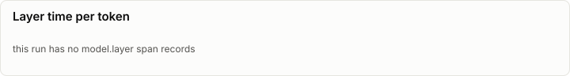
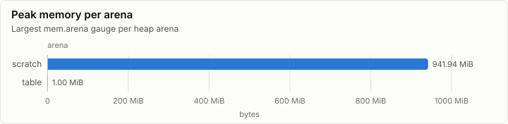

# Inference: Conformance on d3d12

| Prefill | Decode | First token | FLOPs per token | Achieved |
| ---: | ---: | ---: | ---: | ---: |
| n/a | n/a | n/a | n/a | n/a |

## Speed

_No rows._

## Layers

## Memory

| Node | Arena | Peak | Last | Samples |
| --- | --- | ---: | ---: | ---: |
| n0 | scratch | 941.94 MiB | 941.94 MiB | 1 |
| n0 | table | 1.00 MiB | 1.00 MiB | 1 |

## Metering

Resource use attributed to node, component and stage (layers summed). Wall time is span self time, so nested spans are not counted twice.

| Node | Component | Stage | Wall (self) | GPU | FLOPs | Bytes moved | Tokens | Records |
| --- | --- | --- | ---: | ---: | ---: | ---: | ---: | ---: |
| n0 | (none) |  | 3.66 s | 37.55 ms | 0 | 8.98 GiB | 0 | 6,708 |

## Run

| Field | Value |
| --- | --- |
| Run | `20261018-125923-5c5d258f` |
| Title | Conformance on d3d12 |
| Kind | kernels |
| Status | ok |
| Started | 2026-10-18T12:59:23.645Z |
| Ended | 2026-10-18T13:00:13.396Z |
| Execution class | d3d12 pci:10de:2704, 32.0.16.1692, win-x64 shaders 9a7fe626e4d3 |
| Class id | `95b5c71f37ff` |
| Driver | 32.0.16.1692 |
| Commit | `74b14a7394a307c7ffab5e7108b8b11955140c67` |
| Nodes | 1 |
| Records | 7,395 |
| Synthetic | no |

| Parameter | Value |
| --- | --- |
| backend | d3d12 |
| cases | 132 |
| device | NVIDIA GeForce RTX 4080 |
| source | tests/Lrm.Kernels.Conformance (ConformanceHarness) |

### Nodes

| Node | Role | Execution class | Records | Finished | Dropped |
| --- | --- | --- | ---: | --- | ---: |
| n0 | creator | d3d12 pci:10de:2704, 32.0.16.1692, win-x64 shaders 9a7fe626e4d3 | 7,395 | ok | 0 |

### Log problems

None.
