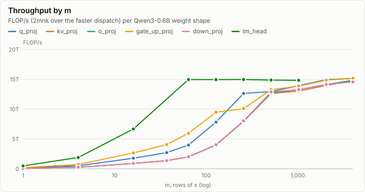
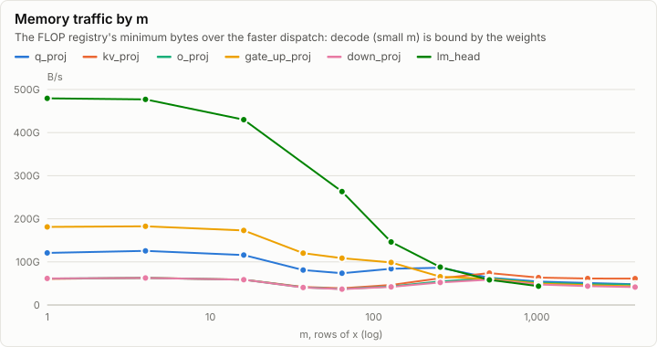
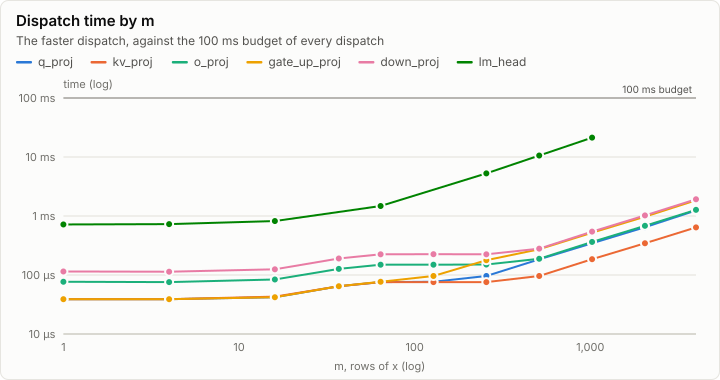
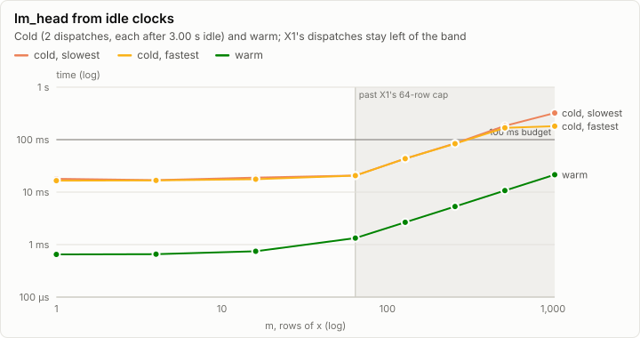
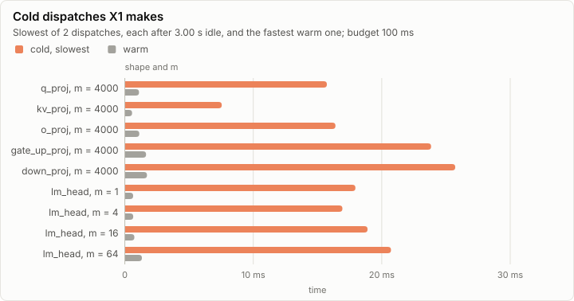

# matmul_bf16w: matmul_bf16w throughput on d3d12

**PASS.** Every row alone equals its rows in the batched calls on all 6 shapes, and every dispatch X1 makes is under the 100 ms budget, warm and from idle clocks. X1 gives lm_head at most 64 rows per dispatch; from idle clocks the budget is exceeded past that cap (lm_head, m = 512; lm_head, m = 1024).

- Throughput points: 63, the fastest 15.19 TFLOP/s (gate_up_proj, m = 4000)
- lm_head decode (m = 1): 650.24 µs, 479.48 GB/s of weight and activation traffic
- Slowest dispatch X1 makes: 25.72 ms cold (down_proj, m = 4000), 25.7% of the 100 ms budget
- lm_head at X1's row cap: 64 rows: 20.72 ms cold, 1.33 ms warm
- fp32 denormals: preserve

## Throughput

Each point is the fastest of 5 back-to-back dispatches after one warm-up, from the backend's `gpu.dispatch` timers: the GPU is warm. FLOPs and traffic are the FLOP registry's cost of the matmul (`OpCost.ofOp`): 2mnk, and every element of x and y in fp32 and of w in bf16 once.

## Cold dispatches

A conformance case, or X1's first dispatch after host work, starts while the GPU idles at low clocks. So after the warm sweep, the points nearest the budget (lm_head at every m, the projections at m = 4,000) are also timed as single dispatches, each alone after 3.00 s idle. Whether the clocks have dropped by then varies, so each point takes 2 of them and keeps the slowest. The budget is judged on the slower of warm and cold, and only for what X1 dispatches: the projections up to 4,000 rows and lm_head up to its row cap. lm_head is measured past the cap to show why the cap is there.

## All points

Warm is the fastest of the back-to-back dispatches; cold is the slowest and the fastest of the dispatches after an idle gap. "Of budget" is the slower of warm and the slowest cold dispatch.

| Shape | m | n | k | Warm | Cold, slowest | Cold, fastest | FLOP/s | Traffic | Of budget | X1 |
| --- | ---: | ---: | ---: | ---: | ---: | ---: | ---: | ---: | ---: | --- |
| q_proj | 1 | 2,048 | 1,024 | 34.82 µs |  |  | 120.47 GFLOP/s | 120.82 GB/s | 0.0% | dispatched |
| q_proj | 4 | 2,048 | 1,024 | 33.79 µs |  |  | 496.48 GFLOP/s | 125.58 GB/s | 0.0% | dispatched |
| q_proj | 16 | 2,048 | 1,024 | 37.89 µs |  |  | 1.77 TFLOP/s | 115.89 GB/s | 0.0% | dispatched |
| q_proj | 37 | 2,048 | 1,024 | 57.34 µs |  |  | 2.71 TFLOP/s | 81.07 GB/s | 0.1% | dispatched |
| q_proj | 64 | 2,048 | 1,024 | 67.58 µs |  |  | 3.97 TFLOP/s | 73.70 GB/s | 0.1% | dispatched |
| q_proj | 128 | 2,048 | 1,024 | 68.61 µs |  |  | 7.83 TFLOP/s | 84.06 GB/s | 0.1% | dispatched |
| q_proj | 256 | 2,048 | 1,024 | 84.99 µs |  |  | 12.63 TFLOP/s | 86.36 GB/s | 0.1% | dispatched |
| q_proj | 512 | 2,048 | 1,024 | 165.89 µs |  |  | 12.95 TFLOP/s | 63.21 GB/s | 0.2% | dispatched |
| q_proj | 1,024 | 2,048 | 1,024 | 308.22 µs |  |  | 13.93 TFLOP/s | 54.43 GB/s | 0.3% | dispatched |
| q_proj | 2,048 | 2,048 | 1,024 | 574.46 µs |  |  | 14.95 TFLOP/s | 51.11 GB/s | 0.6% | dispatched |
| q_proj | 4,000 | 2,048 | 1,024 | 1.11 ms | 15.73 ms | 8.17 ms | 15.14 TFLOP/s | 48.15 GB/s | 15.7% | dispatched |
| kv_proj | 1 | 1,024 | 1,024 | 34.82 µs |  |  | 60.24 GFLOP/s | 60.47 GB/s | 0.0% | dispatched |
| kv_proj | 4 | 1,024 | 1,024 | 33.79 µs |  |  | 248.24 GFLOP/s | 63.03 GB/s | 0.0% | dispatched |
| kv_proj | 16 | 1,024 | 1,024 | 37.89 µs |  |  | 885.62 GFLOP/s | 58.81 GB/s | 0.0% | dispatched |
| kv_proj | 37 | 1,024 | 1,024 | 57.34 µs |  |  | 1.35 TFLOP/s | 41.86 GB/s | 0.1% | dispatched |
| kv_proj | 64 | 1,024 | 1,024 | 67.58 µs |  |  | 1.99 TFLOP/s | 38.79 GB/s | 0.1% | dispatched |
| kv_proj | 128 | 1,024 | 1,024 | 67.58 µs |  |  | 3.97 TFLOP/s | 46.55 GB/s | 0.1% | dispatched |
| kv_proj | 256 | 1,024 | 1,024 | 67.58 µs |  |  | 7.94 TFLOP/s | 62.06 GB/s | 0.1% | dispatched |
| kv_proj | 512 | 1,024 | 1,024 | 84.99 µs |  |  | 12.63 TFLOP/s | 74.02 GB/s | 0.1% | dispatched |
| kv_proj | 1,024 | 1,024 | 1,024 | 164.86 µs |  |  | 13.03 TFLOP/s | 63.60 GB/s | 0.2% | dispatched |
| kv_proj | 2,048 | 1,024 | 1,024 | 307.20 µs |  |  | 13.98 TFLOP/s | 61.44 GB/s | 0.3% | dispatched |
| kv_proj | 4,000 | 1,024 | 1,024 | 569.34 µs | 7.55 ms | 7.53 ms | 14.73 TFLOP/s | 61.24 GB/s | 7.5% | dispatched |
| o_proj | 1 | 1,024 | 2,048 | 68.61 µs |  |  | 61.13 GFLOP/s | 61.31 GB/s | 0.1% | dispatched |
| o_proj | 4 | 1,024 | 2,048 | 67.58 µs |  |  | 248.24 GFLOP/s | 62.79 GB/s | 0.1% | dispatched |
| o_proj | 16 | 1,024 | 2,048 | 74.75 µs |  |  | 897.75 GFLOP/s | 58.74 GB/s | 0.1% | dispatched |
| o_proj | 37 | 1,024 | 2,048 | 113.66 µs |  |  | 1.37 TFLOP/s | 40.90 GB/s | 0.1% | dispatched |
| o_proj | 64 | 1,024 | 2,048 | 134.14 µs |  |  | 2.00 TFLOP/s | 37.13 GB/s | 0.1% | dispatched |
| o_proj | 128 | 1,024 | 2,048 | 134.14 µs |  |  | 4.00 TFLOP/s | 42.99 GB/s | 0.1% | dispatched |
| o_proj | 256 | 1,024 | 2,048 | 134.14 µs |  |  | 8.00 TFLOP/s | 54.72 GB/s | 0.1% | dispatched |
| o_proj | 512 | 1,024 | 2,048 | 168.96 µs |  |  | 12.71 TFLOP/s | 62.06 GB/s | 0.2% | dispatched |
| o_proj | 1,024 | 1,024 | 2,048 | 323.58 µs |  |  | 13.27 TFLOP/s | 51.85 GB/s | 0.3% | dispatched |
| o_proj | 2,048 | 1,024 | 2,048 | 608.26 µs |  |  | 14.12 TFLOP/s | 48.27 GB/s | 0.6% | dispatched |
| o_proj | 4,000 | 1,024 | 2,048 | 1.13 ms | 16.40 ms | 16.19 ms | 14.85 TFLOP/s | 47.23 GB/s | 16.4% | dispatched |
| gate_up_proj | 1 | 3,072 | 1,024 | 34.82 µs |  |  | 180.71 GFLOP/s | 181.18 GB/s | 0.0% | dispatched |
| gate_up_proj | 4 | 3,072 | 1,024 | 34.82 µs |  |  | 722.82 GFLOP/s | 182.59 GB/s | 0.0% | dispatched |
| gate_up_proj | 16 | 3,072 | 1,024 | 37.89 µs |  |  | 2.66 TFLOP/s | 172.97 GB/s | 0.0% | dispatched |
| gate_up_proj | 37 | 3,072 | 1,024 | 57.34 µs |  |  | 4.06 TFLOP/s | 120.29 GB/s | 0.1% | dispatched |
| gate_up_proj | 64 | 3,072 | 1,024 | 67.58 µs |  |  | 5.96 TFLOP/s | 108.61 GB/s | 0.1% | dispatched |
| gate_up_proj | 128 | 3,072 | 1,024 | 84.99 µs |  |  | 9.48 TFLOP/s | 98.70 GB/s | 0.1% | dispatched |
| gate_up_proj | 256 | 3,072 | 1,024 | 159.74 µs |  |  | 10.08 TFLOP/s | 65.64 GB/s | 0.2% | dispatched |
| gate_up_proj | 512 | 3,072 | 1,024 | 242.69 µs |  |  | 13.27 TFLOP/s | 60.49 GB/s | 0.2% | dispatched |
| gate_up_proj | 1,024 | 3,072 | 1,024 | 464.90 µs |  |  | 13.86 TFLOP/s | 49.62 GB/s | 0.5% | dispatched |
| gate_up_proj | 2,048 | 3,072 | 1,024 | 867.33 µs |  |  | 14.86 TFLOP/s | 45.94 GB/s | 0.9% | dispatched |
| gate_up_proj | 4,000 | 3,072 | 1,024 | 1.66 ms | 23.84 ms | 23.33 ms | 15.19 TFLOP/s | 43.35 GB/s | 23.8% | dispatched |
| down_proj | 1 | 1,024 | 3,072 | 102.40 µs |  |  | 61.44 GFLOP/s | 61.60 GB/s | 0.1% | dispatched |
| down_proj | 4 | 1,024 | 3,072 | 101.38 µs |  |  | 248.24 GFLOP/s | 62.71 GB/s | 0.1% | dispatched |
| down_proj | 16 | 1,024 | 3,072 | 111.62 µs |  |  | 901.87 GFLOP/s | 58.72 GB/s | 0.1% | dispatched |
| down_proj | 37 | 1,024 | 3,072 | 169.98 µs |  |  | 1.37 TFLOP/s | 40.58 GB/s | 0.2% | dispatched |
| down_proj | 64 | 1,024 | 3,072 | 199.68 µs |  |  | 2.02 TFLOP/s | 36.76 GB/s | 0.2% | dispatched |
| down_proj | 128 | 1,024 | 3,072 | 199.68 µs |  |  | 4.03 TFLOP/s | 42.01 GB/s | 0.2% | dispatched |
| down_proj | 256 | 1,024 | 3,072 | 200.70 µs |  |  | 8.02 TFLOP/s | 52.24 GB/s | 0.2% | dispatched |
| down_proj | 512 | 1,024 | 3,072 | 249.86 µs |  |  | 12.89 TFLOP/s | 58.75 GB/s | 0.2% | dispatched |
| down_proj | 1,024 | 1,024 | 3,072 | 485.38 µs |  |  | 13.27 TFLOP/s | 47.53 GB/s | 0.5% | dispatched |
| down_proj | 2,048 | 1,024 | 3,072 | 911.36 µs |  |  | 14.14 TFLOP/s | 43.72 GB/s | 0.9% | dispatched |
| down_proj | 4,000 | 1,024 | 3,072 | 1.73 ms | 25.72 ms | 25.10 ms | 14.56 TFLOP/s | 41.55 GB/s | 25.7% | dispatched |
| lm_head | 1 | 151,936 | 1,024 | 650.24 µs | 17.95 ms | 16.54 ms | 478.54 GFLOP/s | 479.48 GB/s | 18.0% | dispatched |
| lm_head | 4 | 151,936 | 1,024 | 657.41 µs | 16.94 ms | 16.72 ms | 1.89 TFLOP/s | 477.04 GB/s | 16.9% | dispatched |
| lm_head | 16 | 151,936 | 1,024 | 746.50 µs | 18.90 ms | 17.62 ms | 6.67 TFLOP/s | 429.95 GB/s | 18.9% | dispatched |
| lm_head | 64 | 151,936 | 1,024 | 1.33 ms | 20.72 ms | 20.64 ms | 14.96 TFLOP/s | 263.16 GB/s | 20.7% | dispatched |
| lm_head | 128 | 151,936 | 1,024 | 2.66 ms | 43.49 ms | 43.43 ms | 14.95 TFLOP/s | 146.23 GB/s | 43.5% | past the cap |
| lm_head | 256 | 151,936 | 1,024 | 5.32 ms | 84.98 ms | 83.69 ms | 14.97 TFLOP/s | 87.90 GB/s | 85.0% | past the cap |
| lm_head | 512 | 151,936 | 1,024 | 10.71 ms | 183.13 ms | 167.99 ms | 14.88 TFLOP/s | 58.30 GB/s | 183.1% | past the cap |
| lm_head | 1,024 | 151,936 | 1,024 | 21.48 ms | 322.11 ms | 180.59 ms | 14.84 TFLOP/s | 43.66 GB/s | 322.1% | past the cap |

## Batch invariance and CpuRef

Per shape, one m = 512 call, one m = 37 call and single-row calls (m = 1) over the same activation rows and weight. The rows alone must equal the rows of both batched calls bit for bit (BatchInvariance). The CpuRef column compares the single rows with CpuRef F32 (Rows.dotBf16); it is informational, because the conformance bound is KernelBounds.

| Shape | n | k | Calls (m) | Rows | Rows alone vs batched | vs CpuRef F32 |
| --- | ---: | ---: | --- | ---: | --- | --- |
| q_proj | 2048 | 1024 | 1,37,512 | 9 | ✓ identical | ✓ bit-exact |
| kv_proj | 1024 | 1024 | 1,37,512 | 9 | ✓ identical | ✓ bit-exact |
| o_proj | 1024 | 2048 | 1,37,512 | 9 | ✓ identical | ✓ bit-exact |
| gate_up_proj | 3072 | 1024 | 1,37,512 | 9 | ✓ identical | ✓ bit-exact |
| down_proj | 1024 | 3072 | 1,37,512 | 9 | ✓ identical | ✓ bit-exact |
| lm_head | 151936 | 1024 | 1,37,512 | 9 | ✓ identical | ✓ bit-exact |

## Arithmetic probes

Two dot products whose result tells the arithmetic apart: whether a `mad` step is fused (one rounding, as CpuRef's FusedMultiplyAdd), and whether the steps run in increasing p. Informational: the bound is KernelBounds.

| Probe | Result | CpuRef F32 | Other choice | What it shows |
| --- | --- | --- | --- | --- |
| fused | `30800000` | `30800000` | `00000000` | mad is one fused multiply-add per step (2^-30), not a rounded product and a sum (0): as CpuRef F32 |
| order | `00000000` | `00000000` | `3f800000` | the steps run in increasing p (+0), not in decreasing p (1): as CpuRef F32 |

## Run

| Field | Value |
| --- | --- |
| Run | `20261018-140617-1ce83fea` |
| Title | matmul_bf16w throughput on d3d12 |
| Kind | kernels |
| Status | ok |
| Started | 2026-10-18T14:06:17.133Z |
| Ended | 2026-10-18T14:07:39.156Z |
| Execution class | d3d12 pci:10de:2704, 32.0.16.1692, win-x64 shaders 2d513d812671 |
| Class id | `4b1614e079f0` |
| Driver | 32.0.16.1692 |
| Commit | `3f84e1547f7c12e41fb1417cd0ef1233eb9947af` |
| Nodes | 1 |
| Records | 2,082 |
| Synthetic | no |

| Parameter | Value |
| --- | --- |
| backend | d3d12 |
| device | NVIDIA GeForce RTX 4080 |
| reps | 5 |
| source | tests/Lrm.Kernels.Conformance/Cases/matmul/MatmulBench.fs (K2) |

### Log problems

None.
