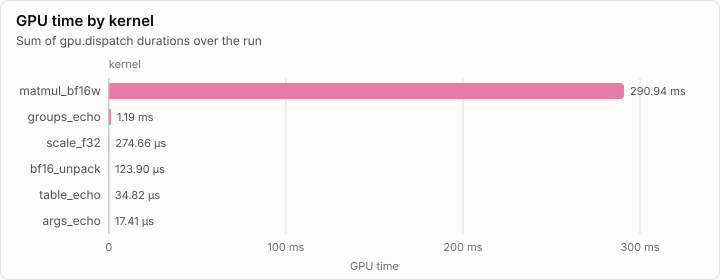
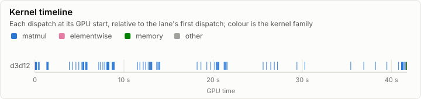
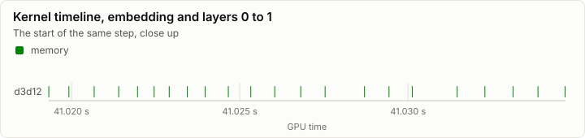
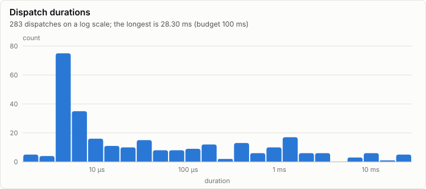

# Kernels: Conformance on d3d12

**PASS.** All 69 conformance cases pass. Every dispatch is under the 100 ms budget.

- Conformance cases: 69, failed: 0
- GPU dispatches: 283, total GPU time 292.58 ms

## Conformance matrix

Passing cases out of all cases, per kernel and backend.

| Kernel | Family | d3d12 |
| --- | --- | --- |
| matmul_bf16w | matmul | ✓ 41/41 |
| scale_f32 | elementwise | ✓ 11/11 |
| bf16_unpack | memory | ✓ 5/5 |
| args_echo | other | ✓ 2/2 |
| groups_echo | other | ✓ 6/6 |
| table_echo | other | ✓ 4/4 |

### Failing cases

_No rows._

## fp32 denormals

The mode each shader backend measured with the `scale_f32` denormal probe right after loading its kernels (GpuBackendInterface). It is fixed within an execution class, and it decides what bit-exact means for a kernel that does fp32 arithmetic (KernelAbiAndCatalog, kernel rules).

| Backend | Node | Blob | fp32 denormals | Bit-exact fp32 arithmetic means |
| --- | --- | --- | --- | --- |
| d3d12 | n0 |  | preserve | equal to CpuRef as it is |

The probe's words (`scale_f32`, a = 0.5): each input, what preserve and flush give, and what each measurement returned.

| Input | Preserve | Flush | d3d12 n0 |
| --- | --- | --- | --- |
| `3f800000` | 3f000000 | 3f000000 | 3f000000 |
| `01000000` | 00800000 | 00800000 | 00800000 |
| `00800000` | 00400000 | 00000000 | 00400000 |
| `80800000` | 80400000 | 80000000 | 80400000 |
| `00000002` | 00000001 | 00000000 | 00000001 |
| `807ffffe` | 803fffff | 80000000 | 803fffff |
| `00400000` | 00200000 | 00000000 | 00200000 |

## GPU time

## Timeline

### Slowest dispatches

| Kernel | Backend | Layer | Step | Duration | Of budget |
| --- | --- | ---: | ---: | ---: | ---: |
| matmul_bf16w | d3d12 |  |  | 28.30 ms | 28.3% |
| matmul_bf16w | d3d12 |  |  | 26.01 ms | 26.0% |
| matmul_bf16w | d3d12 |  |  | 23.48 ms | 23.5% |
| matmul_bf16w | d3d12 |  |  | 23.16 ms | 23.2% |
| matmul_bf16w | d3d12 |  |  | 22.69 ms | 22.7% |
| matmul_bf16w | d3d12 |  |  | 13.76 ms | 13.8% |
| matmul_bf16w | d3d12 |  |  | 12.18 ms | 12.2% |
| matmul_bf16w | d3d12 |  |  | 9.61 ms | 9.6% |
| matmul_bf16w | d3d12 |  |  | 9.39 ms | 9.4% |
| matmul_bf16w | d3d12 |  |  | 9.09 ms | 9.1% |

## Run

| Field | Value |
| --- | --- |
| Run | `20261018-132406-e1c048e8` |
| Title | Conformance on d3d12 |
| Kind | kernels |
| Status | ok |
| Started | 2026-10-18T13:24:06.972Z |
| Ended | 2026-10-18T13:25:28.257Z |
| Execution class | d3d12 pci:10de:2704, 32.0.16.1692, win-x64 shaders 2d513d812671 |
| Class id | `4b1614e079f0` |
| Driver | 32.0.16.1692 |
| Commit | `558815bd640c4dee35eea5bfc49ee9d65ab113ac` |
| Nodes | 1 |
| Records | 3,817 |
| Synthetic | no |

| Parameter | Value |
| --- | --- |
| backend | d3d12 |
| cases | 91 |
| device | NVIDIA GeForce RTX 4080 |
| source | tests/Lrm.Kernels.Conformance (ConformanceHarness) |

### Nodes

| Node | Role | Execution class | Records | Finished | Dropped |
| --- | --- | --- | ---: | --- | ---: |
| n0 | creator | d3d12 pci:10de:2704, 32.0.16.1692, win-x64 shaders 2d513d812671 | 3,817 | ok | 0 |

### Log problems

None.
