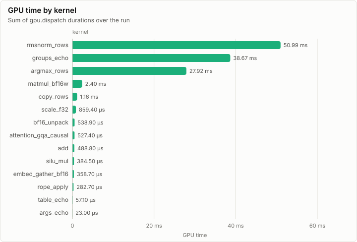
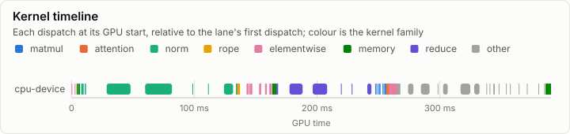
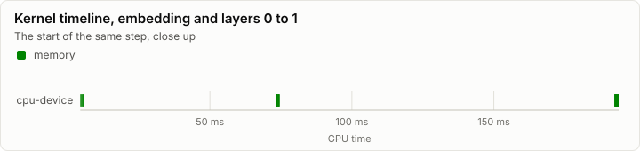
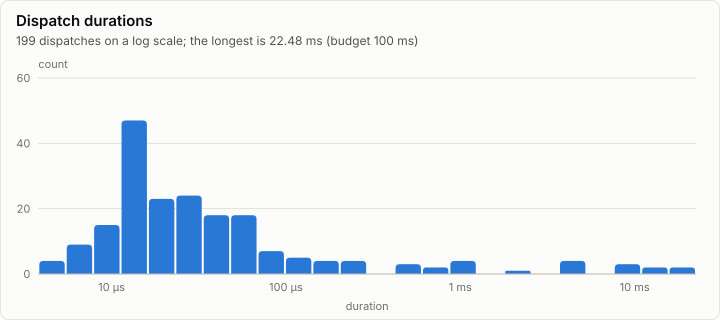

# Kernels: Conformance on CpuDevice (every case, bit-exact to CpuRef F32)

**PASS.** All 54 conformance cases pass. Every dispatch is under the 100 ms budget.

- Conformance cases: 54, failed: 0
- GPU dispatches: 221, total GPU time 55.43 ms

## Conformance matrix

Passing cases out of all cases, per kernel and backend.

| Kernel | Family | cpu-device |
| --- | --- | --- |
| matmul_bf16w | matmul | ✓ 4/4 |
| attention_gqa_causal | attention | ✓ 2/2 |
| rmsnorm_rows | norm | ✓ 6/6 |
| rope_apply | rope | ✓ 2/2 |
| add | elementwise | ✓ 4/4 |
| scale_f32 | elementwise | ✓ 11/11 |
| silu_mul | elementwise | ✓ 2/2 |
| bf16_unpack | memory | ✓ 5/5 |
| copy_rows | memory | ✓ 3/3 |
| embed_gather_bf16 | memory | ✓ 1/1 |
| argmax_rows | reduce | ✓ 2/2 |
| args_echo | other | ✓ 2/2 |
| groups_echo | other | ✓ 6/6 |
| table_echo | other | ✓ 4/4 |

### Failing cases

_No rows._

## fp32 denormals

The mode each shader backend measured with the `scale_f32` denormal probe right after loading its kernels (GpuBackendInterface). It is fixed within an execution class, and it decides what bit-exact means for a kernel that does fp32 arithmetic (KernelAbiAndCatalog, kernel rules).

| Backend | Node | Blob | fp32 denormals | Bit-exact fp32 arithmetic means |
| --- | --- | --- | --- | --- |
| cpu-device | n0 |  | preserve | equal to CpuRef as it is |

The probe's words (`scale_f32`, a = 0.5): each input, what preserve and flush give, and what each measurement returned.

| Input | Preserve | Flush | cpu-device n0 |
| --- | --- | --- | --- |
| `3f800000` | 3f000000 | 3f000000 | 3f000000 |
| `01000000` | 00800000 | 00800000 | 00800000 |
| `00800000` | 00400000 | 00000000 | 00400000 |
| `80800000` | 80400000 | 80000000 | 80400000 |
| `00000002` | 00000001 | 00000000 | 00000001 |
| `807ffffe` | 803fffff | 80000000 | 803fffff |
| `00400000` | 00200000 | 00000000 | 00200000 |

## GPU time

## Timeline

### Slowest dispatches

| Kernel | Backend | Layer | Step | Duration | Of budget |
| --- | --- | ---: | ---: | ---: | ---: |
| groups_echo | cpu-device |  |  | 5.02 ms | 5.0% |
| groups_echo | cpu-device |  |  | 4.78 ms | 4.8% |
| argmax_rows | cpu-device |  |  | 4.27 ms | 4.3% |
| rmsnorm_rows | cpu-device |  |  | 4.21 ms | 4.2% |
| argmax_rows | cpu-device |  |  | 4.03 ms | 4.0% |
| groups_echo | cpu-device |  |  | 4.03 ms | 4.0% |
| rmsnorm_rows | cpu-device |  |  | 3.52 ms | 3.5% |
| groups_echo | cpu-device |  |  | 2.97 ms | 3.0% |
| groups_echo | cpu-device |  |  | 2.49 ms | 2.5% |
| groups_echo | cpu-device |  |  | 2.47 ms | 2.5% |

## Run

| Field | Value |
| --- | --- |
| Run | `20261018-060808-bd6e5208` |
| Title | Conformance on CpuDevice (every case, bit-exact to CpuRef F32) |
| Kind | kernels |
| Status | ok |
| Started | 2026-10-18T06:08:08.332Z |
| Ended | 2026-10-18T06:08:08.710Z |
| Execution class | cpu-device cpu, .NET 10.0.13, win-x64+avx2+fma |
| Class id | `00f093f75ec2` |
| Driver | .NET 10.0.13 |
| Commit | `06ff482bad52ea1412916eb74dbf38e0f4670fc3` |
| Nodes | 1 |
| Records | 1,733 |
| Synthetic | no |

| Parameter | Value |
| --- | --- |
| backend | cpu-device |
| cases | 54 |
| device | CPU device (emulated kernel catalog) |
| source | tests/Lrm.Kernels.Conformance (ConformanceHarness) |

### Nodes

| Node | Role | Execution class | Records | Finished | Dropped |
| --- | --- | --- | ---: | --- | ---: |
| n0 | creator | cpu-device cpu, .NET 10.0.13, win-x64+avx2+fma | 1,733 | ok | 0 |

### Log problems

None.
